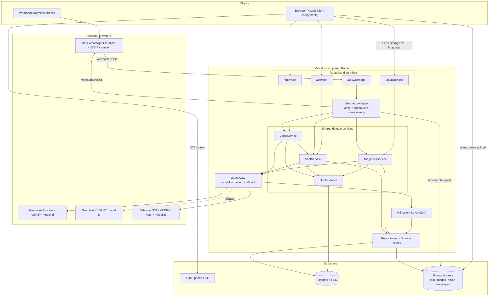
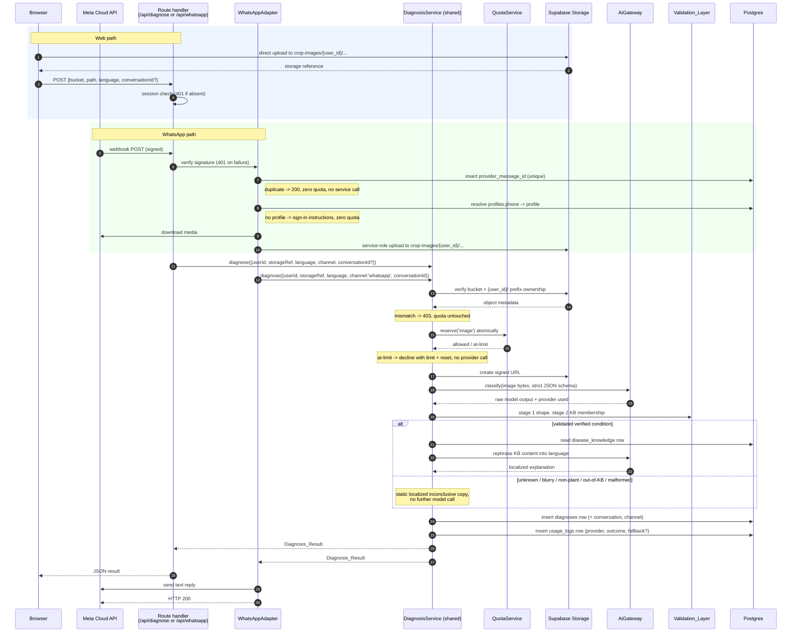

# Design Document

## Overview

Jamee is a Next.js App Router application (TypeScript strict mode) deployed on Vercel, backed by Supabase for auth, Postgres, and private object storage. It reaches farmers through two channels — the browser and WhatsApp — and both channels are thin transports in front of the same three domain services: `DiagnosisService`, `ChatService`, `VoiceService` (Requirement 16).

Three design commitments shape everything below:

1. **No model training, no invented agronomy.** A general multimodal model only *classifies* an image into one of five verified conditions or `unknown`. Every symptom, cause, treatment, and prevention sentence a farmer reads is rephrased from a `disease_knowledge` row (Requirements 4.3–4.5). Nothing outside the knowledge base becomes agricultural advice.
2. **The verified-condition enum is the safety gate.** It lives in one place, is shared by the TypeScript types, the Zod schemas, and a Postgres check constraint. A model naming anything else fails validation and collapses into a single `Inconclusive_Result` shape (Requirements 5.6, 6.1, 6.4).
3. **The browser never sends bytes to the API.** Images and audio go browser → Supabase Storage directly; route handlers receive only a storage reference (Requirements 2.1, 8.1). This keeps request bodies far under the platform body limit (Requirement 2.7).

This design covers Phases 1–6. Requirements 18 and 19 are deferred and appear only in the forward-compatibility note.

### Three kinds of limits, kept separate

The document is careful never to conflate these, because they have different owners and different failure modes:

| Kind | Examples | Who enforces | Status here |
| --- | --- | --- | --- |
| **Jamee application quotas** | 20 image / 50 chat / 20 voice per farmer per Asia/Kolkata day (Requirement 14.1) | Jamee's own `counters` table | Fixed by requirements, authoritative in this design |
| **Documented platform limits** | Vercel serverless request body ceiling (spec states 4.5 MB), function `maxDuration` (spec states 60 s) | Vercel | Treated as design inputs from the requirements; exact current values **VERIFY AT IMPLEMENTATION** |
| **Provider free-tier rate limits** | Gemini requests/minute and requests/day, Groq requests/minute and tokens/day, Supabase storage and egress allowances | Google / Groq / Supabase | Unknown at design time, **VERIFY AT IMPLEMENTATION**; Jamee's quotas are set below them by design, not by measurement |

Jamee's application quotas are the only limit this codebase enforces. Provider limits are handled reactively through the fallback path (Requirement 14.4), never by hardcoding a provider's numbers.

---

## Values to verify before coding

Every item below depends on a third-party detail that changes over time. **No value in this table is asserted as fact anywhere else in this design.** The first implementation task resolves this table and records the findings in the API/deployment documentation.

| # | Value | Where it is used | Doc to check |
| --- | --- | --- | --- |
| V1 | Supabase JS client package name and version; browser vs. server client factory names; App Router cookie/session wiring | `src/lib/supabase/*` | Supabase JavaScript client and Next.js server-side auth guides |
| V2 | Phone/SMS OTP sign-in enablement and which SMS provider must be configured in the Supabase dashboard | Requirement 1.1, deployment docs | Supabase phone auth documentation |
| V3 | Signed URL creation call, its expiry argument, and units (seconds vs. ms) | Requirements 2.8, 12.5 | Supabase Storage signed URL reference |
| V4 | Storage RLS policy helper for path segments (the function that extracts the first folder of an object name) and the bucket-privacy setting name | Requirements 13.5, 13.6 | Supabase Storage access control docs |
| V5 | Whether a trigger on `auth.users` is the supported profile-bootstrap pattern, and the required `security definer` / `search_path` form | Requirement 1.4 | Supabase auth + Postgres function security docs |
| V6 | Google Gemini SDK package name, client initialization, and the **current multimodal model identifier** | `src/lib/gemini.ts` | Google Gemini API models documentation |
| V7 | Gemini structured/JSON output configuration: parameter names for response MIME type, response schema, temperature, max output tokens | `src/lib/prompts.ts`, `gemini.ts` | Gemini structured output documentation |
| V8 | Groq SDK package name, client initialization, and the **current text model identifier** for the fallback | `src/lib/groq.ts` | Groq models documentation |
| V9 | **Whether Groq currently hosts a vision-capable model**, and its identifier if so. This single fact decides whether an image-interpretation fallback exists at all (see Fallback matrix) | `src/lib/groq.ts` | Groq models documentation |
| V10 | Speech-to-text: which host serves Whisper, the exact model identifier, the endpoint/SDK method, accepted audio container/codec list, and the provider's own max file size and max duration | `src/lib/groq.ts` (or a dedicated transcription adapter) | Provider's audio transcription documentation |
| V11 | Provider error shapes: how a rate-limit condition and an unavailability condition are signalled (HTTP status, error code, header names for retry-after) for both Gemini and Groq | `AiGateway` fallback trigger | Both providers' error-handling docs |
| V12 | Meta WhatsApp Business Cloud API version string to pin, and the exact inbound webhook payload field paths for text, image, and audio messages, plus the message id field | `src/lib/whatsapp.ts` | Meta WhatsApp Cloud API webhooks reference |
| V13 | Meta signature header name and HMAC algorithm/encoding for POST verification | Requirement 11.3 | Meta webhook payload-verification docs |
| V14 | Meta two-step media retrieval (media id → media URL → authenticated binary fetch), and required auth header on the binary fetch | Requirement 10.4 | Meta WhatsApp media reference |
| V15 | Meta send-message endpoint shape for a text reply, and any 24-hour customer-service-window constraint on unsolicited replies | Requirement 10.x replies | Meta WhatsApp messages reference |
| V16 | Vercel serverless **request body limit** (spec assumes 4.5 MB) and the **maximum `maxDuration`** permitted on the target plan (spec assumes 60 s) | Requirements 2.7, 3.6, 10.10 | Vercel functions limits documentation |
| V17 | Next.js route segment config for per-route duration (`maxDuration` export) and its accepted values | `src/app/api/*/route.ts` | Next.js route segment config documentation |
| V18 | Whether Vercel exposes a supported post-response continuation primitive (e.g. `waitUntil`) on the target plan/runtime | WhatsApp acknowledgement strategy | Vercel functions documentation |
| V19 | Free-tier allowances: Gemini RPM/RPD, Groq RPM/TPD, Supabase database size / storage / egress, Vercel invocation and duration allowances | Requirement 17.7 sizing note | Each provider's pricing/limits page |
| V20 | MediaRecorder MIME support on target Android browsers (which container/codec actually records) and whether it matches V10's accepted list | `src/components/VoiceRecorder.tsx` | MDN MediaRecorder compatibility data |
| V21 | Whether the deployment platform offers a **scheduled invocation** primitive on the target plan, its minimum interval, and how it authenticates the call it makes | Retention sweep trigger (Requirement 18.3, 18.4) | Deployment platform scheduled-jobs documentation |
| V22 | Storage object **deletion and age query** surface: the batch delete call and its path semantics, whether deleting an absent object errors, and whether `storage.objects` exposes a creation timestamp usable for age filtering | `src/lib/storage.ts`, `src/services/retention.service.ts` (Requirements 8.9, 18.3, 18.4, 18.10) | Supabase Storage delete reference and storage schema docs |

Rule for implementation: if a V-item cannot be confirmed, the code must fail loudly at startup (missing env var / unsupported model) rather than fall back to a guessed value.

V21 and V22 were added by the media-lifecycle amendment. They are the only third-party facts the retention design depends on, and neither blocks the *deletion logic* — V21 blocks only the automatic trigger, for which a documented manual fallback exists (see *Media lifecycle and retention*).

---

## Design decisions that resolve requirement tensions

**D1 — `/api/diagnose` takes JSON, not multipart.** Requirement 2.2 mandates a JSON body carrying a storage reference, while Requirement 2.3 allows images up to 10 MB and Requirement 2.7 requires bodies under the platform ceiling (spec: 4.5 MB, V16). A multipart upload of a 10 MB image cannot satisfy both. The browser therefore uploads directly to Storage and posts a reference; the API reads bytes through a signed URL (Requirement 2.8). Consequence: request bodies are ~200 bytes regardless of image size, and the 10 MB allowance is real rather than nominal. The same reasoning applies to `/api/voice`.

**D2 — Validation is two-stage, so rejection reasons are distinguishable.** Requirement 5 wants a strict schema; Requirement 6.1 needs to know *specifically* that the rejection was an out-of-KB disease name. A single strict enum schema would report "parse failed" for both a malformed JSON blob and a real-but-unsupported disease. Stage 1 validates shape (`status`, `disease_name` as free string, `confidence`, `severity`, flags). Stage 2 checks knowledge-base membership. Both stages log a distinct `rejection_reason` (Requirement 5.7).

**D3 — Every validation failure produces the one inconclusive shape.** Requirement 6.1 only names the out-of-KB case. Requirements 5.2–5.5 (bad JSON, missing field, out-of-range confidence, bad severity) leave the farmer-facing outcome unstated. Decision: all of them map to `Inconclusive_Result` (Requirement 6.4's single shape), each with its own logged reason. A farmer never sees "the model returned malformed JSON"; they see an honest "Jamee could not judge this photo — consult an expert."

**D4 — No repair re-ask on validation failure.** We do not send a "your JSON was invalid, try again" second call. Requirement 6.6 forbids extra model calls once a result is inconclusive, and a repair loop would multiply free-tier consumption. One classification attempt per request (plus the provider fallback of Requirement 14.4, which is a *transport* retry, not a *content* retry).

**D5 — Inconclusive results, quota messages, and error messages are pre-translated static strings.** Requirement 6.6 forbids a model call for inconclusive results, Requirement 14.3 forbids provider calls when a quota is exhausted, and Requirement 15.3 requires localized messages. So en/hi/mr copy for these paths ships in the repository as static message catalogs. The model is used for translation only when rephrasing knowledge-base content for an *identified* condition.

**D6 — The "temporarily busy" literal is the English rendering of a coded error.** Requirement 14.5 specifies exact English text; Requirement 15.3 requires localization. Decision: error code `PROVIDERS_UNAVAILABLE` renders as exactly `Jamee is temporarily busy. Please try again shortly.` for `en`, with hi/mr equivalents in the catalog. Tests assert the English string byte-for-byte.

**D7 — Channel parity means one code path and identical structured fields, not identical prose.** Requirement 10.7 says WhatsApp returns "the same Diagnosis_Result content" as the web. Language models are not bit-deterministic. Parity is defined as: same `DiagnosisService` invocation, same knowledge-base row, identical `status`, `disease_name`, `severity`, and `needs_expert`. Explanation wording may differ between two runs of the same image on either channel. Classification runs at the lowest available temperature (V7) to maximize agreement.

**D8 — Profile creation uses a database trigger plus an idempotent server-side upsert.** Requirement 1.4 attributes profile creation to the Web_App. A purely client-driven insert can be skipped (user closes the tab), which would silently break WhatsApp phone resolution (Requirement 10.2). Mechanism: `on auth.users insert` trigger writes the row with the E.164 phone; the post-sign-in server action upserts defensively. Observable outcome matches 1.4.

**D9 — Chat language follows the message, resolved by the model, not by a script detector.** Requirement 9.6 requires answering in the language of the submitted message. Hindi and Marathi share the Devanagari script and cannot be separated by a character-range check. The chat prompt receives the farmer's preferred language *and* an instruction to answer in the message's language when that language is en/hi/mr. Requirement 9.5 still rejects unsupported explicit language codes at the edge with HTTP 400.

**D10 — `usage_logs` is an append-only audit table and is not the quota source of truth.** The requirements rename the spec's `api_usage` to `usage_logs` (glossary) and require it to record fallbacks (14.7) and validation rejections (5.7) in addition to billable operations. Those rows are not 1:1 with quota units, so quota lives in a separate counter table (see Quota enforcement).

**D11 — WhatsApp processes inline and acknowledges after processing, guarded by a soft deadline.** Discussed under WhatsApp adapter.

---

## Architecture

### Layers

| Layer | Responsibility | Must not |
| --- | --- | --- |
| **Route handlers** (`src/app/api/*`) | Session check, Zod-parse the request, resolve language, call one service, map result/error to HTTP | Contain agronomy, prompt text, provider calls, or SQL |
| **Domain services** (`src/services/*`) | Diagnosis, Chat, Voice orchestration: ownership check → quota reserve → provider call → validation → KB grounding → persistence. Accept `channel` as a parameter (Requirement 16.5) | Know anything about HTTP, cookies, or WhatsApp payloads |
| **AI gateway** (`src/lib/ai/gateway.ts`) | Capability-based provider selection, fallback policy (Requirement 14.4), returns raw provider text plus which provider served it | Interpret content or decide farmer-facing messaging |
| **Provider adapters** (`gemini.ts`, `groq.ts`) | One provider each: request shaping, error classification into `RATE_LIMIT` / `UNAVAILABLE` / `OTHER` | Retry across providers |
| **Repositories + storage** (`src/lib/db/*`, `src/lib/storage/*`) | Typed Supabase access, signed URLs, service-role isolation | Leak the service-role client toward the browser |

### System diagram



### Diagnosis sequence — both channels converge



---

## Project structure

```
src/
  app/
    layout.tsx                     # locale + font shell
    page.tsx                       # sign-in / landing (server component)
    diagnose/page.tsx              # upload + result screen
    chat/page.tsx                  # conversation screen
    voice/page.tsx                 # hold-to-speak screen
    history/page.tsx               # server component, RLS-scoped list
    diagnosis/[id]/page.tsx        # detail view (Requirement 12.3)
    profile/page.tsx               # display name + preferred language (Requirement 1.8)
    auth/callback/route.ts         # session exchange + ensure-profile (D8)
    api/
      diagnose/route.ts            # POST, JSON storage ref (D1)
      chat/route.ts                # POST
      voice/route.ts               # POST
      whatsapp/route.ts            # GET challenge + POST webhook
  components/
    SignInForm.tsx                 # phone + OTP, client
    ImageUploader.tsx              # validation + direct upload, client
    DiagnosisResultCard.tsx        # severity, confidence, needs_expert banner
    ChatThread.tsx / ChatComposer.tsx
    VoiceRecorder.tsx              # MediaRecorder, 120s / 10MB caps
    LanguageSwitcher.tsx
    HistoryList.tsx / EmptyState.tsx
    ErrorBanner.tsx                # code -> localized message + retry
  services/
    diagnosis.service.ts           # single image-analysis implementation (16.3)
    chat.service.ts                # single grounding/rephrase implementation (16.4)
    voice.service.ts
    quota.service.ts
    conversation.service.ts        # find-or-create per channel
  lib/
    supabase/
      client.ts                    # browser client (anon key)
      server.ts                    # RLS-scoped server client (user session)
      admin.ts                     # service-role client, server-only guard
    ai/
      gateway.ts                   # capability routing + fallback (14.4)
      errors.ts                    # RATE_LIMIT | UNAVAILABLE | OTHER
    gemini.ts                      # primary adapter (V6, V7)
    groq.ts                        # text fallback + transcription (V8, V9, V10)
    whatsapp.ts                    # verify, parse, media, send (V12-V15)
    prompts.ts                     # classification + rephrase + chat prompts
    schemas.ts                     # all Zod schemas (single source)
    knowledge.ts                   # KB lookup + verified-condition enum
    messages/                      # static en/hi/mr catalogs (D5)
      en.ts  hi.ts  mr.ts
    errors.ts                      # AppError + code -> status mapping
    storage.ts                     # path builder, signed URLs, ownership check
    rate-limit.ts                  # per-farmer burst limiter (13.8)
    time.ts                        # Asia/Kolkata window keys + reset time
  types/
    domain.ts  api.ts  database.ts # generated Supabase types
supabase/
  migrations/
    0001_extensions.sql
    0002_profiles.sql
    0003_conversations_messages.sql
    0004_disease_knowledge.sql
    0005_diagnoses.sql
    0006_usage_logs.sql
    0007_counters_and_quota_fn.sql
    0008_whatsapp_inbound.sql
    0009_storage_buckets_policies.sql
    0010_seed_disease_knowledge.sql
docs/
  API.md  DEPLOYMENT.md  TESTING_REPORT.md
.env.example
```

`src/services/*` and `src/lib/*` never import from `src/app/*`. That one-way rule is what keeps Requirement 16.3/16.4's "exactly one implementation" true over time.

---

## Data model and migrations

Six domain tables plus two operational tables. Enum-like columns are `text` with check constraints rather than Postgres enums, so a new severity or channel is a migration edit instead of a type alteration; the check constraint keeps the database as strict as the Zod layer.

`updated_at` is maintained by one shared trigger function so no route handler has to remember it.

### 0001–0002: extensions and profiles

```sql
-- 0001_extensions.sql
create extension if not exists pgcrypto;   -- gen_random_uuid()

create or replace function public.set_updated_at()
returns trigger language plpgsql as $$
begin
  new.updated_at = now();
  return new;
end $$;
```

```sql
-- 0002_profiles.sql
create table public.profiles (
  id           uuid primary key references auth.users(id) on delete cascade,
  phone        text not null unique,                        -- E.164, single identity (Req 1.5)
  display_name text,
  language     text not null default 'en'
                 check (language in ('en','hi','mr')),      -- Req 9.1
  created_at   timestamptz not null default now(),
  updated_at   timestamptz not null default now(),
  constraint profiles_phone_e164 check (phone ~ '^\+[1-9][0-9]{7,14}$')
);

create index profiles_phone_idx on public.profiles (phone);  -- WhatsApp resolution (Req 10.2)

create trigger profiles_set_updated_at
  before update on public.profiles
  for each row execute function public.set_updated_at();

-- D8: bootstrap on first session
create or replace function public.handle_new_user()
returns trigger language plpgsql security definer set search_path = public as $$
begin
  insert into public.profiles (id, phone)
  values (new.id, new.phone)
  on conflict (id) do nothing;
  return new;
end $$;
-- VERIFY AT IMPLEMENTATION (V5): trigger on auth.users is the supported bootstrap pattern
create trigger on_auth_user_created
  after insert on auth.users
  for each row execute function public.handle_new_user();

alter table public.profiles enable row level security;

create policy profiles_select_own on public.profiles
  for select using (auth.uid() = id);
create policy profiles_update_own on public.profiles
  for update using (auth.uid() = id) with check (auth.uid() = id);
create policy profiles_insert_own on public.profiles
  for insert with check (auth.uid() = id);
```

The unique constraint on `phone` is load-bearing: Requirement 1.5 makes the phone the single cross-channel identity, and Requirement 10.2 resolves an inbound WhatsApp sender through it. Two profiles sharing a phone would make that resolution ambiguous.

### 0003: conversations and messages

```sql
create table public.conversations (
  id         uuid primary key default gen_random_uuid(),
  user_id    uuid not null references public.profiles(id) on delete cascade,
  channel    text not null check (channel in ('web','whatsapp')),
  title      text,
  created_at timestamptz not null default now(),
  updated_at timestamptz not null default now()
);

create index conversations_user_recent_idx
  on public.conversations (user_id, updated_at desc);

create table public.messages (
  id              uuid primary key default gen_random_uuid(),
  conversation_id uuid not null references public.conversations(id) on delete cascade,
  user_id         uuid not null references public.profiles(id) on delete cascade,
  role            text not null check (role in ('farmer','jamee')),
  content         text not null,
  language        text not null check (language in ('en','hi','mr')),
  channel         text not null check (channel in ('web','whatsapp')),
  input_kind      text not null default 'text'
                    check (input_kind in ('text','voice','image')),
  transcript_of   text,                    -- storage path when input_kind='voice'
  created_at      timestamptz not null default now()
);

create index messages_conversation_idx
  on public.messages (conversation_id, created_at desc);   -- Conversation_Context window
```

`messages.user_id` is denormalized from the conversation purely so RLS can be a single-column predicate without a join, which keeps context reads cheap.

### 0004: disease_knowledge

```sql
create table public.disease_knowledge (
  id             uuid primary key default gen_random_uuid(),
  disease_name   text not null unique check (disease_name in (
                   'Tomato Early Blight','Tomato Late Blight','Tomato Healthy',
                   'Potato Early Blight','Potato Late Blight')),
  crop           text not null check (crop in ('tomato','potato')),
  scientific_name text,                       -- null for the healthy entry
  symptoms       text[] not null,
  causes         text[] not null,
  treatment      text[] not null,             -- empty array for the healthy entry
  prevention     text[] not null,
  default_severity text not null check (default_severity in ('none','low','moderate','high')),
  source         text not null,               -- Req 4.2: provenance per row
  created_at     timestamptz not null default now(),
  updated_at     timestamptz not null default now(),
  constraint healthy_has_no_treatment check (
    disease_name <> 'Tomato Healthy' or cardinality(treatment) = 0
  )
);

create trigger disease_knowledge_set_updated_at
  before update on public.disease_knowledge
  for each row execute function public.set_updated_at();

alter table public.disease_knowledge enable row level security;

create policy dk_select_authenticated on public.disease_knowledge
  for select to authenticated using (true);                  -- Req 13.3
-- Req 13.4: no insert/update/delete policy exists for authenticated or anon.
-- Writes are possible only through the service role, which bypasses RLS.
```

Requirement 4.1 says the knowledge base holds *exactly* five entries. The `unique` constraint plus the name check constraint make five the maximum; the seed migration makes five the minimum. A deployment test asserts `count(*) = 5`.

### 0005: diagnoses

```sql
create table public.diagnoses (
  id              uuid primary key default gen_random_uuid(),
  user_id         uuid not null references public.profiles(id) on delete cascade,
  conversation_id uuid not null references public.conversations(id) on delete cascade,
  status          text not null check (status in ('identified','unknown')),
  disease_name    text check (disease_name in (
                    'Tomato Early Blight','Tomato Late Blight','Tomato Healthy',
                    'Potato Early Blight','Potato Late Blight')),  -- Req 4.1 / 5.6
  knowledge_id    uuid references public.disease_knowledge(id),
  confidence      numeric(4,3) check (confidence >= 0 and confidence <= 1),  -- Req 5.4
  severity        text not null check (severity in ('none','low','moderate','high')),
  explanation     text not null,
  language        text not null check (language in ('en','hi','mr')),
  needs_expert    boolean not null default false,
  channel         text not null check (channel in ('web','whatsapp')),  -- Req 16.5
  image_bucket    text not null check (image_bucket = 'crop-images'),
  image_path      text not null,
  -- Requirement 18.7: set by the retention sweep when the full-size original is deleted.
  -- image_path is left intact so the thumbnail path stays derivable from it.
  full_image_deleted_at timestamptz,
  model_provider  text not null check (model_provider in ('gemini','groq')),
  created_at      timestamptz not null default now(),

  -- Inconclusive_Result shape is enforced by the database, not just by code (Req 6.4, 6.5)
  constraint diagnoses_unknown_shape check (
    status <> 'unknown' or
    (disease_name is null and knowledge_id is null
     and needs_expert = true and severity = 'none')
  ),
  constraint diagnoses_identified_shape check (
    status <> 'identified' or (disease_name is not null and knowledge_id is not null)
  )
);

create index diagnoses_user_recent_idx on public.diagnoses (user_id, created_at desc);   -- Req 12.1
create index diagnoses_conversation_idx on public.diagnoses (conversation_id, created_at desc);

-- Retention sweep candidate scan: rows whose original has not yet been deleted,
-- oldest first. Partial so the index shrinks as the sweep does its job (Req 18.3).
create index diagnoses_retention_idx on public.diagnoses (created_at)
  where full_image_deleted_at is null;
```

Those two check constraints are the reason an inconclusive result cannot silently carry a disease name or treatment reference: a bug that tried to persist one fails the insert rather than reaching a farmer. `disease_knowledge` is created in 0004 so this foreign key resolves.

`full_image_deleted_at` exists so the history view can tell "deleted by policy" from "missing unexpectedly" with a column read instead of a storage probe per list row. Probing would cost one storage call per history entry on every render, which is exactly the egress-and-invocation cost the amendment set out to remove. The column is nullable and has no constraint tying it to `image_path`, because `image_path` is deliberately left intact: the thumbnail path is derived from it, so erasing it would take the surviving thumbnail with it.

### 0006: usage_logs (renamed from `api_usage`)

The glossary names this table `usage_logs`; earlier drafts called it `api_usage`. The rename is adopted here, and the table's job is wider than API accounting — it is the audit trail for Requirements 5.7, 14.6, 14.7, and 3.7.

```sql
create table public.usage_logs (
  id               uuid primary key default gen_random_uuid(),
  user_id          uuid not null references public.profiles(id) on delete cascade,
  operation        text not null check (operation in ('image','chat','voice')),
  channel          text not null check (channel in ('web','whatsapp')),
  model_provider   text check (model_provider in ('gemini','groq','none')),
  outcome          text not null check (outcome in (
                     'success','inconclusive','validation_rejected',
                     'provider_error','timeout','quota_declined','duplicate_ignored'
                   )),
  used_fallback    boolean not null default false,        -- Req 14.7
  rejection_reason text,                                  -- Req 5.7 / D2
  quota_spent      boolean not null default true,         -- audit of the spend rule
  latency_ms       integer,
  prompt_version   text,                                   -- attributes a behavioural change
  conversation_id  uuid references public.conversations(id) on delete set null,
  diagnosis_id     uuid references public.diagnoses(id) on delete set null,
  created_at       timestamptz not null default now()
);

create index usage_logs_user_day_idx on public.usage_logs (user_id, created_at desc);
create index usage_logs_outcome_idx  on public.usage_logs (outcome, created_at desc);
```

Columns carried, and why each exists: `user_id`, `operation`, `channel`, `model_provider`, `outcome` (Requirement 14.6); `used_fallback` (14.7); `rejection_reason` (5.7 and D2's distinguishable reasons); `quota_spent` so the spend rule is auditable against the counter table; `latency_ms` for the free-tier sizing note; `prompt_version` so a prompt change is attributable to the rows it produced (see Prompting and grounding); `conversation_id` / `diagnosis_id` for tracing a log row back to what the farmer saw.

### 0007: counters and the atomic quota function

```sql
create table public.counters (
  user_id     uuid not null references public.profiles(id) on delete cascade,
  operation   text not null check (operation in ('image','chat','voice')),
  window_kind text not null check (window_kind in ('day','minute')),
  window_key  text not null,          -- 'YYYY-MM-DD' (Asia/Kolkata) or 'YYYY-MM-DDTHH:MM'
  used        integer not null default 0 check (used >= 0),
  updated_at  timestamptz not null default now(),
  primary key (user_id, operation, window_kind, window_key)
);

-- Atomic reserve. Returns the new count on success, null when already at the limit.
create or replace function public.counter_try_increment(
  p_user uuid, p_operation text, p_window_kind text, p_window_key text, p_limit int
) returns integer
language sql security definer set search_path = public as $$
  insert into public.counters (user_id, operation, window_kind, window_key, used)
  values (p_user, p_operation, p_window_kind, p_window_key, 1)
  on conflict (user_id, operation, window_kind, window_key) do update
    set used = public.counters.used + 1,
        updated_at = now()
    where public.counters.used < p_limit
  returning used;
$$;

-- Refund (see spend rule). Never goes below zero.
create or replace function public.counter_decrement(
  p_user uuid, p_operation text, p_window_kind text, p_window_key text
) returns integer
language sql security definer set search_path = public as $$
  update public.counters
     set used = used - 1, updated_at = now()
   where user_id = p_user and operation = p_operation
     and window_kind = p_window_kind and window_key = p_window_key
     and used > 0
  returning used;
$$;

create or replace function public.counter_used(
  p_user uuid, p_operation text, p_window_kind text, p_window_key text
) returns integer
language sql stable security definer set search_path = public as $$
  select coalesce((select used from public.counters
    where user_id = p_user and operation = p_operation
      and window_kind = p_window_kind and window_key = p_window_key), 0);
$$;

alter table public.counters enable row level security;
create policy counters_select_own on public.counters
  for select using (auth.uid() = user_id);
-- writes only via the security-definer functions, invoked with the service role
```

### 0008: WhatsApp inbound idempotency store

```sql
create table public.whatsapp_inbound (
  provider_message_id text primary key,              -- Req 11.6
  from_phone          text not null,
  user_id             uuid references public.profiles(id) on delete set null,
  message_type        text not null,                 -- text | image | audio | other
  status              text not null default 'received'
                        check (status in ('received','processed','failed','rejected')),
  received_at         timestamptz not null default now(),
  completed_at        timestamptz
);

create index whatsapp_inbound_received_idx on public.whatsapp_inbound (received_at desc);

-- RLS on with no policies at all: the table is unreachable for anon and
-- authenticated, and the service role bypasses RLS by design.
alter table public.whatsapp_inbound enable row level security;
```

The primary key *is* the idempotency mechanism (Requirement 11.5): the adapter inserts before doing anything billable, and a unique violation is the duplicate signal. No `select`-then-`insert`, so two concurrent deliveries of the same message cannot both proceed. The table holds no farmer-authored content, but `from_phone` is farmer PII, so RLS is enabled with **no** policies rather than left off — a table in `public` with RLS disabled would be readable through the data API. Only the service role touches it.

### 0009: storage buckets and policies

```sql
insert into storage.buckets (id, name, public)
values ('crop-images','crop-images',false),
       ('voice-messages','voice-messages',false)
on conflict (id) do nothing;                       -- Req 13.5 (private)

-- Req 13.6: a farmer may read/write only under their own {user_id}/ prefix.
-- VERIFY AT IMPLEMENTATION (V4): the folder-extraction helper name and signature
create policy crop_images_rw_own on storage.objects
  for all to authenticated
  using (bucket_id = 'crop-images'
         and (storage.foldername(name))[1] = auth.uid()::text)
  with check (bucket_id = 'crop-images'
         and (storage.foldername(name))[1] = auth.uid()::text);

create policy voice_messages_rw_own on storage.objects
  for all to authenticated
  using (bucket_id = 'voice-messages'
         and (storage.foldername(name))[1] = auth.uid()::text)
  with check (bucket_id = 'voice-messages'
         and (storage.foldername(name))[1] = auth.uid()::text);
```

Object path convention, shared by both channels:

```
crop-images/{user_id}/{YYYY}/{MM}/{uuid}.{jpg|png|webp}            <- Full_Size_Image
crop-images/{user_id}/{YYYY}/{MM}/{uuid}.thumb.{jpg|png|webp}      <- Thumbnail_Derivative
voice-messages/{user_id}/{YYYY}/{MM}/{uuid}.{ext}
```

The `{user_id}` first segment does double duty: it is the storage RLS predicate, and it is what the API-side ownership check compares against the session user (Requirements 2.5, 2.6). WhatsApp media is uploaded with the service role but *still* under the resolved profile's `{user_id}/` prefix, so a farmer can later read their WhatsApp images from the web history through a normal signed URL.

**Thumbnail path derivation (Requirement 2.13).** A thumbnail path is a pure function of its original's path: insert the literal `.thumb` immediately before the final extension. `thumbPathFor()` and `originalPathFor()` live in `src/lib/storage.ts` and are exact inverses, so no column stores a thumbnail path and nothing has to be kept in sync.

```
a/2026/09/b.jpg   ->  a/2026/09/b.thumb.jpg
a/2026/09/b.thumb.jpg  ->  a/2026/09/b.jpg
```

Three properties of this convention were the reason for choosing it over a sibling folder such as `{user_id}/{YYYY}/{MM}/thumbs/{uuid}.{ext}`:

- **The RLS predicate needs no change.** `(storage.foldername(name))[1]` is still `{user_id}`, so both objects are covered by the existing `crop_images_rw_own` policy with no new grant. Adding a path segment would also have worked here, but only because the *first* segment is what the policy reads; a convention that changed the first segment would have needed a policy edit, and this one is immune to that class of mistake.
- **Both derivatives share an extension**, because the browser produces both in one re-encode pass with one output MIME type (see *Browser-direct upload*). So the extension is not a second thing to derive.
- **The `.thumb.` infix is a single unambiguous predicate** for the retention sweep, which must delete originals and keep thumbnails while scanning one bucket.

`storageRefSchema` is deliberately *not* widened to accept a `.thumb.` path. Its regex allows exactly one dot before the extension, so a client cannot submit a thumbnail as the object to diagnose, and it cannot submit a fabricated derived path at all. The thumbnail path is only ever computed server-side from an original path that already passed validation and ownership.

No `video-inputs` bucket is created (Requirement 19 is deferred).

**Policy scope narrowed to the operations Jamee actually uses.** The two policies above are written `for all`, which grants a farmer session `delete` and `update` on their own objects. No Jamee code path uses either: paths carry a fresh `uuid` so nothing is ever upserted (V4 notes `upsert` would additionally need `SELECT` + `UPDATE`), and every deletion runs with the service role (see *Media lifecycle and retention*). Narrowing both policies to `select, insert` therefore costs nothing and removes a farmer's ability to orphan a `diagnoses` row's image out from under the history view. That narrowing is part of migration `0009` (task 4.8).

### 0010: seed the five verified conditions

One migration, five rows, `source` populated per row (Requirement 4.2). Content is drawn from public extension-service literature; the exact citation string per row is filled in during implementation and recorded verbatim in the `source` column — the design does not invent a citation.

```sql
insert into public.disease_knowledge
  (disease_name, crop, scientific_name, symptoms, causes, treatment, prevention,
   default_severity, source)
values
  ('Tomato Early Blight','tomato','Alternaria solani',
   array['Dark brown spots with concentric rings on older, lower leaves',
         'Yellow halo around each spot',
         'Affected leaves dry and drop, starting from the bottom of the plant'],
   array['Fungal infection by Alternaria solani',
         'Warm, humid weather with leaf wetness',
         'Spores surviving on crop debris and volunteer plants'],
   array['Remove and destroy affected lower leaves',
         'Apply a protectant fungicide labelled for early blight, following the label rate',
         'Avoid overhead irrigation late in the day'],
   array['Rotate away from tomato and potato for two seasons',
         'Stake plants for airflow and mulch to limit soil splash',
         'Use certified disease-free seed and clear crop debris after harvest'],
   'moderate','<extension-service citation - fill at implementation>'),

  ('Tomato Late Blight','tomato','Phytophthora infestans',
   array['Large greasy grey-green to brown patches on leaves',
         'White fuzzy growth on leaf undersides in humid conditions',
         'Firm brown lesions on stems and fruit; rapid collapse of foliage'],
   array['Oomycete infection by Phytophthora infestans',
         'Cool, wet, humid weather',
         'Spores carried by wind and rain from nearby infected plants or tubers'],
   array['Remove and destroy infected plants immediately, do not compost them',
         'Apply a fungicide labelled for late blight without delay, following the label rate',
         'Harvest healthy fruit early if spread is rapid'],
   array['Plant resistant varieties where available',
         'Avoid overhead irrigation and crowded spacing',
         'Destroy volunteer tomato and potato plants and cull piles'],
   'high','<extension-service citation - fill at implementation>'),

  ('Tomato Healthy','tomato',null,
   array['Uniform green leaves with no spots, lesions, or wilting',
         'Normal leaf shape and size for the growth stage'],
   array['No disease detected in the submitted photo'],
   array[]::text[],                                    -- Req 3.4: no treatment content
   array['Continue regular monitoring of lower leaves',
         'Keep foliage dry by watering at the base',
         'Maintain crop rotation and field sanitation'],
   'none','<extension-service citation - fill at implementation>'),

  ('Potato Early Blight','potato','Alternaria solani',
   array['Dark concentric-ringed lesions on older leaves',
         'Lesions bounded by leaf veins, giving an angular outline',
         'Progressive yellowing and death of lower foliage'],
   array['Fungal infection by Alternaria solani',
         'Warm temperatures with alternating wet and dry periods',
         'Inoculum surviving in soil and crop residue'],
   array['Remove severely affected foliage',
         'Apply a protectant fungicide labelled for early blight on potato, per label rate',
         'Maintain balanced nitrogen to avoid early senescence'],
   array['Rotate with non-solanaceous crops',
         'Plant certified seed tubers',
         'Bury or remove crop residue after harvest'],
   'moderate','<extension-service citation - fill at implementation>'),

  ('Potato Late Blight','potato','Phytophthora infestans',
   array['Water-soaked pale green patches that turn brown-black',
         'White sporulation at lesion margins on leaf undersides in humid weather',
         'Dark firm rot on tubers'],
   array['Oomycete infection by Phytophthora infestans',
         'Cool, wet, humid conditions',
         'Infected seed tubers and wind-blown spores'],
   array['Destroy infected plants and affected tubers',
         'Apply a fungicide labelled for potato late blight promptly, per label rate',
         'Kill the haulm before harvest in a severe outbreak to protect tubers'],
   array['Plant certified, disease-free seed tubers',
         'Hill soil well to cover tubers and improve drainage',
         'Remove cull piles and volunteer plants'],
   'high','<extension-service citation - fill at implementation>');
```

The seed is idempotent in practice because `disease_name` is unique; re-running adds an `on conflict (disease_name) do nothing` guard.

---

## Quota enforcement

### Choice: a dedicated counter table, not counted `usage_logs` rows

Both options were considered against the race requirement.

| | Count `usage_logs` in an atomic function | Dedicated `counters` table |
| --- | --- | --- |
| Atomicity | Needs `pg_advisory_xact_lock` or `serializable` around read-then-insert; a plain `count(*)` under `read committed` lets two concurrent requests both pass at the boundary | One statement: `insert … on conflict do update … where used < limit`. The conflicting row is locked by Postgres, so the second writer sees the first writer's value |
| Cost of a check | `count(*)` over a growing audit table per request | Primary-key lookup on one row |
| Semantic fit | Audit rows are not 1:1 with quota units — a fallback (14.7) and a validation rejection (5.7) each add rows without adding a billable unit | The counter counts exactly one thing: reserved units |
| Refund | Requires deleting or flagging audit rows, corrupting the audit trail | `used = used - 1` on a counter row; audit stays append-only |
| Log retention | Pruning old logs to stay inside the free tier would silently change quota answers | Retention and quota are independent |

**Decision: the dedicated `counters` table** (migration 0007). It is race-free in a single statement without advisory locks, constant-time, and it keeps `usage_logs` a pure append-only audit trail (D10). The trade-off accepted is one extra table and the need to refund explicitly rather than "just not logging".

Double-spend is prevented by three things together: the single-statement atomic increment; one reserve per request, taken exactly once at a defined point; and, for WhatsApp, the idempotency insert that happens *before* the reserve so a Meta redelivery cannot reach the counter at all.

### When a unit is reserved, finalized, or refunded

The rule, stated as one sentence: **a unit is spent if and only if at least one provider call was attempted for that request.**

Order of operations in every service — the sequence is the contract:

1. Authenticated session resolved, else 401 — **no reserve** (Requirement 1.7).
2. Request body Zod-parsed; unsupported language → 400 — **no reserve** (Requirement 9.5).
3. WhatsApp only: signature verified, then `whatsapp_inbound` insert. Unique violation → acknowledge 200, log `duplicate_ignored`, **no reserve** (Requirement 11.5).
4. Storage reference checked: correct bucket and `{user_id}/` prefix owned by the caller. Mismatch → 403 — **no reserve** (Requirement 2.6, explicitly "quota unchanged").
5. Burst rate limit checked (Requirement 13.8, `window_kind='minute'`) → 429 — **no reserve**.
6. **Reserve**: `counter_try_increment(user, op, 'day', kolkataDay, limit)`. Null result → decline with the limit and the reset time, and **no provider call is made** (Requirement 14.3).
7. Provider work: signed URL, classification, validation, KB grounding, rephrase.
8. **Finalize**: persist the domain rows and append a `usage_logs` row with the provider, outcome, and `used_fallback`. The counter is not touched again.
9. **Refund** (`counter_decrement`) only when step 7 failed *before the first provider call was attempted* — signed-URL issuance failure, unreadable object, knowledge-base read failure, or an unhandled error thrown ahead of the gateway call. The `usage_logs` row records `quota_spent = false`.

The reserve is taken once per *request*, by whichever service owns that request's operation type. A `ChatService` invocation nested inside a `VoiceService` request therefore performs **no** reserve of its own: the voice unit taken at step 6 covers the answer that request produces, so one voice message never spends both a voice unit and a chat unit. `ChatService` reserves only when it is itself the entry point — the chat endpoint, or an inbound WhatsApp text message.

What this yields against the requirements:

- Accepted inconclusive diagnosis → exactly one unit (Requirement 6.7). The classification call happened; validation rejected the content. Spent.
- Ownership 403 → zero (Requirement 2.6).
- Duplicate webhook delivery → zero (Requirement 11.5).
- Quota already exhausted → zero, and no provider is called (Requirement 14.3).
- Provider fallback used → still one unit, plus a `used_fallback` audit row (Requirements 14.4, 14.7).
- Both providers failed, or the operation timed out → spent, no refund. This is deliberate: those requests consumed real provider capacity, and refunding them would let a failing provider drain the free tier through retries. The farmer is told honestly that Jamee is busy and can retry, and the retry costs a unit.

Web double-submit is not idempotent by request (the requirements define no client idempotency key). The uploader disables its submit control while a request is in flight, and a genuine retry after an error spends a new unit — documented in `docs/API.md` so it is not a surprise.

Cross-channel sharing (Requirement 14.2) is automatic: the counter key is `(user_id, operation, 'day', window_key)` with no channel component.

`window_key` comes from `src/lib/time.ts`, which formats "now" in Asia/Kolkata as `YYYY-MM-DD` and computes the next Asia/Kolkata midnight as the reset instant returned in the decline message (Requirement 14.3). The window is derived per request, so nothing needs resetting at midnight — a new key simply starts at zero.

### Rate limiting versus daily quota

Requirement 13.8's per-farmer rate limiting is a different control from Requirement 14.1's daily quota and is kept separate: same table, `window_kind = 'minute'`, its own per-operation ceiling (a small burst allowance chosen so a farmer cannot loop faster than a human works, and set independently of the daily quota), checked at step 5 and never refunded because it precedes the reserve. Minute rows are pruned by a periodic delete; at the 6-tester scale a prune is a convenience, not a requirement.

---

## Media lifecycle and retention

Quotas bound how many *requests* a farmer makes. Nothing above bounds how many *bytes* accumulate, and bytes are the dimension that runs out first: V19 puts Supabase Free at **1 GB storage** and **5 GB monthly egress**, and at full worst-case load the unamended design wrote 240 objects a day and deleted none. Requirement 18 closes that, and Requirements 2.10–2.14, 8.9–8.11 and 12.6–12.11 are the surfaces that make it survivable for a farmer.

Three mechanisms, in the order the bytes meet them:

1. **Re-encode before upload** (Requirement 2.10). The browser downscales an admitted image toward ~400 KB, so both storage growth and per-read egress fall by roughly an order of magnitude against the 10 MB admission ceiling.
2. **Read a derivative for list views** (Requirements 2.13, 12.6). A history screen of 20 entries reads 20 thumbnails, not 20 full-size originals.
3. **Delete what nothing reads** (Requirements 8.9, 18.3, 18.4). Voice originals go as soon as their transcript is durable; full-size crop images go when the retention window elapses; thumbnails and every database row stay.

Note what mechanism 1 does *not* change: Requirements 2.3 and 2.4 still gate on the file the farmer **selects**. A 9 MB photo is still admitted, still gets the "accepted types and size limit" message only when it breaches 10 MB or the MIME list, and only then is re-encoded. The 10 MB allowance stays real; it is simply no longer the size of the object that lands in the bucket.

### What is deleted, when, and by whom

| Object | Written by | Deleted when | Deleted by | Requirement |
| --- | --- | --- | --- | --- |
| `voice-messages/{user_id}/…` original | Browser (web) or service role (WhatsApp) | Immediately after its transcript is persisted as a `messages` row | `VoiceService`, service-role client | 8.9 |
| `voice-messages/…` original, transcription failed or transcript empty | same | Retention sweep, once older than the window | `RetentionService`, service-role client | 8.10, 18.4 |
| `crop-images/…/{uuid}.{ext}` — Full_Size_Image | Browser (web) or service role (WhatsApp) | Retention sweep, once its `diagnoses` row is older than the window | `RetentionService`, service-role client | 18.3 |
| `crop-images/…/{uuid}.thumb.{ext}` — Thumbnail_Derivative | Browser only | Never | — | 18.5 |
| `diagnoses`, `messages`, `conversations`, `usage_logs` rows | Services | Never by this design | — | 18.6 |

**The browser never deletes.** Every deletion runs server-side with the service role, for one reason that applies to both paths: the WhatsApp path has no farmer session at all, so a session-scoped delete could not be the single implementation. Making the service role the only deleter keeps one code path and one audit story. It is also why the storage policies get narrowed to `select, insert` (see migration `0009` above) — a farmer session has no legitimate reason to hold `delete` on an object the history view depends on.

**Why voice originals go on success rather than on a timer.** Requirement 8.8 rules out synthesized speech and nothing in the requirements reads a recording back; the transcript is the durable artefact, persisted as a `messages` row with `input_kind = 'voice'`. So once that row is committed, the object has no reader. Deleting it there removes roughly half the accumulation rate at its source rather than deferring it to a sweep.

**Why a failed transcription keeps its bytes.** `TRANSCRIPTION_FAILED` is **502, retryable** in the error taxonomy — retryable *over the same object*. Deleting the object on failure would make the retryable flag a lie and force the farmer to re-record for what was a provider outage, contradicting Requirement 15.4's retry action. `TRANSCRIPT_EMPTY` (422) does ask the farmer to record again, so its object has no reader either, but it is retained on the same rule anyway, for two reasons: it makes the deletion rule a single testable biconditional — *a voice object is absent if and only if a transcript message exists for it* — rather than three cases with three triggers; and V10 records `no_speech_prob` and `avg_logprob` as available confidence signals, meaning an empty transcript can be a provider artefact rather than a silent recording, so keeping the bytes for a few days leaves something diagnosable behind. The grace period is not a separate constant: it is the same retention window, so there is exactly one number to configure and one sweep to run.

### How the sweep finds its work

Two scans per invocation, in this order, both bounded:

1. **Row-driven, for known originals.** `select id, user_id, image_bucket, image_path from diagnoses where full_image_deleted_at is null and created_at < now() - (retention_days || ' days')::interval order by created_at limit N`. Each row's `image_path` is deleted and `full_image_deleted_at` is stamped (Requirement 18.7). This is the scan that keeps the history view honest, and it is served by the partial index added to `0005`.
2. **Age-driven, as an orphan backstop.** A browser upload that succeeded before a diagnosis request failed leaves an object with no `diagnoses` row, and a failed transcription leaves a voice object with no `messages` row, so neither is reachable from scan 1. Scan 2 reads object names and ages from the `storage` schema for both buckets, excludes any `crop-images` path containing the `.thumb.` infix, and deletes the remainder past the window. Whether `storage.objects` exposes a usable creation timestamp is **V22** — until it resolves, scan 2 is the part of the sweep that does not run, and scan 1 alone still satisfies Requirements 18.3 and 18.7 for every object a farmer can see.

Deletion is idempotent by construction (Requirement 18.10): scan 1's `where full_image_deleted_at is null` predicate excludes anything a previous run already stamped, and an object that is already absent is treated as deleted rather than as an error — **V22** also covers whether the delete call errors on a missing path, and the service normalizes that outcome either way. Both scans take a `limit N` so one invocation stays inside the 60 s ceiling (Requirement 18.11); leftover work is simply picked up by the next run, which is safe precisely because the operation is idempotent.

### RLS, storage policies, and why the application check is the boundary

The service role bypasses RLS and bypasses the storage path policies, so neither of them constrains the sweep. That is the same situation as the WhatsApp adapter and the quota functions, and it gets the same answer from *Security boundary → Defence in depth*: **every service-role operation carries an explicit `user_id` anchor, and one without it is a defect.**

Concretely, for deletion that means the sweep never deletes a path it invented or a path it found by listing a bucket root:

- Scan 1 deletes only `image_path` values read off a `diagnoses` row, and asserts the path's first segment equals that row's `user_id` before issuing the delete. A mismatch is a hard error, not a skipped row — it means either the path convention or the row is corrupt, and continuing would risk deleting across tenants (Requirement 18.8).
- Scan 2's candidates come from the storage schema rather than from a row, so its `user_id` anchor is the path's own first segment; it deletes only under `{first_segment}/` and never widens.
- `VoiceService`'s on-success delete reuses the existing `assertOwnership` seam against the requesting farmer before deleting (Requirement 8.11).

Tenant isolation during deletion is therefore the *same* predicate that Property 5 already holds for reads, applied to a second verb. Property 31 states it over deletion.

### Triggering a sweep with no always-on process

This is a serverless deployment. There is no daemon, no cron container, and nothing that survives a response. The sweep is therefore an ordinary route handler with a shared-secret gate:

```
POST /api/internal/retention-sweep
  header:  X-Retention-Sweep-Secret: <RETENTION_SWEEP_SECRET>
  export const maxDuration = 60
```

**This endpoint is network-exposed and it deletes data, so its authentication check is the entire security boundary.** Three properties it must have, and all three are Requirement 18.12 and 18.13 read strictly: the secret is compared in constant time; a missing, wrong, or absent header is 401 with no deletion attempted and no detail in the body; and a valid *farmer* session is explicitly **not** authorization for this route — the session check that guards `/api/diagnose` is not reused here, because a farmer must not be able to trigger a sweep at all. The route lives under `/api/internal/` so the boundary is visible in the path, and `scripts/check-secret-scope.ts` (task 27.1) already asserts that secrets appear only in server modules.

**What triggers the POST is not yet a verified capability — V21.** Whether the deployment platform offers a scheduled invocation on the target plan, at what minimum interval, and how it authenticates, is not recorded in `docs/VERIFIED_VALUES.md`, and this design does not assume it. Two consequences, deliberately arranged so V21 blocks nothing important:

- **If V21 resolves to a scheduled primitive:** point it at the route once a day, with the secret supplied the way V21 documents. Nothing in the sweep changes.
- **If V21 does not resolve, or the primitive is unavailable on the plan:** the sweep is invoked manually. `docs/DEPLOYMENT.md` carries it as a named operational step with the exact command, and because the operation is idempotent and bounded, running it twice, late, or several times in a row is harmless. A pilot of six farmers with a seven-day window tolerates a manual weekly run; what it does not tolerate is *no* mechanism, which is what the unamended plan had.

The honest reading: automation is a convenience here, and the correctness of Requirement 18 rests on the sweep's logic rather than on its schedule. What a missed schedule costs is bucket headroom, which is why the arithmetic below reserves 25%.

### The arithmetic that bounds the window

One configurable constant, `MEDIA_RETENTION_DAYS` in `src/lib/config/media.ts`, **default 7**. The constraint it has to satisfy:

```
(full_size_bytes_per_day + straggler_bytes_per_day) × MEDIA_RETENTION_DAYS
  + thumbnail_bytes_per_day × pilot_days
  ≤ 1 GB × 0.75
```

Worst-case load is Jamee's own quota: 6 farmers × 20 images and 20 voice notes a day = 120 of each. Substituting, with the three per-object figures labelled for what they are:

| Term | Figure | Basis |
| --- | --- | --- |
| `full_size_bytes_per_day` | 120 × ~400 KB ≈ **48 MB/day** | The Downscale_Target — a design target, not a measurement |
| `thumbnail_bytes_per_day` | 120 × ~25 KB ≈ **3 MB/day** | Planning estimate for a ~320 px longest-edge re-encode; **retained forever** |
| `straggler_bytes_per_day` | ≈ **5 MB/day** | Planning estimate: voice objects whose transcription did not succeed |
| Usable budget | 0.75 × 1 GB ≈ **768 MB** | V19's 1 GB, less 25% headroom for a missed sweep run |

```
day 0   of the pilot:  768        / 53 ≈ 14 days available
day 90  of the pilot: (768 − 270) / 53 ≈  9 days available
day 132 of the pilot: (768 − 396) / 53 ≈  7 days available   <- the default's limit
```

Read that top to bottom: **the safe window shrinks as thumbnails accumulate.** Thumbnails are never swept, so they are a slow permanent accumulation — 3 MB/day is ~1 GB in under a year at full quota. The default of 7 days holds for roughly the first **four months at maximum farmer activity**, and far longer at realistic activity (at 20% of quota the whole media footprint is under 300 MB after a year). This is the reason `MEDIA_RETENTION_DAYS` is configurable and the reason Requirement 18.2 puts the arithmetic in the deployment document: it is a number to review, not a number to set once. The amendment converts a six-day deadline into a multi-month runway; it does not make storage unbounded.

For contrast, the unamended figures: at the ~700 KB average that the egress allowance permits, 240 objects a day is 168 MB/day and fills 1 GB in about **6 days**, with nothing deleting anything.

### Egress after the amendment

5 GB/month is about 170 MB/day. Media leaves Supabase once per provider read, because both providers accept a URL (V6, V10), and again on every history or detail render — and signed-URL expiry is measured in seconds (V3), so browser cache reuse across renders is limited and repeat views really do re-fetch.

| Read path | Per day at worst-case load | Before the amendment |
| --- | --- | --- |
| Provider image reads | 120 × ~400 KB ≈ 48 MB | 120 × up to 10 MB |
| Provider audio reads | 120 × ~400 KB ≈ 48 MB | unchanged — voice is not re-encoded |
| History list renders | 20 thumbnails × ~25 KB ≈ **0.5 MB per render** | 20 originals ≈ **14 MB per render** |
| Detail views | one full-size original per open, while it exists | same |

The list-render line is the one that changes character rather than magnitude: at 14 MB a render, a farmer scrolling their history a few times a day was a genuine threat to a 170 MB/day budget; at 0.5 MB it is noise. Past the retention window it drops to zero, because the detail view has no original left to fetch.

### Residual exposures, stated rather than fixed

Three things the amendment does not solve. None is a defect against Requirement 18; all three would be expensive to rediscover.

- **A pathological voice day is not bounded by any window.** Requirement 8.2 admits recordings up to 10 MB, and 120 of those is 1.2 GB — past the whole allowance inside a single day, before any sweep could run, and none of it deleted on success if the transcriptions also fail. Reaching it needs all six pilot farmers to spend their full voice quota on maximum-size recordings, so it is abuse rather than use. The mechanisms that would actually bound it — a lower voice admission ceiling, or client-side audio re-encoding — are outside the approved scope of this amendment and are recorded here as the follow-up decision, not adopted.
- **WhatsApp-originated diagnoses have no thumbnail.** Requirement 2.13 puts thumbnail production in the browser, and the WhatsApp path has no browser: the adapter downloads bytes into a function and uploads them with the service role. Producing a thumbnail there would mean server-side image decoding in the one code path where bytes already move through a function, which V19's Active-CPU note flags as the path worth measuring. So those entries take Requirement 12.7's fallback and render the full-size original in the list until the window elapses, then Requirement 12.10's no-image state. That is why 12.7 exists as a first-class criterion rather than as retention-only degradation — it carries the WhatsApp channel too.
- **Thumbnails accumulate without bound.** Covered in the arithmetic above. The alternative — sweeping thumbnails on a longer second window — would need a second configurable constant and would make history entries lose their image entirely, so it is not adopted here.

All schemas live in `src/lib/schemas.ts`; all types are inferred from them, never hand-declared twice. The verified-condition list is declared once and reused by the Zod enum, the TypeScript union, and the SQL check constraints above.

### Shared enums

```ts
// src/lib/schemas.ts
export const VERIFIED_CONDITIONS = [
  'Tomato Early Blight',
  'Tomato Late Blight',
  'Tomato Healthy',
  'Potato Early Blight',
  'Potato Late Blight',
] as const;                                        // Requirement 4.1 — exactly five

export const verifiedConditionSchema = z.enum(VERIFIED_CONDITIONS);
export const severitySchema = z.enum(['none', 'low', 'moderate', 'high']);
export const languageSchema  = z.enum(['en', 'hi', 'mr']);
export const channelSchema   = z.enum(['web', 'whatsapp']);

export type VerifiedCondition = z.infer<typeof verifiedConditionSchema>;
export type Severity = z.infer<typeof severitySchema>;
export type Language = z.infer<typeof languageSchema>;
export type Channel  = z.infer<typeof channelSchema>;
```

### Vision model output — two stages (D2)

```ts
// Stage 1: shape only. disease_name stays a free string so that an out-of-KB
// name is a *distinguishable* rejection rather than an unparseable blob.
export const visionRawSchema = z.object({
  status: z.enum(['identified', 'unclear', 'no_plant']),
  disease_name: z.string().min(1).nullable(),
  confidence: z.number().min(0).max(1),            // Requirement 5.4
  severity: severitySchema,                        // Requirement 5.5
});
export type VisionRaw = z.infer<typeof visionRawSchema>;

// Stage 2: knowledge-base membership. This is the safety gate.
export const visionVerifiedSchema = visionRawSchema.extend({
  status: z.literal('identified'),
  disease_name: verifiedConditionSchema,           // Requirement 5.6
});

export type RejectionReason =
  | 'not_json'                 // 5.2
  | 'missing_field'            // 5.3
  | 'confidence_out_of_range'  // 5.4
  | 'invalid_severity'         // 5.5
  | 'unverified_condition'     // 5.6 -> 6.1
  | 'model_unclear'            // 6.2
  | 'model_no_plant';          // 6.3
```

How an out-of-KB name becomes the inconclusive shape, concretely. Suppose the model answers `{"status":"identified","disease_name":"Wheat Rust","confidence":0.88,"severity":"high"}`. Stage 1 passes — the shape is right. Stage 2 runs `visionVerifiedSchema.safeParse(raw)` and `disease_name` fails `z.enum(VERIFIED_CONDITIONS)`. The service maps that single failure path to `rejection_reason = 'unverified_condition'`, writes it to `usage_logs` (Requirement 5.7), discards the model's name and its confidence entirely (Requirement 6.5), and returns the one inconclusive object below (Requirements 6.1, 6.4). No second model call is made (Requirement 6.6). `status:'unclear'` and `status:'no_plant'` reach the same object by a different reason code (Requirements 6.2, 6.3), differing only in which static localized sentence is attached.

### Diagnosis result — a discriminated union with one inconclusive shape

```ts
export const identifiedResultSchema = z.object({
  status: z.literal('identified'),
  diseaseName: verifiedConditionSchema,            // canonical, never translated (Req 4.6, 9.4)
  confidence: z.number().min(0).max(1),
  severity: severitySchema,
  explanation: z.string().min(1),                  // KB-grounded, localized (Req 3.2)
  knowledge: z.object({
    symptoms: z.array(z.string()),
    causes: z.array(z.string()),
    treatment: z.array(z.string()),                // empty for Tomato Healthy (Req 3.4)
    prevention: z.array(z.string()),
    source: z.string(),
  }),
  needsExpert: z.literal(false),
  language: languageSchema,
});

export const inconclusiveResultSchema = z.object({
  status: z.literal('unknown'),                    // Requirement 6.4
  diseaseName: z.null(),                           // Requirement 6.5
  confidence: z.null(),
  severity: z.literal('none'),
  explanation: z.string().min(1),                  // static localized copy (D5)
  knowledge: z.null(),                             // no treatment content (Req 6.5)
  needsExpert: z.literal(true),
  language: languageSchema,
});

export const diagnosisResultSchema =
  z.discriminatedUnion('status', [identifiedResultSchema, inconclusiveResultSchema]);
export type DiagnosisResult = z.infer<typeof diagnosisResultSchema>;
```

Because `knowledge` is `null` in the inconclusive branch, TypeScript makes it impossible to render treatment text for an inconclusive result — the compiler enforces Requirement 6.5 at the UI layer, and the `diagnoses_unknown_shape` check constraint enforces it at the database layer.

### Storage references

```ts
export const storageRefSchema = z.object({
  bucket: z.enum(['crop-images', 'voice-messages']),
  path: z.string().min(1).max(512)
    .regex(/^[0-9a-f-]{36}\/\d{4}\/\d{2}\/[0-9a-f-]{36}\.[a-z0-9]{2,5}$/,
           'path must be {user_id}/{YYYY}/{MM}/{uuid}.{ext}'),
});
```

The regex enforces the shape; it does not prove ownership. Ownership is a runtime comparison of `path.split('/')[0]` against the session user id, plus an object-exists probe, executed before any quota reserve (Requirements 2.5, 2.6).

### API request and response contracts

```ts
// POST /api/diagnose   (D1: JSON, not multipart)
export const diagnoseRequestSchema = z.object({
  image: storageRefSchema.refine(r => r.bucket === 'crop-images'),   // Requirement 2.5
  language: languageSchema,
  conversationId: z.string().uuid().optional(),                      // Requirement 7.5
});
export const diagnoseResponseSchema = z.object({
  diagnosisId: z.string().uuid(),
  conversationId: z.string().uuid(),
  result: diagnosisResultSchema,
  quota: z.object({ operation: z.literal('image'), used: z.number().int(),
                    limit: z.number().int(), resetsAt: z.string().datetime() }),
});

// POST /api/chat
export const chatRequestSchema = z.object({
  conversationId: z.string().uuid(),               // Requirement 7.1/7.2 — context key
  message: z.string().min(1).max(1000),
  language: languageSchema,
});
export const chatResponseSchema = z.object({
  conversationId: z.string().uuid(),
  farmerMessageId: z.string().uuid(),
  answer: z.object({
    messageId: z.string().uuid(),
    content: z.string().min(1),
    language: languageSchema,
    groundedIn: z.array(verifiedConditionSchema),  // which KB rows fed the answer
    needsExpert: z.boolean(),                      // true for out-of-scope (Req 4.7, 7.6)
  }),
  quota: quotaStatusSchema,
});

// POST /api/voice
export const voiceRequestSchema = z.object({
  audio: storageRefSchema.refine(r => r.bucket === 'voice-messages'),
  language: languageSchema,
  conversationId: z.string().uuid(),
  durationSeconds: z.number().positive().max(120),  // Requirement 8.2, re-checked server-side
});
export const voiceResponseSchema = z.object({
  transcript: z.string(),                           // Requirement 8.6 — both returned
  answer: chatResponseSchema.shape.answer,
  conversationId: z.string().uuid(),
  quota: quotaStatusSchema,
});
```

Requirement 2.2 also permits a diagnosis request without a conversation id; Requirement 7.5 then requires the API to create one and attach the diagnosis, which is why `conversationId` is optional on diagnose and required on chat and voice.

### Localized error envelope

Every non-2xx response from the API layer uses one shape (Requirement 15.3):

```ts
export const errorEnvelopeSchema = z.object({
  error: z.object({
    code: z.string(),                    // stable, machine-readable
    message: z.string(),                 // localized, farmer-readable
    language: languageSchema,
    retryable: z.boolean(),              // drives the retry action (Req 15.4)
    details: z.object({                  // present only where the code defines it
      limit: z.number().int().optional(),
      used: z.number().int().optional(),
      resetsAt: z.string().datetime().optional(),
      supportedLanguages: z.array(z.string()).optional(),   // Requirement 9.5
      acceptedTypes: z.array(z.string()).optional(),
      maxBytes: z.number().int().optional(),
    }).optional(),
  }),
});
```

`details` is deliberately structured rather than baked into the message string, so the client can render a localized sentence *and* a precise number without string parsing. No stack trace, provider payload, or model text ever enters this envelope (Requirement 15.6).

### Service interfaces

```ts
export interface DiagnoseInput {
  userId: string;
  storageRef: StorageRef;
  language: Language;
  channel: Channel;                       // Requirement 16.5
  conversationId?: string;
}
export interface DiagnosisService {
  diagnose(input: DiagnoseInput): Promise<{ diagnosisId: string; conversationId: string;
                                            result: DiagnosisResult }>;
}
export interface ChatService {
  answer(input: { userId: string; conversationId: string; message: string;
                  language: Language; channel: Channel;
                  inputKind?: 'text' | 'voice' }): Promise<ChatAnswer>;
}
export interface VoiceService {
  handle(input: { userId: string; storageRef: StorageRef; language: Language;
                  channel: Channel; conversationId: string })
    : Promise<{ transcript: string; answer: ChatAnswer }>;
}
```

`channel` being a required parameter is what makes Requirement 16.5 structurally true — a caller cannot forget it, and both route handlers and the WhatsApp adapter pass literals.

---

## Provider strategy and fallback

`AiGateway` routes by **capability**, not by provider name. Three capabilities: `vision-classify`, `text-generate` (rephrasing, chat), `transcribe`.

```ts
type Capability = 'vision-classify' | 'text-generate' | 'transcribe';
type ProviderId = 'gemini' | 'groq';
type ProviderFailure = 'RATE_LIMIT' | 'UNAVAILABLE' | 'OTHER';

interface GatewayResult<T> { value: T; provider: ProviderId; usedFallback: boolean; }
```

The fallback trigger is narrow by requirement: only a rate-limit or unavailability condition from the primary causes a retry on the fallback (Requirement 14.4). A validation failure, a malformed answer, or a content refusal is *not* a transport failure and does not trigger a provider retry (D4). Classifying a provider error into `RATE_LIMIT` / `UNAVAILABLE` / `OTHER` needs the providers' real error shapes — **VERIFY AT IMPLEMENTATION (V11)**; until then adapters expose a single `classifyError()` seam with a conservative default of `OTHER` (no fallback, fail fast) so an unrecognized error never silently doubles provider spend.

### Fallback matrix

| Capability | Primary | Fallback | On both failing |
| --- | --- | --- | --- |
| `vision-classify` (image → candidate condition) | Gemini multimodal — **VERIFY model id (V6)** | **Conditional.** Exists only if a currently vision-capable Groq model is available — **VERIFY (V9)**. If none, this capability has no fallback | `PROVIDERS_UNAVAILABLE` → the Requirement 14.5 busy message (Requirement 14.8) |
| `text-generate` (KB rephrase, chat answer) | Gemini text — **VERIFY model id (V6)** | Groq text model — **VERIFY model id (V8)** | `PROVIDERS_UNAVAILABLE` → busy message (Requirement 14.5) |
| `transcribe` (audio → text) | Whisper — **VERIFY host, model id, limits (V10)** | None in this release | `TRANSCRIPTION_FAILED` → retryable error; empty transcript is a separate case (Requirement 8.7) |

Requirement 14.8 says image interpretation must treat a both-provider failure as a failed operation returning the busy message. The code path is written so that the *absence* of a vision fallback is handled by exactly the same branch as a *failed* vision fallback:

```ts
// src/lib/ai/gateway.ts
async run<T>(capability: Capability, req: ProviderRequest<T>): Promise<GatewayResult<T>> {
  const chain = this.providersFor(capability);      // may legitimately have length 1
  let lastFailure: ProviderFailure | undefined;

  for (const [index, provider] of chain.entries()) {
    try {
      return { value: await provider.invoke(req), provider: provider.id, usedFallback: index > 0 };
    } catch (err) {
      lastFailure = provider.classifyError(err);
      const canFallback = lastFailure === 'RATE_LIMIT' || lastFailure === 'UNAVAILABLE';
      if (!canFallback) break;                     // content/other errors: fail fast
    }
  }
  // Reached when the chain is exhausted OR had a single member (no vision fallback).
  // One branch, so "no fallback configured" and "fallback also failed" are
  // indistinguishable to callers, satisfying Requirement 14.8.
  throw new AppError('PROVIDERS_UNAVAILABLE', { cause: lastFailure });
}
```

`providersFor('vision-classify')` reads a single configuration flag derived from V9. If V9 turns out to be false, the chain is `[gemini]` and nothing else in the codebase changes; if it later becomes true, adding the adapter to the chain is a one-line change. That is the whole point of the capability indirection.

Provider free-tier numbers are never encoded in this logic. Jamee reacts to a rate-limit *signal*; it does not model a provider's quota. Whether Jamee's own daily limits (Requirement 14.1) sit comfortably below the providers' free tiers for 6 farmers is a sizing question answered by V19 during implementation and recorded in `docs/DEPLOYMENT.md`.

### Timeouts

Every provider call carries an abort deadline derived from a single per-request soft budget below the platform function ceiling (spec: 60 s; **VERIFY V16/V17**). On expiry the service returns `DIAGNOSIS_TIMEOUT` naming the diagnosis operation and logs `outcome = 'timeout'` (Requirements 3.6, 3.7). The budget is one constant in `src/lib/ai/gateway.ts`, expressed as a fraction of the configured ceiling, so raising `maxDuration` does not require touching call sites.

---

## Prompting and grounding

Three prompts, all in `src/lib/prompts.ts`, all versioned by a `PROMPT_VERSION` constant recorded on `usage_logs` rows during development so a behavioral change is attributable.

### 1. Constrained vision classification

Contract with the model: emit only JSON matching `visionRawSchema`, choose `disease_name` only from the five verified conditions, and return a non-identified status rather than guessing.

```
You are an image classifier for a crop advisory tool. You classify ONLY these
five conditions:
  Tomato Early Blight | Tomato Late Blight | Tomato Healthy
  Potato Early Blight | Potato Late Blight

Return ONLY this JSON object, no prose, no markdown fence:
{"status":"identified"|"unclear"|"no_plant",
 "disease_name": <one of the five names, or null>,
 "confidence": <number 0..1>,
 "severity": "none"|"low"|"moderate"|"high"}

Rules:
- If the image is blurry, dark, or too low-resolution to judge -> status "unclear",
  disease_name null.                                        [Requirement 6.2]
- If the image contains no plant -> status "no_plant", disease_name null. [6.3]
- If the plant is not tomato or potato, or the condition is not one of the five
  -> status "unclear", disease_name null. Never invent or substitute a name. [4.7, 5.6]
- If several leaves are visible, judge the single most affected leaf and report
  exactly one condition.                                     [Requirement 3.5]
- A visibly healthy tomato plant -> "Tomato Healthy", severity "none".  [3.4]
- Do not give treatment advice. Do not explain. JSON only.
```

Structured-output enforcement (response MIME type, response schema, temperature) is configured on the request rather than trusted to the prompt — **VERIFY parameter names (V7)**. Lowest available temperature, for D7's parity reasoning.

Belt and braces: even with structured output configured, the response is still parsed by `visionRawSchema` then `visionVerifiedSchema` (Requirement 5.1). The prompt is a request; the schema is the enforcement.

### 2. Knowledge-base rephrasing (identified results only)

Called once, only after stage-2 validation succeeds. The request carries the knowledge-base row's arrays verbatim and instructs rephrase-only (Requirement 4.5):

```
Rephrase the VERIFIED CONTENT below into simple {en|hi|mr} for a smallholder
farmer with limited schooling. 4-6 short sentences.

VERIFIED CONTENT (the only facts you may use):
  disease: {canonical_name}         symptoms: {…}   causes: {…}
  treatment: {…}                    prevention: {…}

Rules:
- Use ONLY the facts above. Add no disease, symptom, cause, chemical, dose,
  brand, or timing that is not written above.                 [Requirement 4.3]
- Write the disease name exactly as "{canonical_name}" in Latin script. Do not
  translate or transliterate it.                              [Requirements 4.6, 9.4]
- If treatment is empty, do not mention treatment at all.     [Requirement 3.4]
- No greetings, no disclaimers, no markdown.
```

For `Tomato Healthy` the treatment array is empty by seed and by check constraint, so "report a healthy crop with no treatment content" (Requirement 3.4) holds by construction rather than by the model's cooperation.

### 3. Chat over conversation context

Input assembled by `ChatService`: the last N messages of the conversation (N as a constant, bounded by token budget), the most recent `Diagnosis_Result` of that conversation, and the knowledge-base rows for the conditions in scope.

```
Answer the farmer's question using ONLY the verified content supplied.

CURRENT DIAGNOSIS: {canonical_name | none}      RECENT MESSAGES: {…}
VERIFIED CONTENT: {kb rows}

Rules:
- If the question has no explicit subject (e.g. "why?", "how much?"), it refers
  to CURRENT DIAGNOSIS.                                        [Requirement 7.3]
- If the answer is not in VERIFIED CONTENT, reply exactly with the supplied
  fallback sentence and set nothing else.                      [Requirements 7.6, 4.7]
- Reply in the language of the farmer's message when it is English, Hindi, or
  Marathi; otherwise reply in {requested_language}.            [Requirements 9.6, 9.3]
- Keep the disease name in Latin script, untranslated.         [Requirements 4.6, 9.4]
- No new agricultural facts, no chemicals or doses not listed above.
```

Out-of-scope questions (Requirement 4.7) and unanswerable questions (Requirement 7.6) are *not* left to the model's judgement alone: `ChatService` first resolves which knowledge-base rows are in scope, and when the resolution set is empty it returns the static localized "Jamee covers tomato and potato conditions only — please consult an agricultural expert" message with `needsExpert: true` and makes no model call at all. The prompt rule is a second line of defence for the harder middle case where rows exist but do not contain the answer.

### Post-generation validation of rephrased text

Chat and rephrase output is checked before it reaches a farmer:

1. Non-empty, within a length ceiling.
2. If an identified condition is in play, the canonical name appears verbatim in Latin script (Requirements 4.6, 9.4). If it is missing or mangled, the service repairs it deterministically by prefixing the canonical name rather than re-calling the model.
3. A deny-list scan for the four other verified condition names when they are not in scope, catching a cross-contaminated answer.
4. Failure of check 1 → treat as a provider failure for that step: identified diagnoses fall back to a static localized "condition identified, consult the details" template built from the knowledge-base row itself, so the farmer still receives KB-grounded content. This keeps Requirement 3.2 true even when the language model is unhelpful.

Checks 2–4 are heuristics over *presentation*; the substantive guarantee is structural — the model only ever receives knowledge-base content to work from, so there is no unverified fact available for it to leak.

---

## WhatsApp adapter

One route, `src/app/api/whatsapp/route.ts`, with two verbs. The route handler stays thin; all logic sits in `src/lib/whatsapp.ts` and the shared services.

### GET — webhook verification

Compare the received verify token against `WHATSAPP_VERIFY_TOKEN` using a timing-safe comparison, echo the challenge with 200 on match (Requirement 11.1), respond 403 on mismatch (Requirement 11.2). Query parameter names are Meta's — **VERIFY (V12)**.

### POST — signature verification over the raw body

The signature is an HMAC over the **exact bytes Meta signed**. `request.json()` discards those bytes, and re-serializing the parsed object will not reproduce them (key order, whitespace, unicode escaping). So the body is read as text first, verified, and only then parsed:

```ts
export async function POST(request: Request) {
  const raw = await request.text();                     // read ONCE, as text
  const signature = request.headers.get(META_SIGNATURE_HEADER);   // VERIFY name (V13)

  if (!verifySignature(raw, signature, process.env.WHATSAPP_APP_SECRET!)) {
    return json({ error: { code: 'WEBHOOK_SIGNATURE_INVALID', … } }, 401);  // Req 11.4
  }
  const payload = whatsappWebhookSchema.safeParse(JSON.parse(raw));         // Req 11.3 order
  if (!payload.success) return new Response(null, { status: 200 });         // ack + ignore
  return handleInbound(payload.data);
}
```

`verifySignature` uses a constant-time comparison over the computed digest. Algorithm and encoding are Meta's — **VERIFY (V13)**. Requirement 11.4 is explicit that no shared service is invoked on a signature failure, so verification precedes parsing, profile resolution, and every service call. This 401 is the one deliberate exception to Requirement 10.11's "acknowledge with 200": an unsigned request is not an accepted delivery.

### Inbound processing order

```
1. Parse payload → { providerMessageId, fromPhone, type, textBody?, mediaId? }   [VERIFY V12]
2. INSERT INTO whatsapp_inbound (provider_message_id, …)
     - unique violation → log duplicate_ignored, return 200, ZERO quota,
       no service call                                        [Requirements 11.5, 11.6]
3. Resolve profiles.phone = fromPhone                          [Requirement 10.2]
     - no profile → send sign-in instructions, mark 'rejected', 200, zero quota  [10.3]
4. Reject unsupported type (not text/image/audio) → reply "photos, text, voice
   notes", mark 'rejected', 200, zero quota                    [Requirement 10.9]
5. Find-or-create the farmer's active WhatsApp conversation    [Requirements 10.5, 10.8]
6. Dispatch by type:
     image → download media → service-role upload → DiagnosisService  [10.4]
     text  → ChatService with the conversation id                     [10.5]
     audio → download media → service-role upload → VoiceService      [10.6]
7. Send the reply text via the Cloud API
8. Mark whatsapp_inbound.status = 'processed', return 200       [Requirement 10.11]
```

Step 2 sitting above steps 3–6 is what makes Requirement 11.5 true in the strong sense: a redelivery cannot spend quota, cannot call a provider, and cannot produce a second reply, because the insert fails before any of that is reachable.

One consequence of that ordering: step 2 precedes profile resolution, while `usage_logs.user_id` is `not null`. The `duplicate_ignored` row is therefore written with the `user_id` already stored on the conflicting `whatsapp_inbound` row. When that column is null — the original delivery came from an unresolvable number — the duplicate is recorded by the `whatsapp_inbound` status alone and no `usage_logs` row is written. Requirement 14.6 asks for a usage row per completed model operation, and a duplicate completes none, so the audit stays correct either way.

### Media download and upload

Meta's media retrieval is a two-step flow (media id → a short-lived media URL → an authenticated binary fetch) — **VERIFY the exact steps and required auth header (V14)**. The adapter then uploads the bytes with the **service-role** client, because a webhook carries no farmer session, writing to `crop-images/{profile.id}/{YYYY}/{MM}/{uuid}.{ext}`. Keeping the `{user_id}/` prefix means the object is readable later by that farmer's own session under the storage policy, which is what lets WhatsApp diagnoses appear in the web history with working thumbnails (Requirements 12.2, 12.5).

Content type and size are checked against the same limits as the web path before upload; an oversized or unsupported media item gets a plain-language reply and spends nothing.

### Conversation find-or-create

`ConversationService.findOrCreateActive(userId, 'whatsapp')` returns the most recently updated `channel = 'whatsapp'` conversation for that farmer, creating one when none exists. Because Requirement 10.8 requires follow-ups to resolve against the most recent diagnosis in *that* conversation, the WhatsApp channel deliberately keeps a single long-running thread rather than starting a new conversation per image — a new image simply appends a new diagnosis to the thread, and "why?" resolves to the latest one. Web conversations are separate rows (`channel = 'web'`), so a web thread and a WhatsApp thread never bleed into each other while still sharing one identity and one quota.

### Acknowledgement versus processing

Requirement 10.11 wants a 200 for every accepted delivery; Requirement 10.10 wants the whole invocation inside the function duration ceiling. Meta redelivers on non-200, and a late 200 risks a redelivery that duplicates work.

**Decision (D11): process inline in one invocation, then acknowledge, with a soft deadline and an idempotency guard.** Reasoning:

- A serverless function on this platform cannot be relied on to keep working after the response is sent unless a supported continuation primitive exists — **VERIFY (V18)**. Designing on an unverified primitive would be the riskier choice.
- The observed work is one classification call plus one rephrase call plus two Supabase round trips. That fits comfortably inside the assumed 60 s ceiling for a single message.
- The `whatsapp_inbound` insert already happened, so even if Meta redelivers after a slow 200, the redelivery is dropped as a duplicate. Correctness does not depend on the acknowledgement being fast.
- A soft deadline (a fraction of the configured ceiling, same constant as the gateway budget) fires before the platform kills the function: the adapter sends "Jamee is taking longer than usual on this photo — please send it again in a moment", marks the row `failed`, and returns 200. Marking it `failed` rather than `processed` is deliberate — it keeps the audit honest, and the farmer's next send is a new `provider_message_id` so it is processed normally.

If V18 confirms a supported continuation primitive, the upgrade path is contained: return 200 immediately after step 2 and move steps 3–8 into the continuation. Nothing in the services changes, because they already take a `channel` and are already idempotent-guarded.

---

## Frontend

### Screens and component boundaries

| Route | Rendering | Notes |
| --- | --- | --- |
| `/` | Server component; `SignInForm` is client | Redirects to `/diagnose` when a session exists |
| `/diagnose` | Server shell (session + preferred language) + client `ImageUploader` and `DiagnosisResultCard` | Upload, progress, result |
| `/chat` | Server shell loads conversation + messages via RLS; client `ChatComposer` | Optimistic farmer bubble, server-confirmed answer |
| `/voice` | Server shell; client `VoiceRecorder` | Needs `MediaRecorder`, so client-only |
| `/history` | Server component; data via the RLS-scoped server client | Signed thumbnail URLs minted server-side (Requirement 12.5); `EmptyState` invites a first upload when the farmer has no diagnoses (Requirement 12.4) |
| `/diagnosis/[id]` | Server component | Image, condition or inconclusive label, confidence, severity, full explanation, conversation messages (Requirement 12.3) |
| `/profile` | Server shell + client form | Display name + preferred language (Requirement 1.8) |

Rule of thumb applied throughout: data fetching and signed-URL minting are server-side; anything touching `navigator`, `MediaRecorder`, or local component state is a client component. No route handler is called just to read data a server component can query directly under RLS.

### Browser-direct upload

`ImageUploader` validates MIME type against `image/jpeg | image/png | image/webp` and size against 10 MB, and on rejection states both the accepted types and the limit (Requirements 2.3, 2.4). It then uploads straight to `crop-images/{user_id}/{YYYY}/{MM}/{uuid}.{ext}` with the browser Supabase client — the storage policy independently enforces the prefix, so a tampered client cannot write into another farmer's folder. Only on a successful upload does it POST the reference (Requirement 15.5: an upload failure produces an upload error and **no** diagnosis request).

### Voice capture

`VoiceRecorder` is hold-to-speak: `MediaRecorder` starts on press, stops on release. It enforces a hard 120 s stop with a visible countdown from 100 s, and rejects a blob over 10 MB after stop, stating both limits (Requirements 8.2, 8.3). The recorded container/codec must be one the transcription provider accepts — **VERIFY (V10, V20)**; the component picks from a preference list of supported MIME types and surfaces a clear message if the browser offers none. Upload goes directly to `voice-messages/{user_id}/…`, then `/api/voice` receives the reference and the measured duration. The response renders transcript above answer (Requirement 8.6). No audio playback of answers in this release (Requirement 8.8).

### Honest loading states

Requirement 15.2 forbids simulated progress, so every indicator is bound to an actual request state:

| Observed state | Displayed |
| --- | --- |
| Direct upload in flight | "Uploading your photo…" with real byte progress if the upload API reports it, otherwise an indeterminate spinner — never a timed bar |
| `/api/diagnose` awaiting response | Exactly `Jamee is analyzing your crop image…` (Requirement 15.1) |
| Transcription in flight | "Jamee is listening to your recording…" (Requirement 15.7) |
| Chat awaiting response | "Jamee is thinking…" |
| Error | `ErrorBanner` with the localized message from the envelope plus a Retry action for that operation (Requirement 15.4) |

Indeterminate spinners are used wherever real progress is unavailable. No `setInterval` ever advances a percentage.

### Mobile layout and accessibility

Mobile-first, single column, tap targets at least 44×44 px, primary actions in thumb reach. Body text scales with the OS setting (relative units, no fixed `px` on text). Devanagari rendering is verified with a font stack that covers Hindi and Marathi.

Accessibility specifics: every control has a visible label plus an accessible name; the upload input is a real `<input type="file">` with a `<label>`, not a click-handled `<div>`; the result region is an `aria-live="polite"` landmark so a screen reader announces a diagnosis when it arrives; loading text is real text, not only a spinner; error banners are `role="alert"`; severity is conveyed by label text and icon, never colour alone; the recorder is operable by keyboard (press-and-hold has an equivalent tap-to-start/tap-to-stop path). Contrast targets WCAG 2.1 AA. Full WCAG conformance cannot be asserted from code alone — it needs manual testing with a screen reader and expert review, which is listed in the manual test plan.

---

## Security boundary

### Environment variables

| Variable | Exposure | Used by |
| --- | --- | --- |
| `NEXT_PUBLIC_SUPABASE_URL` | Public (browser) | Browser + server clients |
| `NEXT_PUBLIC_SUPABASE_ANON_KEY` | Public (browser) | Browser client; RLS applies |
| `SUPABASE_SERVICE_ROLE_KEY` | **Server only** | `lib/supabase/admin.ts` |
| `GEMINI_API_KEY` | **Server only** | `lib/gemini.ts` |
| `GROQ_API_KEY` | **Server only** | `lib/groq.ts` |
| `WHATSAPP_ACCESS_TOKEN` | **Server only** | Media download, send |
| `WHATSAPP_PHONE_NUMBER_ID` | **Server only** | Send endpoint |
| `WHATSAPP_VERIFY_TOKEN` | **Server only** | GET challenge |
| `WHATSAPP_APP_SECRET` | **Server only** | POST signature (Requirement 11.3) |
| `WHATSAPP_API_VERSION` | Server only | Pinned Meta version (V12) |

Only `NEXT_PUBLIC_`-prefixed values can reach the browser bundle, which is the mechanical guarantee behind Requirement 13.7. Three further layers make an accidental leak hard:

1. `src/lib/supabase/admin.ts` begins with `import 'server-only'`, so importing it from a client component is a build error, not a runtime surprise.
2. The service-role client is created inside a function (never at module scope) and that function throws when `typeof window !== 'undefined'`.
3. Secrets are read through a small `serverEnv` accessor in a `server-only` module that validates presence at first use with Zod and fails loudly; no `process.env.X!` scattered through the codebase.

A CI grep asserts that `SUPABASE_SERVICE_ROLE_KEY`, `GEMINI_API_KEY`, `GROQ_API_KEY`, and the WhatsApp secrets appear only under `src/lib/**` server modules and `src/app/api/**`, and never in a file containing `'use client'`.

### Defence in depth

RLS is the primary authorization boundary and is enabled on all six farmer-facing tables (Requirement 13.1) plus `counters`. Route handlers additionally check the session (Requirement 1.7) and object ownership (Requirement 2.5) rather than relying on RLS alone, because service-role paths (the WhatsApp adapter, quota functions) bypass RLS by design — so for those paths the application check *is* the boundary. Every service-role query is written with an explicit `user_id` predicate for exactly that reason, and code review treats a service-role query without a `user_id` filter as a defect.

---

## Error taxonomy

One `AppError` type carrying a stable code; one mapping table to HTTP status and localized message key. Messages come from `src/lib/messages/{en,hi,mr}.ts` (D5) and are selected by the request's resolved language.

| Code | HTTP | Retryable | Message intent | Requirement |
| --- | --- | --- | --- | --- |
| `AUTH_REQUIRED` | 401 | no | Sign in to continue | 1.7 |
| `OTP_INVALID` | 400 | yes | Code is incorrect or expired | 1.3 |
| `LANGUAGE_UNSUPPORTED` | 400 | no | Names `en`, `hi`, `mr` in `details.supportedLanguages` | 9.5 |
| `MESSAGE_INVALID` | 400 | no | The question could not be read; type it again. The text counterpart of `STORAGE_REF_INVALID`, so `/api/chat`'s body-contract fallback does not name a photo | 7.1, 15.3 |
| `STORAGE_REF_INVALID` | 400 | no | Reference is not a usable object | 2.2 |
| `STORAGE_REF_FORBIDDEN` | 403 | no | Not your file | 2.6 (quota untouched) |
| `FILE_TYPE_UNSUPPORTED` | 400 | no | Lists accepted types and max size | 2.4 |
| `FILE_TOO_LARGE` | 400 | no | States the 10 MB limit | 2.4, 8.3 |
| `AUDIO_TOO_LONG` | 400 | no | States 120 s and 10 MB | 8.3 |
| `AUDIO_FORMAT_UNSUPPORTED` | 400 | no | The recording cannot be used; type the question instead. V10's accepted containers go in `details.acceptedTypes`, not into the sentence | 8.4, 10.6 |
| `RATE_LIMITED` | 429 | yes | Slow down, try again shortly | 13.8 |
| `QUOTA_EXCEEDED` | 429 | no (today) | States the limit and reset time via `details` | 14.3 |
| `TRANSCRIPT_EMPTY` | 422 | yes | Record again somewhere quieter | 8.7 |
| `TRANSCRIPTION_FAILED` | 502 | yes | Could not hear the recording | 8.4 |
| `PROVIDERS_UNAVAILABLE` | 503 | yes | `en` renders exactly `Jamee is temporarily busy. Please try again shortly.` | 14.5, 14.8, D6 |
| `DIAGNOSIS_TIMEOUT` | 504 | yes | Names the diagnosis operation | 3.7 |
| `WEBHOOK_SIGNATURE_INVALID` | 401 | n/a | No body content | 11.4 |
| `WEBHOOK_VERIFY_TOKEN_INVALID` | 403 | n/a | No body content | 11.2 |
| `CONVERSATION_NOT_FOUND` | 404 | no | The conversation could not be found — a `conversationId` that is not a uuid, or is not this farmer's. One code for one meaning, so the response is not an oracle | 7.1 |
| `DIAGNOSIS_NOT_FOUND` | 404 | no | The result could not be found. Raised by the diagnosis detail screen, a server component rather than an endpoint | 12.3 |
| `SWEEP_UNAUTHORIZED` | 401 | no | No body content; the sweep route has no human caller | 18.12 |
| `INTERNAL_ERROR` | 500 | yes | Generic message; no stack trace, no provider payload | 15.6 |

`Inconclusive_Result` is **not** in this table. An inconclusive diagnosis is a successful 200 response carrying `status: 'unknown'` — the request worked, the photo could not be judged. Modelling it as an error would break the single-shape rule (Requirement 6.4) and the quota rule (Requirement 6.7).

A single `withErrorHandling` wrapper in the API layer catches `AppError` and maps it, and catches everything else as `INTERNAL_ERROR` after logging the real cause server-side only.

---

## Testing strategy

Unit and property tests are complementary: property tests cover the universal rules (see Correctness Properties), unit tests pin specific examples and edge cases, integration tests exercise wiring with mocked providers, and a short manual pass covers what only a human can judge.

### Unit tests (Vitest)

- **Zod schemas.** Malformed JSON, missing fields, confidence at `-0.1` / `0` / `1` / `1.1`, unknown severity, out-of-KB disease name — each maps to its expected `RejectionReason` (Requirements 5.2–5.6).
- **Grounding.** Rephrase requests contain the knowledge-base arrays and no other agronomic content; `Tomato Healthy` produces no treatment text; canonical names survive `en`/`hi`/`mr` untouched (Requirements 3.4, 4.6, 9.4).
- **Quota atomicity.** Against a real Postgres instance: fire the reserve concurrently at the limit boundary and assert the total never exceeds the limit and no reservation is lost; assert refund never drives `used` below zero.
- **Spend rule.** Ownership 403 → zero; duplicate delivery → zero; inconclusive → exactly one; pre-provider failure → refunded to zero.
- **Signature verification.** Valid signature passes; flipped byte, truncated digest, absent header, and a re-serialized body all fail; comparison is constant-time (Requirement 11.3).
- **Idempotency.** Two concurrent inserts of the same `provider_message_id`: one proceeds, one is dropped, no service call and no reply from the second.
- **Fallback matrix.** Primary `RATE_LIMIT` → fallback used and `used_fallback` recorded; primary `OTHER` → no fallback; single-member chain failing → `PROVIDERS_UNAVAILABLE` (Requirement 14.8).
- **Window keys.** Asia/Kolkata day boundary, including a UTC-evening timestamp that belongs to the next Kolkata day.
- **Error mapping.** Every code yields its status and a non-empty message in all three languages; the `en` `PROVIDERS_UNAVAILABLE` string matches Requirement 14.5 byte-for-byte.

### Static architecture check (CI)

The single-implementation claims are structural, not behavioural, so they are verified by a static check rather than by a property test: exactly one `DiagnosisService` module and one `ChatService` module exist; both the route handlers and the WhatsApp adapter import those modules rather than reimplementing image analysis, grounding, or rephrasing; and nothing under `src/services/**` or `src/lib/**` imports from `src/app/**`. That last rule is what keeps the first two true as the codebase grows (Requirements 3.8, 7.7, 16.1–16.4).

### Integration tests (mocked providers, real Postgres)

Providers are mocked at the adapter seam so the gateway, services, validation, persistence, and RLS are all real. Scenarios follow the requirements' own test matrix: healthy crop, clear diseased crop, blurry image, non-plant image, multiple leaves; chat in three languages plus a subject-less follow-up and an unknown question; voice with empty and noisy transcripts; WhatsApp text, image, audio, unsupported type, duplicate delivery, timeout, and provider rate limit. RLS is verified by attempting cross-farmer reads with a second farmer's session and asserting zero rows.

### Manual tester validation

Some things cannot be automated honestly:

- Hindi and Marathi **transcription quality** on real farmer speech with field background noise. Automated tests can assert a non-empty transcript; only a human speaker can judge whether it is right.
- Hindi and Marathi **explanation readability** — whether a rephrased knowledge-base entry is actually plain language for a smallholder farmer.
- **WhatsApp end-to-end** from a real handset: send a photo, receive a diagnosis, ask a follow-up, confirm the same content appears in the web history (Requirements 10.7, 12.2).
- **Real SMS OTP delivery** through the configured provider (Requirement 1.1).
- **Screen-reader and mobile-device accessibility** pass.

Results are recorded in `docs/TESTING_REPORT.md` (Requirement 17.5).

---

## Deployment

Steps for `docs/DEPLOYMENT.md` (Requirement 17.3), each with the V-items it must resolve:

1. Create the Supabase project; record URL, anon key, service-role key.
2. Enable phone OTP auth and configure the SMS provider (V2).
3. Run `supabase/migrations/*` in order; assert `select count(*) = 5 from disease_knowledge` (Requirement 4.1) and that both buckets exist and are private (Requirement 13.5).
4. Obtain `GEMINI_API_KEY` and `GROQ_API_KEY`; resolve model identifiers (V6, V8, V9, V10) and record them in `docs/API.md`.
5. Create the Meta app and WhatsApp Business number; set `WHATSAPP_*` variables; pin the API version (V12).
6. Deploy to Vercel with all environment variables; confirm the permitted `maxDuration` on the plan (V16, V17).
7. Register the webhook callback URL and verify token with Meta; confirm the GET challenge returns 200 and a wrong token returns 403.
8. Smoke test the release acceptance sequence from the requirements, end to end, on a phone.
9. Record free-tier headroom for 6 farmers from the resolved V19 numbers.

TypeScript strict mode with zero errors is a release gate, enforced in CI (Requirement 17.8).

### Documentation deliverables (Requirement 17)

- `.env.example` — every variable name with a placeholder, no real secret (17.2).
- `docs/API.md` — each endpoint's method, request schema, response schema, and error codes, generated from the Zod schemas so it cannot drift (17.4).
- `docs/DEPLOYMENT.md` — the nine steps above plus the resolved values-to-verify table (17.3).
- `docs/TESTING_REPORT.md` — image, chat, voice, and WhatsApp scenario outcomes (17.5).
- `supabase/migrations/` — tables, RLS policies, buckets, and the five seed rows (17.6).

---

## Forward compatibility (deferred, not release work)

Two seams exist so the deferred requirements do not force a rewrite, and neither is built in this release:

- **Video frame analysis (Requirement 18).** `DiagnosisService` already separates "obtain image bytes" from "classify and ground". A future frame-sampling step would produce N images and reduce them to one `Diagnosis_Result` through the existing validation and grounding path. The `video-inputs` bucket is **not created** in this release.
- **Expert video calling (Requirement 19).** `needs_expert` is already persisted on every inconclusive diagnosis, so a future "request an expert" action has a query to hang off with no schema change.

Neither is designed here, tasked, or tested. They appear only to record that the release architecture does not block them.

---

## Correctness Properties

*A property is a characteristic or behavior that should hold true across all valid executions of a system — essentially, a formal statement about what the system should do. Properties serve as the bridge between human-readable specifications and machine-verifiable correctness guarantees.*

Each property below survived a consolidation pass: overlapping acceptance criteria were merged so that no property is implied by another. Criteria classified as example, edge case, integration, or smoke during prework are covered by the testing strategy above rather than by a property here — notably transcription *quality* in Hindi and Marathi (Requirement 8.5), latency against the platform ceiling (Requirements 3.6, 10.10), the architectural single-implementation claims (Requirements 3.8, 7.7, 16.1–16.4, covered by the static architecture check), and free-tier headroom (Requirement 17.7).

Providers are stubbed at the adapter seam for every property test, so 100+ iterations cost nothing at a provider.

### Property 1: Identity round-trip across channels

For any valid E.164 phone number, after a first authenticated session is established for that number, a Profile exists whose id equals the auth user id and whose phone equals that number exactly; resolving that same number the way an inbound WhatsApp message is resolved returns that same Profile; and for any display name and any supported language written to that Profile, reading it back returns the same values.

**Validates: Requirements 1.4, 1.5, 1.8, 10.2**

### Property 2: The authentication gate covers the whole protected surface

For any protected surface — the diagnosis, chat, voice, and history screens, and the diagnosis, chat, voice, and history endpoints — and any request body, a request carrying no valid session results in the sign-in screen for a screen and HTTP 401 for an endpoint, with no domain service invoked.

**Validates: Requirements 1.6, 1.7**

### Property 3: Client-side media admission is exactly the stated limits

For any candidate image characterized by (MIME type, byte size), the uploader accepts it if and only if the type is `image/jpeg`, `image/png`, or `image/webp` and the size is at most 10 MB; for any candidate recording characterized by (duration, byte size), the recorder accepts it if and only if the duration is at most 120 seconds and the size is at most 10 MB. Every rejection states the accepted types or duration limit and the size limit.

**Validates: Requirements 2.3, 2.4, 8.2, 8.3**

### Property 4: The upload boundary never carries media bytes and never runs ahead of a failed upload

For any accepted image or recording of any size within the limits, the request body subsequently sent to the API layer contains no media bytes, carries a storage reference, and stays below the platform request-body ceiling independently of the media size; and for any upload failure, an upload error is reported and no diagnosis or voice request is sent for that file.

**Validates: Requirements 2.1, 2.7, 8.1, 15.5**

### Property 5: Ownership is proven before anything is spent

For any storage reference and any authenticated caller, analysis begins only if the reference names the expected bucket and its first path segment equals the caller's user id; otherwise the response is HTTP 403, the caller's quota counter is unchanged, and no provider call is made.

**Validates: Requirements 2.5, 2.6**

### Property 6: Model output validation accepts exactly the well-formed, in-knowledge-base responses

For any provider response string, the validation layer accepts it if and only if it parses as JSON, contains every required field of the diagnosis schema, carries a confidence value within the closed interval 0 to 1, carries a severity within the defined severity values, and — when its status is identified — names one of the five verified conditions; nothing rejected is ever persisted or returned to a caller.

**Validates: Requirements 5.1, 5.2, 5.3, 5.4, 5.5, 5.6**

### Property 7: Every rejection is attributable and its content is discarded

For any rejected provider response, a usage log row records a rejection reason that distinguishes its cause, and no token originating from the rejected content appears anywhere in the response returned to the farmer.

**Validates: Requirement 5.7**

### Property 8: All non-identified outcomes collapse into one inconclusive shape

For any cause of a non-identified diagnosis — an out-of-knowledge-base condition name, an unclear image, an image with no plant, or a response that fails schema validation — the result has status `unknown`, `needs_expert` true, a null disease name, no knowledge payload, severity `none`, an explanation recommending an agricultural expert, and no treatment sentence from any knowledge base row.

**Validates: Requirements 6.1, 6.2, 6.3, 6.4, 6.5**

### Property 9: An inconclusive result costs exactly one unit and no extra model call

For any request that yields an inconclusive result, exactly one image-analysis unit is added to the farmer's daily counter, exactly one classification attempt is made, and no model call is issued after the result is determined inconclusive. A transport-level fallback retry of that single attempt (Requirement 14.4) is the one permitted second invocation, and it never re-asks the model for different content.

**Validates: Requirements 6.6, 6.7**

### Property 10: Identified results are grounded only in the matching knowledge base entry

For any verified condition and any supported language, an identified diagnosis reports exactly one condition, its explanation is generated from a request that contained only that condition's knowledge base row together with a rephrase-only instruction, and the explanation introduces no other verified condition name and no agricultural term absent from that row.

**Validates: Requirements 3.2, 3.5, 4.3, 4.5**

### Property 11: Chat answers are grounded only in resolved knowledge base entries

For any farmer question that resolves to a non-empty set of knowledge base rows, the answer is generated from a request containing only those rows plus a rephrase-only instruction, and the answer introduces no verified condition outside the resolved set.

**Validates: Requirements 4.4, 4.5**

### Property 12: A healthy classification carries no treatment content

For any diagnosis identified as Tomato Healthy, the result has severity `none`, reports a healthy crop, and contains no treatment sentence from any knowledge base row.

**Validates: Requirement 3.4**

### Property 13: The canonical disease name is language-invariant

For any verified condition and any supported language, the canonical disease name appears verbatim in its Latin-script canonical form in the farmer-facing output, unchanged across all three languages.

**Validates: Requirements 4.6, 9.4**

### Property 14: Questions outside verified knowledge yield an honest referral

For any question about a crop or condition outside the verified conditions, and for any question whose knowledge base resolution set is empty, the answer states the limits of Jamee's coverage or its lack of verified information, recommends consulting an agricultural expert, sets `needsExpert` true, and contains no treatment content.

**Validates: Requirements 4.7, 7.6**

### Property 15: Conversation context is complete for its conversation and isolated from every other

For any two conversations belonging to any farmers, with arbitrarily interleaved message and diagnosis timestamps, the context assembled for one conversation contains that conversation's most recent diagnosis and only messages belonging to that conversation.

**Validates: Requirements 7.1, 7.2**

### Property 16: Subject-less follow-ups resolve to the latest diagnosis on either channel

For any conversation on either channel that contains at least one diagnosis, and any follow-up question with no explicit subject, the resolved subject is the condition of the most recent diagnosis in that conversation.

**Validates: Requirements 7.3, 10.8**

### Property 17: Conversation and message persistence round-trips, carrying the channel

For any chat exchange, exactly one farmer message and one Jamee answer are persisted in the same conversation with the correct roles; for any diagnosis request submitted without a conversation identifier, a conversation is created and the diagnosis references it; and for any operation on either channel, every persisted row records the channel value supplied to the service.

**Validates: Requirements 3.3, 7.4, 7.5, 16.5**

### Property 18: The voice pipeline preserves the transcript and handles an empty one

For any non-empty transcript, that exact text is passed to the chat service as the farmer message and the response returns both the transcript and the text answer; for any transcript that is empty or only whitespace, the response asks the farmer to record the question again in a quieter place and no chat answer is produced.

**Validates: Requirements 8.4, 8.6, 8.7**

### Property 19: Language codes propagate, and unsupported codes are refused at the edge

For any request originating after a language selection, the selected supported language code is present in the request; for any response to such a request, the response's language field equals the requested code and its script class matches that language; and for any language code outside `en`, `hi`, `mr`, the API returns HTTP 400 naming the three supported codes.

**Validates: Requirements 9.2, 9.3, 9.5, 9.6**

### Property 20: Daily quotas are never exceeded and are shared across channels

For any interleaving of web and WhatsApp requests of one operation type by one farmer within one Asia/Kolkata day, including concurrent requests, the number of requests that reach a provider never exceeds that operation's daily limit; every request beyond the limit is declined with the limit and the reset time stated and invokes no provider; and the accepted count is identical regardless of how the requests were distributed between channels.

**Validates: Requirements 14.1, 14.2, 14.3**

### Property 21: The fallback chain either serves the request or reports the busy message

For any operation whose primary provider fails with a rate-limit or unavailability error, the request is retried on the fallback provider when the capability has one; for any operation whose provider chain is exhausted — including an image-interpretation chain that has no vision fallback configured at all — the result is the `PROVIDERS_UNAVAILABLE` error, whose English rendering is exactly `Jamee is temporarily busy. Please try again shortly.`

**Validates: Requirements 14.4, 14.5, 14.8**

### Property 22: Every model operation leaves a complete audit row

For any completed model operation, exactly one usage log row records the farmer identifier, the operation type, the channel, the model provider used, and the outcome; and whenever the gateway served the request from the fallback provider, that row records the fallback.

**Validates: Requirements 14.6, 14.7**

### Property 23: The webhook rejects everything it cannot authenticate, and processes each delivery once

For any verify token presented on the webhook GET route, the challenge is echoed with HTTP 200 if and only if the token equals the configured value, and HTTP 403 otherwise; for any request body and signature presented on the POST route, the payload is read as a message only after the signature verifies against the app secret over the raw body bytes, and a failing signature yields HTTP 401 with no shared service invoked; and for any sequence of deliveries, including concurrent redeliveries of one provider message id, the message is processed at most once, every repeat is acknowledged with HTTP 200 with no service call and no quota change, and the provider message id is recorded.

**Validates: Requirements 11.1, 11.2, 11.3, 11.4, 11.5, 11.6**

### Property 24: Inbound WhatsApp messages are routed by type and always acknowledged

For any signed, well-formed inbound delivery from a resolvable phone number, an image is stored under that farmer's own prefix in `crop-images` and dispatched to the diagnosis service with that reference, a text message is dispatched to the chat service with that farmer's active WhatsApp conversation identifier, an audio message is stored under that farmer's prefix in `voice-messages` and dispatched to the voice service, any other message type receives a reply naming photos, text, and voice notes with no service call and no quota change, an unresolvable phone number receives sign-in instructions with no service call and no quota change, and every one of these deliveries is acknowledged with HTTP 200.

**Validates: Requirements 10.3, 10.4, 10.5, 10.6, 10.9, 10.11**

### Property 25: Channel parity of diagnosis content

For any crop image and any fixed classification outcome, a diagnosis produced through the WhatsApp entry point and a diagnosis produced through the web entry point carry identical status, disease name, severity, and `needs_expert` values, and are grounded in the same knowledge base row.

**Validates: Requirement 10.7**

### Property 26: History is complete, ordered, and detailed

For any set of diagnoses belonging to a farmer across both channels, the history list contains exactly that set, ordered by creation time descending, each entry carrying a thumbnail, the condition name or inconclusive label, the severity, the channel, and the timestamp; and for any entry selected, the detail view presents the image, the condition or inconclusive label, the confidence, the severity, the full explanation, and the related conversation messages.

**Validates: Requirements 12.1, 12.2, 12.3**

### Property 27: Tenant isolation holds across tables, storage, and the knowledge base

For any two distinct farmers, every attempt by one to read or write the other's rows in `profiles`, `conversations`, `messages`, `diagnoses`, or `usage_logs` returns no rows or fails, and every attempt to read or write an object under the other's storage path prefix in either private bucket is denied; and for any authenticated farmer, reads of `disease_knowledge` succeed while every insert, update, and delete is denied.

**Validates: Requirements 13.2, 13.4, 13.6**

### Property 28: Burst rate limiting precedes any quota spend

For any burst of requests to the diagnosis, chat, or voice endpoint by one farmer within one short window, requests beyond the burst allowance are refused with HTTP 429, and no refused request increments that farmer's daily quota counter or invokes a provider.

**Validates: Requirement 13.8**

### Property 29: The error envelope is total, localized, and leak-free

For any error code in the taxonomy and any supported language, the response carries that stable code with a non-empty farmer-readable message in that language and an accurate retryable flag that drives a retry action; and for any error thrown anywhere in the API layer, including errors carrying stack traces or provider payloads, the response body contains no stack trace fragment and no provider payload fragment.

**Validates: Requirements 15.3, 15.4, 15.6**

### Property 30: Deliverable completeness over the environment and endpoint sets

For every key in the server environment schema, `.env.example` lists that key with a placeholder and no live credential value; and for every registered API route, the API documentation records its HTTP method, request body schema, response body schema, and error codes.

**Validates: Requirements 17.2, 17.4**

### Property 31: Tenant isolation holds over deletion

For any batch of retention candidates drawn from any number of distinct farmers, every object path the sweep hands to a delete is a path it read off a row, under the path prefix of that row's own `user_id`; a single candidate whose path is not under its own row's prefix ends the invocation with no deletion issued at all and no row stamped; every deletion-instant stamp is anchored on both that row's id and that row's `user_id` and writes no other column; and for a candidate that has no owning row — the orphan backstop, whose only tenant anchor is the path's own first folder — a path with no usable owner folder is refused rather than deleted, and no path outside the ones storage reported is ever deleted.

**Validates: Requirement 18.8**

This statement was **reconstructed**, not originally authored here. The number entered the design with the media-lifecycle amendment, which closed its RLS discussion with a forward reference only ("Property 31 states it over deletion") and no entry; task 35.2 supplied the title. The statement above was derived from Requirement 18.8 and the three deletion anchors in "How the sweep finds its work", and claims nothing beyond them. The reconstruction and its reasoning are recorded in the header of `tests/property/deletion-isolation.property.test.ts` and in `docs/TESTING_REPORT.md` §1.1.
