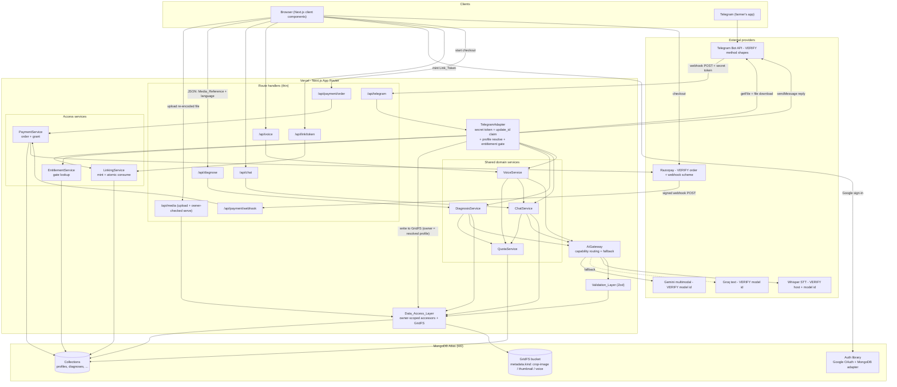
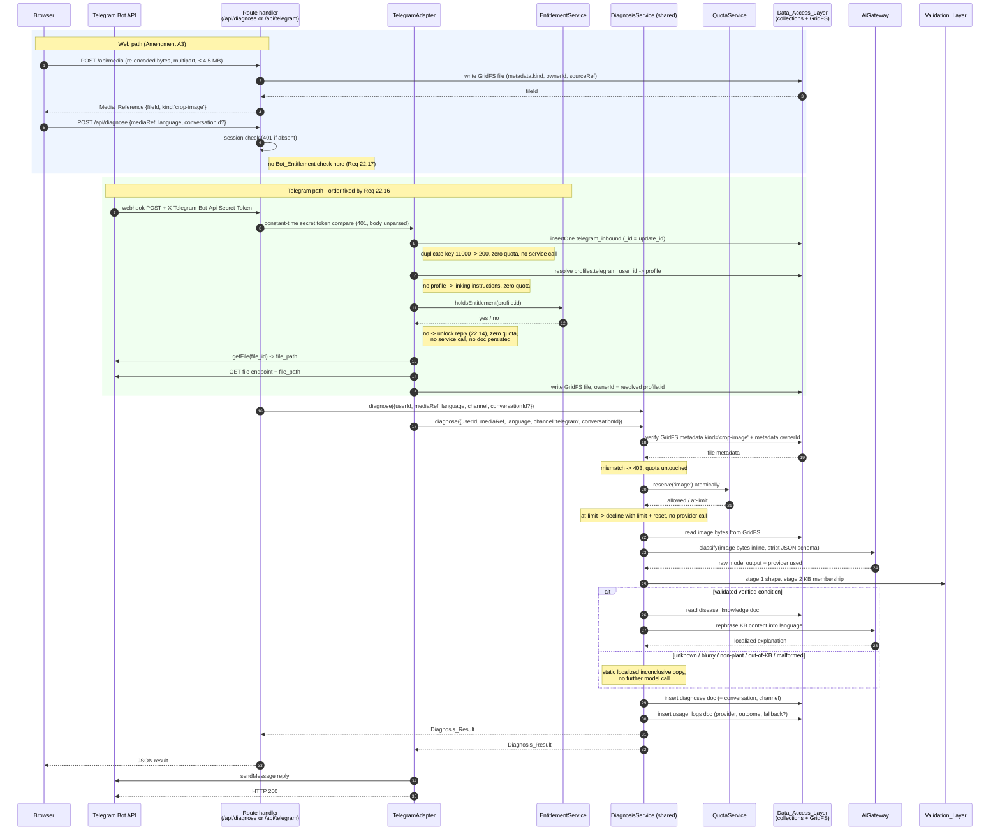

# Design Document

## Overview

Jamee is a Next.js App Router application (TypeScript strict mode) deployed on Vercel, backed by MongoDB Atlas (free M0 tier) for records, MongoDB GridFS for uploaded files, and an in-app authentication library with a MongoDB adapter for Google sign-in and sessions (*Amendment A3*; the earlier Supabase backing for auth, Postgres, and object storage is superseded). It reaches farmers through two channels — the browser and Telegram — and both channels are thin transports in front of the same three domain services: `DiagnosisService`, `ChatService`, `VoiceService` (Requirement 16). The browser channel is free to every signed-in farmer; the Telegram channel answers only a farmer who has linked a Telegram account and holds a one-time `Bot_Entitlement` (Requirements 21, 22).

Three design commitments shape everything below:

1. **No model training, no invented agronomy.** A general multimodal model only *classifies* an image into one of five verified conditions or `unknown`. Every symptom, cause, treatment, and prevention sentence a farmer reads is rephrased from a `disease_knowledge` document (Requirements 4.3–4.5). Nothing outside the knowledge base becomes agricultural advice.
2. **The verified-condition enum is the safety gate.** It lives in one place, is shared by the TypeScript types, the Zod schemas, and — under *Amendment A3* — a MongoDB `$jsonSchema` collection validator in place of the former Postgres check constraint. A model naming anything else fails validation and collapses into a single `Inconclusive_Result` shape (Requirements 5.6, 6.1, 6.4).
3. **The browser never sends analysis bytes to the API.** *Amended by Amendment A3.* Under Supabase the browser uploaded straight to Storage and the API received only a reference. There is no browser-reachable object store anymore, so the browser now uploads a re-encoded file to an authenticated Jamee endpoint (the Media_Endpoint) that writes it to GridFS and returns a Media_Reference; the diagnosis and voice *analysis* requests still carry only that reference in a small JSON body (Requirements 2.1, 8.1), so the analysis request is still ~200 bytes regardless of media size (Requirement 2.7). The one change is that the *upload* leg now carries the file, which is why it must stay under the 4.5 MB Request_Body_Ceiling — see **D1**.

This design covers Phases 1–6, plus Requirements 21 and 22, which the Telegram channel turned out to require. Requirements 19 and 20 (video frames, expert calling) are deferred and appear only in the forward-compatibility note.

### Three kinds of limits, kept separate

The document is careful never to conflate these, because they have different owners and different failure modes:

| Kind | Examples | Who enforces | Status here |
| --- | --- | --- | --- |
| **Jamee application quotas** | 20 image / 50 chat / 20 voice per farmer per Asia/Kolkata day (Requirement 14.1) | Jamee's own `counters` table | Fixed by requirements, authoritative in this design |
| **Documented platform limits** | Vercel serverless request body ceiling (spec states 4.5 MB), function `maxDuration` (spec states 60 s) | Vercel | Treated as design inputs from the requirements; exact current values **VERIFY AT IMPLEMENTATION** |
| **Provider free-tier rate limits** | Gemini requests/minute and requests/day, Groq requests/minute and tokens/day, Atlas M0 cluster-storage and connection allowances (*Amendment A3*, replacing Supabase storage/egress) | Google / Groq / MongoDB Atlas | Unknown at design time, **VERIFY AT IMPLEMENTATION** (V32); Jamee's quotas are set below them by design, not by measurement |

Jamee's application quotas are the only limit this codebase enforces. Provider limits are handled reactively through the fallback path (Requirement 14.4), never by hardcoding a provider's numbers.

---

## Amendment A1 — Telegram channel, Google sign-in, linking, and payment

> Status: IN FORCE. This amendment tracks requirements Amendment A1 together with the two requirements added after it, 21 (Telegram Account Linking) and 22 (Payment And Bot Entitlement). It **supersedes** parts of this document rather than extending them, so a reader who implemented the earlier design should treat the following as replaced and re-read the sections named:
>
> 1. **The second channel is Telegram, and every WhatsApp mechanism in this document is withdrawn.** Gone: the Meta Graph API version pin, the `X-Hub-Signature-256` HMAC over the raw body, the GET verification handshake, the two-step media retrieval, the WAMID as the deduplication key, and the 24-hour customer-service window. The section formerly titled *WhatsApp adapter* is now *Telegram adapter*; the `whatsapp_inbound` table is now `telegram_inbound`, keyed on `update_id`; and the `channel` value is `'telegram'` everywhere it was `'whatsapp'`. The reason is cost rather than capability: WhatsApp conversation pricing sits outside the zero-cost footprint this release targets.
> 2. **Web sign-in is Google OAuth through `signInWithOAuth({ provider: 'google' })`.** Gone: phone OTP, the SMS provider, the `SignInForm` phone-and-code flow, the `OTP_INVALID` error code, the manual "real SMS delivery" test, and V2. Removing SMS removed this project's only standing bill; the Payment_Provider added below is not a replacement for it, because its charge is a per-transaction fee out of money a farmer pays rather than an amount Jamee owes (Requirements 1.10, 22.26).
> 3. **Identity is the Supabase auth user id, and `profiles.phone` is no longer an identity column.** It becomes nullable optional contact information with neither `NOT NULL` nor `UNIQUE`, and it takes part in no resolution of any kind. Inbound Telegram senders resolve through `profiles.telegram_user_id` (nullable, `UNIQUE`), which is written only by the linking flow. See **D8**, which is amended in place and explains why the E.164 normalizer disappears with the identity it existed for.
> 4. **Two capabilities are new and in scope:** account linking by single-use expiring token (**D13**) and a one-time payment that grants a permanent entitlement gating the bot (**D14**, **D15**). Both add tables, routes, and RLS policies; neither touches the three shared services.
> 5. **D7, D8, and D11 are amended in place and keep their numbers.** D12 through D16 are new. D1–D6, D9, and D10 are untouched. Properties 1–31 keep their numbers and their statements; the ones this amendment falsifies are listed at the head of *Correctness Properties* and restated by a follow-up task, not here.
> 6. **What this amendment does not change.** Supabase remains auth, database, and storage. The three shared services, the two-stage validation of D2, the single inconclusive shape of D3, the quota and counter design, the error-envelope shape, and the whole media-lifecycle and retention design are untouched in substance — only their channel names and their phone references are corrected. One thing improves: Requirement 10.6 becomes satisfiable, because Telegram voice notes are OGG/Opus and V10's accepted container list includes `ogg`, so the `audio/aac` and `audio/amr` hole recorded against V14 closes along with the channel that opened it.

---

## Amendment A3 — MongoDB replaces Supabase, records and files alike

> Status: APPROVED AND IN FORCE. This amendment tracks requirements Amendment A3 and is a strict instruction from the product owner, not a tension this design resolves by argument — the reasoning below explains *how* the substitution is made cohesive, never *whether* to make it. It **supersedes** the data-platform substance of this document rather than extending it, so a reader who implemented against the Supabase design should treat the following as replaced and re-read the sections named. Where Amendment A1 is still in force, it stays in force: the Telegram channel, Google sign-in as a user-facing flow, account linking, the weekly ₹20 recharge and its window arithmetic, Gemini/Groq, the three languages, and the daily quotas all stand exactly as A1 amended them. A3 changes what those things are *stored in* and *served from*, not what they do.
>
> **What A3 replaces, and where to re-read:**
>
> 1. **Supabase is gone in full — auth, Postgres, and Storage all at once.** The Overview's "backed by Supabase for auth, Postgres, and private object storage" becomes MongoDB Atlas (free M0 tier) for records, MongoDB GridFS for files, and an in-app authentication library with a MongoDB adapter for sessions. There is no separate object store and no browser-held database credential. Re-read: *Overview*, *Architecture* (layers, system diagram, both sequence diagrams), *Data model* (now *Data model and collection setup*), *Security boundary*, *Media lifecycle and retention*, *Telegram adapter*, *Testing strategy*, and *Deployment*.
> 2. **Records become collections, one for one, and the 14 SQL migrations become one idempotent `npm run db:setup` script.** The tables of migrations `0002`–`0013` become MongoDB collections; every former `UNIQUE` becomes a unique index (partial or sparse where the field is nullable), and every former `CHECK` on an enumerated field becomes MongoDB `$jsonSchema` collection validation where practical. The five verified conditions are seeded by the same script. The `supabase/migrations/` tree becomes historical.
> 3. **Files live in GridFS in one bucket, distinguished by `metadata.kind`.** The private buckets `crop-images` and `voice-messages` are replaced by a single GridFS bucket whose files carry `metadata.kind` of `crop-image`, `thumbnail`, or `voice`, `metadata.ownerId` (the Auth_User_Id), and a link to their source. The choice of one bucket over two is argued in **D17**. The browser uploads a re-encoded file to an authenticated Media_Endpoint, which writes it to GridFS and returns a Media_Reference; the diagnosis and voice requests still carry only that reference in a JSON body, so the *analysis* request never carries bytes even though the *upload* leg now does (**D1** is amended for exactly this). A Media_Endpoint streams a file back only to its owner. Server-side analysis reads bytes from GridFS directly and sends them inline to Gemini and Groq (inline-byte limits are **V34**).
> 4. **RLS is gone, and tenant isolation moves into a Data_Access_Layer** (**D18**). MongoDB has no row-level security, so a single server-side module holds the database handle and injects the owning Auth_User_Id into every filter, insert, update, and delete. This is **application-enforced**, and A3 records that as an accepted academic weakening of a formerly database-enforced guarantee. A CI check on the existing `scripts/check-*` pattern fails the build if any module outside the data layer imports the `mongodb` driver or the raw handle.
> 5. **The public/anon key confusion disappears.** There is no browser database key and no service-role key, so the Supabase anon-vs-service-role reasoning that ran through the *Security boundary* is retired outright rather than restated. `NEXT_PUBLIC_SUPABASE_URL`, `NEXT_PUBLIC_SUPABASE_PUBLISHABLE_KEY`, `NEXT_PUBLIC_SUPABASE_ANON_KEY`, and `SUPABASE_SERVICE_ROLE_KEY` are removed from the environment; the server-only `MONGODB_URI` and the auth library's secret and Google client id/secret (named per the chosen library) are added. Telegram, Razorpay, Gemini, Groq, and `RETENTION_SWEEP_SECRET` are unchanged.
> 6. **Every Postgres single-statement atomicity guarantee is mapped to MongoDB, not weakened** (**D19**). The quota counter, the `telegram_inbound` claim, the payment grant, and the webhook throttle each map to a conditional `findOneAndUpdate`-with-upsert or an `insertOne` whose duplicate-key error (code `11000`) is the "already done" signal, with no read-then-write. The link-token consume-and-bind and the payment grant each span two documents and use a multi-document transaction. Atlas M0 is a three-node replica set, so transactions are available — recorded as **V33**.
> 7. **The authentication library is chosen at implementation, and which one is a V-item.** A3 names no library. The design chooses between Auth.js (NextAuth v5) and Better Auth on the single criterion of which one supports the Next.js version installed in this repo (**D18a**, **V35**), reading `node_modules/next/dist/docs` first as `AGENTS.md` requires. Either way it runs inside the Web_App with the Google provider and a MongoDB adapter, its user and session records live in MongoDB, and Requirement 1's user-facing behaviour is unchanged. The D8 profile bootstrap becomes the library's sign-in / user-created hook plus the idempotent server-side upsert, and the E.164 story stays retired.
> 8. **What A3 does not change.** The three shared services and their one-code-path parity (**D7**), the two-stage validation (**D2**), the single inconclusive shape (**D3**), the quota *semantics* (**D10** and the reserve/finalize/refund rule), the error-envelope shape, the media *lifecycle* (re-encode before upload, a derivative for list views, delete what nothing reads), and the whole prompting and grounding design are untouched in substance. Only their storage substrate and their isolation mechanism change. One thing the retention design gains: GridFS files carry an `uploadDate`, so the age-based orphan backstop that the retired V22 (U-V22b) left blocked under Supabase is now possible (see *Media lifecycle and retention*).
>
> **Decisions.** **D1** is amended in place — the upload leg now carries bytes through the Media_Endpoint, while the analysis request still carries only a Media_Reference. **D17** (one GridFS bucket), **D18** (the Data_Access_Layer), **D18a** (auth-library choice), and **D19** (atomicity mapping) are new and appear at the end of *Design decisions that resolve requirement tensions*. D2–D16 keep their numbers; **D8**, **D11**, **D14**, **D15**, and **D16** are amended in place where they named a Postgres statement, a trigger, RLS, or the service role. Each such amendment is a substrate change rather than a change of intent — every atomicity and ordering property those decisions rested on is preserved by **D19**, and where the argument for a decision was *the database makes this one statement*, the argument survives with the statement re-expressed in MongoDB.
>
> **V-items.** **V1**, **V3**, **V4**, **V5**, **V22**, and **V23** are retired in place — their numbers and findings kept, each pointing to its successor — because they named Supabase surfaces that no longer exist. New V-items **V28**–**V35** are added and every one is marked VERIFY, because resolving them is task work rather than a design assertion: the MongoDB Node.js driver (V28), GridFS (V29), the auth library and its MongoDB adapter (V30), `mongodb-memory-server` in replica-set mode (V31), Atlas M0's own limits (V32), transactions on M0 (V33), the Gemini/Groq inline-byte limits (V34), and the auth library's Next.js compatibility (V35).
>
> **Correctness Properties are amended by a separate run** and are deliberately untouched here. Where a property below still reads in Postgres/RLS/Storage vocabulary after this run, that is expected and is the other run's work — not a contradiction this amendment failed to resolve. The one place this matters for a reader is Property 3, whose 10 MB voice figure this amendment lowers to 3 MB everywhere *outside* the property set; the property itself is left to that run.

---

## Values to verify before coding

Every item below depends on a third-party detail that changes over time. **No value in this table is asserted as fact anywhere else in this design.** The first implementation task resolves this table and records the findings in the API/deployment documentation.

| # | Value | Where it is used | Doc to check |
| --- | --- | --- | --- |
| V1 | **RETIRED by Amendment A3.** Was: Supabase JS client package/version and the browser-vs-server client factory wiring. There is no Supabase client and no browser database client anymore — server-only MongoDB access is **V28**, and the auth library's session wiring is **V30**/**V35** | — | — |
| V2 | **RETIRED by Amendment A1.** Was: phone/SMS OTP enablement and which SMS provider to configure. Jamee registers no SMS provider at all. Superseded by **V23** | — | — |
| V3 | **RETIRED by Amendment A3.** Was: the Supabase signed-URL creation call and its expiry units. There are no signed URLs — files are streamed to their owner through the authenticated Media_Endpoint, and server-side analysis reads GridFS bytes directly (**V29**) | — | — |
| V4 | **RETIRED by Amendment A3.** Was: the Supabase Storage RLS path-segment helper and the bucket-privacy setting. There is no storage RLS and no bucket privacy setting — ownership is `metadata.ownerId` on each GridFS file, checked by the Data_Access_Layer (**D18**, **V29**) | — | — |
| V5 | **RETIRED by Amendment A3.** Was: whether an `auth.users` trigger is the supported profile-bootstrap pattern and its `security definer`/`search_path` form. There is no Postgres and no trigger — the bootstrap is now the auth library's sign-in / user-created hook plus an idempotent server-side upsert through the Data_Access_Layer (**D8**, **V30**) | — | — |
| V6 | Google Gemini SDK package name, client initialization, and the **current multimodal model identifier** | `src/lib/gemini.ts` | Google Gemini API models documentation |
| V7 | Gemini structured/JSON output configuration: parameter names for response MIME type, response schema, temperature, max output tokens | `src/lib/prompts.ts`, `gemini.ts` | Gemini structured output documentation |
| V8 | Groq SDK package name, client initialization, and the **current text model identifier** for the fallback | `src/lib/groq.ts` | Groq models documentation |
| V9 | **Whether Groq currently hosts a vision-capable model**, and its identifier if so. This single fact decides whether an image-interpretation fallback exists at all (see Fallback matrix) | `src/lib/groq.ts` | Groq models documentation |
| V10 | Speech-to-text: which host serves Whisper, the exact model identifier, the endpoint/SDK method, accepted audio container/codec list, and the provider's own max file size and max duration | `src/lib/groq.ts` (or a dedicated transcription adapter) | Provider's audio transcription documentation |
| V11 | Provider error shapes: how a rate-limit condition and an unavailability condition are signalled (HTTP status, error code, header names for retry-after) for both Gemini and Groq | `AiGateway` fallback trigger | Both providers' error-handling docs |
| V12 | **RETIRED by Amendment A1.** Was: the Graph API version string to pin and the inbound WhatsApp field paths. Telegram publishes one unversioned Bot API surface, so there is no version to pin. Superseded by **V24** | — | — |
| V13 | **RETIRED by Amendment A1.** Was: Meta's signature header name and HMAC algorithm/encoding. Telegram authenticates by a shared secret token, so there is no digest and no hex-vs-base64 encoding question (**D12**). Superseded by **V24** | — | — |
| V14 | **RETIRED by Amendment A1.** Was: Meta's two-step media retrieval and its inbound audio container set — the row that recorded the unsatisfiable half of Requirement 10.6. Superseded by **V25** and **V26** | — | — |
| V15 | **RETIRED by Amendment A1.** Was: Meta's send-message endpoint and the 24-hour customer-service window. Telegram has no reply window and no template requirement (see **D11**). Superseded by **V24** | — | — |
| V16 | Vercel serverless **request body limit** (spec assumes 4.5 MB) and the **maximum `maxDuration`** permitted on the target plan (spec assumes 60 s) | Requirements 2.7, 3.6, 10.10 | Vercel functions limits documentation |
| V17 | Next.js route segment config for per-route duration (`maxDuration` export) and its accepted values | `src/app/api/*/route.ts` | Next.js route segment config documentation |
| V18 | Whether Vercel exposes a supported post-response continuation primitive (e.g. `waitUntil`) on the target plan/runtime | Telegram acknowledgement strategy (D11) | Vercel functions documentation |
| V19 | Free-tier allowances: Gemini RPM/RPD, Groq RPM/TPD, Supabase database size / storage / egress, Vercel invocation and duration allowances | Requirement 17.7 sizing note | Each provider's pricing/limits page |
| V20 | MediaRecorder MIME support on target Android browsers (which container/codec actually records) and whether it matches V10's accepted list | `src/components/VoiceRecorder.tsx` | MDN MediaRecorder compatibility data |
| V21 | Whether the deployment platform offers a **scheduled invocation** primitive on the target plan, its minimum interval, and how it authenticates the call it makes | Retention sweep trigger (Requirement 18.3, 18.4) | Deployment platform scheduled-jobs documentation |
| V22 | **RETIRED by Amendment A3.** Was: the Supabase Storage batch-delete call, its path semantics, whether deleting an absent object errors, and whether `storage.objects` exposes a usable creation timestamp (the last part, U-V22b, blocked the age-based orphan backstop). GridFS answers all of this: `GridFSBucket.delete(id)`, and every file carries `uploadDate`, so the backstop is now possible — superseded by **V29** | — | — |
| V23 | **RETIRED by Amendment A3.** Was: Supabase's `signInWithOAuth({ provider: 'google' })` call shape, its code-exchange helper, and where the Google client id/secret live. Google sign-in now runs through the chosen in-app auth library; its Google-provider and MongoDB-adapter wiring, and where the client id/secret are configured, are **V30**, and the library choice itself is **V35** | — | — |
| V24 | Telegram Bot API **method and update shapes**: `setWebhook` including its `secret_token` parameter and any length/character constraints on that token; the exact header name Telegram presents it in; the `Update` field paths for `update_id`, `message.from.id`, `message.text`, `message.photo[]`, `message.voice`, and the `/start` payload; `sendMessage` request shape and its text length cap; and Telegram's **retry behaviour on a non-200 response**, which D11's acknowledgement reasoning depends on | `src/lib/telegram.ts`, `src/app/api/telegram/route.ts` (Requirements 10.1–10.11, 11.1–11.8) | Telegram Bot API reference |
| V25 | Telegram **file retrieval**: `getFile(file_id)` → `file_path`, the download URL form built from the bot token and that path, the documented validity window of a `file_path`, and the bot-download size ceiling | Telegram adapter media fetch (Requirements 10.4, 10.6) | Telegram Bot API `getFile` reference |
| V26 | Telegram **inbound media facts**: that a `voice` message is always OGG/Opus and how it differs from `audio` and `document`, the `mime_type` and `file_size` fields actually present on each, and which entry of the `photo[]` size array to take for diagnosis. This row carries the fact that makes Requirement 10.6 satisfiable, so it is load-bearing rather than incidental | `src/lib/telegram.ts` (Requirements 10.4, 10.6, 10.9) | Telegram Bot API message-type reference |
| V27 | Razorpay: order-creation endpoint and request/response shape, which identifiers the browser checkout needs, the **webhook signature scheme** (header name, HMAC algorithm, encoding, and which secret keys it), the **event names** for a captured and a failed payment, the payload paths for the payment id, order id, amount, and status, and the difference between test and live mode credentials (requirements O22-3) | `src/lib/razorpay.ts`, `src/app/api/payment/*` (Requirements 22.1–22.11, 22.25) | Razorpay orders, checkout, and webhooks documentation |
| V28 | **MongoDB Node.js driver** (added by A3): package name and version, the `MongoClient` construction and options, how the connection pool is reused across serverless invocations (the `globalThis`-cached client of **D19**) within the M0 connection limit, the duplicate-key error code (`11000`) and where it is exposed on the thrown error, the return shape of `findOneAndUpdate` (whether it returns the pre- or post-update document and under which option), and how a write against a `$jsonSchema` validator reports a validation failure | `src/lib/db/*` (the Data_Access_Layer) | MongoDB Node.js driver docs |
| V29 | **GridFS** (added by A3): the `GridFSBucket` API for an upload stream and a download stream, how `metadata` is written and read, `bucket.delete(id)` and whether it errors on an absent id, the `files` collection fields available for a query (notably `uploadDate` for the age-based orphan backstop and `length`/`metadata`), and how a download stream is piped to a route Response | `src/lib/media/*`, `src/services/retention.service.ts` (Requirements 2.1, 2.8, 8.1, 8.9, 12.5, 18.3, 18.4, 18.10) | MongoDB GridFS docs |
| V30 | **Auth library — provider and adapter** (added by A3): for the library chosen under **V35**, the Google-provider configuration, the MongoDB adapter package and how it is pointed at this database, the sign-in / user-created hook used for the D8 bootstrap, the server-side session-read call that replaces `src/proxy.ts`'s Supabase session check, where the Google client id/secret and the library secret are configured, and which callback/redirect URLs must be registered | `src/lib/auth/*`, `src/app/api/auth/*`, `src/proxy.ts` (Requirements 1.1–1.4) | The chosen library's Google-provider + MongoDB-adapter docs |
| V31 | **`mongodb-memory-server` in replica-set mode** (added by A3): the package and version, how to start it as a single-node replica set so multi-document transactions work, its startup cost and any binary download it needs, and how the test harness points the Data_Access_Layer at it — this is what lets the integration project run without Docker and stop self-skipping | `tests/integration/*`, test setup | `mongodb-memory-server` docs |
| V32 | **Atlas M0 limits** (added by A3): the cluster-storage allowance (documented ~512 MB), the concurrent-connection limit the cached pool must stay under, and any operation/throughput caps relevant at the 6-farmer scale — the successor to the Supabase storage/egress row of the retired V19 line for the storage dimension | Retention arithmetic, connection pooling (**D19**) | MongoDB Atlas M0 tier limits page |
| V33 | **Transactions on M0** (added by A3): confirmation that a multi-document transaction runs on the M0 replica set, the session/transaction API on the Node.js driver, the retryable-write and transient-transaction-error semantics, and any M0-specific caveat — load-bearing for the link-token consume-and-bind and the payment grant (**D19**) | `src/services/linking.service.ts`, `src/services/payment.service.ts` | MongoDB transactions + driver session docs |
| V34 | **Gemini and Groq inline-byte limits** (added by A3): the maximum inline (base64 / bytes-in-request) payload each provider accepts for an image, and for any audio sent inline, since analysis now reads bytes from GridFS and sends them inline rather than handing the provider a URL — if a re-encoded image or a voice file can exceed the inline limit, that bound is a hard input to the upload ceilings | `src/lib/gemini.ts`, `src/lib/groq.ts` | Gemini and Groq request-size docs |
| V35 | **Auth library choice** (added by A3): which of Auth.js (NextAuth v5) or Better Auth supports the Next.js version installed in this repo, decided by reading `node_modules/next/dist/docs` first as `AGENTS.md` requires. This single fact selects the library that **V30** then configures (**D18a**) | `package.json`, `src/lib/auth/*` | `node_modules/next/dist/docs`, then each library's Next.js compatibility notes |

Rule for implementation: if a V-item cannot be confirmed, the code must fail loudly at startup (missing env var / unsupported model) rather than fall back to a guessed value.

V21 and V22 were added by the media-lifecycle amendment. They are the only third-party facts the retention design depends on, and neither blocks the *deletion logic* — V21 blocks only the automatic trigger, for which a documented manual fallback exists (see *Media lifecycle and retention*).

V23 through V27 were added by Amendment A1, and V2 and V12–V15 were retired by it. The retired rows are left in place with their numbers rather than deleted, because `docs/VERIFIED_VALUES.md` resolved several of them with source URLs and dated notes, and a reader arriving from that file needs to find the number they came for and learn that it no longer applies. Note what the retirement costs: V14's resolved row is the only record of why Requirement 10.6 was unsatisfiable under the old channel, and V13's is the only record of the signature-encoding ambiguity Jamee had to accept. Both problems are now historical, and **D12** says why the replacement is not a downgrade.

V28 through V35 were added by Amendment A3, and V1, V3, V4, V5, V22, and V23 were retired by it — for the same reason A1's retirements were left in place: `docs/VERIFIED_VALUES.md` may have resolved a Supabase row with a dated note, and a reader arriving from that file must find the number they came for and be sent to its successor rather than meeting a gap. The A3 rows cluster by concern: V28/V29/V33 are the MongoDB driver, GridFS, and transactions the data layer and media store are built on; V30/V35 are the auth library and its Next.js fit; V31 is the test harness that makes the integration project run without Docker; V32 is the M0 allowance the retention arithmetic is sized against; and V34 is the one A3 adds because analysis bytes now travel *inline* to the providers rather than by URL. Every one is VERIFY, because A3 changed the substrate and none of these facts is asserted anywhere else in this design.

---

## Design decisions that resolve requirement tensions

**D1 — `/api/diagnose` takes JSON, not multipart, and the bytes move on a separate upload leg.** *Amended by Amendment A3.* Requirement 2.2 mandates a JSON body carrying a media reference, while Requirement 2.3 allows images up to 10 MB and Requirement 2.7 requires bodies under the platform ceiling (spec: 4.5 MB, V16). A multipart upload of a 10 MB image cannot satisfy both. The analysis request therefore stays JSON and carries only a Media_Reference; the request body is ~200 bytes regardless of image size, and `/api/voice` follows the same reasoning.

What A3 changes is *where the bytes go before that request*. Under Supabase the browser uploaded directly to Storage and the API later read the bytes through a signed URL. There is no browser-reachable object store anymore and no signed URL, so the browser now uploads the re-encoded file to an authenticated Jamee endpoint — the **Media_Endpoint** — which writes it to GridFS and returns the Media_Reference the analysis request then carries. So the byte-carrying leg moves *through* Jamee rather than around it, and it is a real upload subject to the 4.5 MB Request_Body_Ceiling: the re-encoded Full_Size_Image (Downscale_Target ~400 KB) and the voice file (Requirement 8's limit lowered to 3 MB by A3, precisely so it clears the ceiling with headroom) both fit. The analysis leg is unchanged — it never carried bytes and still does not. Server-side, the Diagnosis_Service reads the image bytes from GridFS by their Media_Reference and sends them **inline** to the model provider rather than handing over a URL (inline-byte limits are V34).

The distinction that matters for a reader of the old design: "the browser never sends bytes to the API" was true of a world with a direct-to-storage upload. Under A3 the honest statement is narrower and is the one this decision now makes — *the analysis request never carries bytes; the upload leg does, and it is bounded by the ceiling rather than by the 10 MB admission limit.*

**D2 — Validation is two-stage, so rejection reasons are distinguishable.** Requirement 5 wants a strict schema; Requirement 6.1 needs to know *specifically* that the rejection was an out-of-KB disease name. A single strict enum schema would report "parse failed" for both a malformed JSON blob and a real-but-unsupported disease. Stage 1 validates shape (`status`, `disease_name` as free string, `confidence`, `severity`, flags). Stage 2 checks knowledge-base membership. Both stages log a distinct `rejection_reason` (Requirement 5.7).

**D3 — Every validation failure produces the one inconclusive shape.** Requirement 6.1 only names the out-of-KB case. Requirements 5.2–5.5 (bad JSON, missing field, out-of-range confidence, bad severity) leave the farmer-facing outcome unstated. Decision: all of them map to `Inconclusive_Result` (Requirement 6.4's single shape), each with its own logged reason. A farmer never sees "the model returned malformed JSON"; they see an honest "Jamee could not judge this photo — consult an expert."

**D4 — No repair re-ask on validation failure.** We do not send a "your JSON was invalid, try again" second call. Requirement 6.6 forbids extra model calls once a result is inconclusive, and a repair loop would multiply free-tier consumption. One classification attempt per request (plus the provider fallback of Requirement 14.4, which is a *transport* retry, not a *content* retry).

**D5 — Inconclusive results, quota messages, and error messages are pre-translated static strings.** Requirement 6.6 forbids a model call for inconclusive results, Requirement 14.3 forbids provider calls when a quota is exhausted, and Requirement 15.3 requires localized messages. So en/hi/mr copy for these paths ships in the repository as static message catalogs. The model is used for translation only when rephrasing knowledge-base content for an *identified* condition.

**D6 — The "temporarily busy" literal is the English rendering of a coded error.** Requirement 14.5 specifies exact English text; Requirement 15.3 requires localization. Decision: error code `PROVIDERS_UNAVAILABLE` renders as exactly `Jamee is temporarily busy. Please try again shortly.` for `en`, with hi/mr equivalents in the catalog. Tests assert the English string byte-for-byte.

**D7 — Channel parity means one code path and identical structured fields, not identical prose — and it is asserted only where the farmer holds a Bot_Entitlement.** *Amended by Amendment A1.* Requirements 10.7 and 10.13 require the Telegram channel to agree with the web channel on the content of a Diagnosis_Result. Language models are not bit-deterministic, so parity is defined structurally: same `DiagnosisService` invocation, same knowledge-base row, identical `status`, `disease_name`, `severity`, and `needs_expert`. Explanation wording may differ between two runs of the same image on either channel. Classification runs at the lowest available temperature (V7) to maximize agreement.

The amendment adds a guard and takes nothing away. Under Requirement 22.13 an update from a linked farmer who holds no entitlement produces no Diagnosis_Result at all — the gate replies and returns before any service is invoked — so there is nothing on the Telegram side to compare, and an unguarded parity claim would be *unsatisfiable* for that farmer rather than merely unexercised. Parity is therefore stated as: **where the submitting farmer holds a Bot_Entitlement**, the two channels agree on those four fields. Where the guard does not hold, the correct Telegram outcome is the gated reply of 22.14, and that is not a parity failure. Note what the guard does not do: it does not weaken parity where it applies, and it introduces no entitlement-dependent branch inside `DiagnosisService`. The gate lives in the adapter, ahead of the service (**D14**), so the service still has exactly one behaviour and the parity test still exercises one code path.

**D8 — Profile creation uses the auth library's sign-in hook plus an idempotent server-side upsert, and it copies no phone number.** *Amended by Amendment A1, then by Amendment A3.* Requirement 1.4 attributes profile creation to the Web_App. A purely client-driven insert can be skipped — the farmer closes the tab on the callback — and a farmer with no `profiles` document has no preferred language, no linking state, and nothing for an entitlement to hang off. So the obligation survives unchanged: the bootstrap fires from a place the client cannot skip, and the post-sign-in server action upserts defensively.

*A3 replaces the mechanism, not the obligation.* Under Supabase this was an `on auth.users insert` Postgres trigger plus the upsert. There is no Postgres and no `auth.users` table anymore: the first half is now the chosen auth library's **sign-in / user-created hook** (V30), which runs server-side when the library establishes a first session, and the second half is the same idempotent upsert, performed through the Data_Access_Layer (**D18**) into the `profiles` collection. The V5 worry that a failing trigger could block sign-up is gone with the trigger; the upsert remains the defensive second half so that a hook that does not fire — or fires before the library commits its own user record — still leaves a `profiles` document behind on the next authenticated request.

What changes is what gets copied. The bootstrap now writes `(_id, email)` — the Auth_User_Id the library assigned, and the Google email — into the `profiles` collection and writes **no** phone (Requirement 1.4 is explicit that the bootstrap stores no phone number). *Amended by A3: the `auth.users` row and its trigger are gone; the same two values now come from the auth library's session/user record and are written by the sign-in hook and the defensive upsert (V30).* The `profiles.phone` field survives as nullable optional contact information with no constraint and no reader (Requirement 1.9).

**The E.164 normalizer goes away with it, and this is worth stating rather than leaving a reader to notice a deletion.** Under phone identity the bootstrap had a production-blocking defect: Supabase Auth stores `auth.users.phone` with the leading `+` stripped, while `profiles.phone` carried a `check (phone ~ '^\+[1-9][0-9]{7,14}$')` constraint and inbound WhatsApp senders arrived as a bare `wa_id`. The trigger, the constraint, and the adapter therefore disagreed about the same value's format, and every path that touched a phone needed a normalizer plus a test asserting the `+` was restored — a normalizer that, if it ever ran in only two of the three places, would have produced a sign-up that failed or a sender that resolved to nobody. None of that exists now. There is no format to reconcile, because the identity is an opaque id the auth layer assigns and the bootstrap copies verbatim onto the Profile — under A1 that was `auth.users.id` → `profiles.id`, and *under A3 it is the auth library's user id → `profiles._id` (V30)*, a substrate change that leaves the argument intact: the id is generated once, never parsed, never reformatted. The normalizer is **not lost, it is unnecessary** — the problem it patched is gone with the identity that created it. Telegram senders resolve through `profiles.telegram_user_id`, a numeric id written only by the linking flow (**D13**), never parsed out of a message and never reformatted.

**D9 — Chat language follows the message, resolved by the model, not by a script detector.** Requirement 9.6 requires answering in the language of the submitted message. Hindi and Marathi share the Devanagari script and cannot be separated by a character-range check. The chat prompt receives the farmer's preferred language *and* an instruction to answer in the message's language when that language is en/hi/mr. Requirement 9.5 still rejects unsupported explicit language codes at the edge with HTTP 400.

**D10 — `usage_logs` is an append-only audit table and is not the quota source of truth.** The requirements rename the spec's `api_usage` to `usage_logs` (glossary) and require it to record fallbacks (14.7) and validation rejections (5.7) in addition to billable operations. Those rows are not 1:1 with quota units, so quota lives in a separate counter table (see Quota enforcement).

**D11 — The Telegram adapter processes inline and acknowledges after processing, guarded by a soft deadline.** *Amended by Amendment A1 — naming only; the reasoning is unchanged.* Discussed under *Telegram adapter*. The shape of the decision survives the channel change intact: the `update_id` is claimed before anything billable, the reply is sent, `markProcessed` runs after the reply, and the unit of work is one update rather than one batch. One input to the old reasoning disappears — Telegram has no 24-hour customer-service window and no template requirement, so a late or deferred reply is a latency problem and not a deliverability one (V15 is retired; V24 supplies Telegram's retry behaviour on a non-200).

**D12 — Webhook authenticity is a shared secret token compared in constant time, not an HMAC over the body.** Requirement 11.2 registers a `Webhook_Secret_Token` through `setWebhook` and has Telegram present it in the `X-Telegram-Bot-Api-Secret-Token` header of every delivery. Jamee compares that header against the configured value in constant time **before parsing the body**, answers 401 on a missing or mismatched value, and treats an unconfigured secret as a failed verification rather than a skipped one (Requirement 11.4). There is no GET handshake, because Telegram has no verification challenge: registration is an authenticated call Jamee makes outbound.

This reads like a weaker primitive than an HMAC and is not, for three reasons worth recording because the instinct is to assume otherwise. First, the threat the old HMAC defended against was a forged *body*, and the body is not what Jamee trusts here — the secret token is a bearer credential over TLS that Jamee itself generated and that only Telegram was ever told, so an attacker who cannot read the header cannot produce it, and one who can read it could equally have stolen an app secret. Second, the failure modes are strictly fewer: an HMAC has to be computed over the exact bytes the sender signed, which forced the old design to read the body as text, verify, and only then `JSON.parse` — a constraint a future refactor to `request.json()` would silently break. A header comparison has no such coupling to body bytes, so the ordering requirement of 11.2 ("before parsing") is a cheap invariant instead of a fragile one. Third, it retires a genuine unknown rather than trading it for another: V13 could not confirm from first-party documentation whether Meta's digest was hex or base64, and the design had to accept an ambiguity in the one comparison that must not be wrong. A fixed string has no encoding. What Jamee gives up is that the token does not attest to the *payload*, so a replayed body from a party who has the token is still accepted — which is exactly what the `update_id` claim of Requirement 11.7 exists to make harmless, and it is enforced by a `UNIQUE` primary key rather than by trust.

**D13 — Linking is proved by an explicit single-use expiring token, and the bind and the consume are one statement.** Requirement 21 has to bind one Telegram account to one Jamee account with no phone number anywhere in the picture. Three mechanisms were available and two are unsafe.

*Implicit matching is not available at all.* A Google identity carries no phone number, and a Telegram update carries no email, so there is no shared attribute to join on. Matching on a display name, or on "the most recently signed-in farmer", would bind an account on a coincidence. Requirement 21.2 forbids deriving any part of the token from an `Auth_User_Id`, a `Google_Email`, a `Telegram_User_Id`, or a timestamp, which closes the door on a "derive it deterministically and skip the storage" variant: anything derivable by Jamee from public-ish inputs is derivable by an attacker who can send `/start` to a public bot.

*So the binding is proved in both directions.* The farmer proves control of the Jamee account by minting the token inside an authenticated session, and proves control of the Telegram account by delivering that same token from it, as the payload of `/start` carried by a `https://t.me/<bot>?start=<token>` deep link. The token is a capability and nothing else: it authorizes exactly one binding and grants no session, no read, and no second use (Requirement 21.5).

*Single-use and expiring are not belt-and-braces, they bound distinct exposures.* The deep link travels through whatever the farmer used to open it — a browser history entry, a screenshot, a copied message — so a token's lifetime is the window in which a leaked link is still a binding. Expiry (a compile-time constant, minutes, Requirement 21.4) bounds that window in time; single-use bounds it in count, so a link that is leaked *after* a successful bind is already spent. Either one alone leaves a hole the other closes.

*The bind and the consume must be one atomic operation* (Requirement 21.7). Two concurrent `/start` deliveries of one token — trivially producible, since Telegram redelivers on a non-200 and a farmer can tap a link twice — would otherwise both read an unconsumed row, both write a `telegram_user_id`, and both reply "linked". The consequence is not a duplicate reply, it is that the second write can land a *different* sender's id on the profile. So the mechanism is a single conditional `update … where consumed_at is null and expires_at > now()` whose `RETURNING` clause is the authorization: if it returns no row, the token was not valid at the instant of the write, and no binding is attempted. There is no read-then-write, for the same reason the quota counter and the `update_id` claim have none.

*The replies for unknown, expired, and consumed are byte-identical* (Requirement 21.8). Distinguishing them would turn the bot into a token-validity oracle: a party who can send arbitrary `/start` payloads to a public bot could tell "no such token" from "that token existed and has expired", which leaks whether a guess was structurally right and makes enumeration measurably cheaper. The three cases share one message and one code path that never learns which of them it is in.

**D14 — The entitlement gate sits in the adapter, after the claim and the resolution, and is keyed to the auth user id.** Requirement 22.16 fixes the order, and each position earns its place. Secret-token verification is first because an unauthenticated request must not cost a database round trip (**D12**). The `update_id` claim is second because it must precede anything billable, and a database read to resolve a profile is the cheapest thing it must precede (Requirement 11.7). Profile resolution is third because the entitlement is a property of the profile, so there is nothing to check before one exists. The entitlement check is fourth and last, immediately before the first line of farmer-facing work. It therefore gates the photo, text, and voice handling of 10.4, 10.5, and 10.6, and exempts exactly three things: the `/start` exchange, the linking instructions of 10.3, and the gated reply of 22.14 itself (Requirement 22.15).

Putting the gate in the adapter rather than inside the services is what keeps **D7**'s parity claim testable and Requirement 22.17's "the web stays free" true by construction: the services have no entitlement parameter, cannot consult one, and so cannot accidentally start gating the web channel. A gated update reserves no quota unit, persists no row, and invokes no service (Requirement 22.13), which puts it in the same class as a duplicate delivery — acknowledged with 200 and audited by the `telegram_inbound` row alone.

**The entitlement is keyed to the `Auth_User_Id`, never to a `Telegram_User_Id`** (Requirements 22.12, 22.20). *Amended by A3 — substrate only; the keying argument is unchanged.* The farmer paid, not the chat account. Keying it to the chat account would mean that unlinking discards a purchase, that re-linking from a new phone requires paying twice, and that a farmer who loses access to a Telegram account loses a permanent entitlement — three support problems manufactured by a schema choice. With the auth user id as the key, `unlink` clears one nullable field (`profiles.telegram_user_id`) and costs nothing (Requirement 21.15), the entitlement document is untouched, and the farmer's next binding is served without further payment (Requirement 22.19). It also makes the right uniqueness the natural one: under A3 the `bot_entitlements` collection uses the Auth_User_Id as its `_id`, so at most one entitlement per farmer holds by the primary-key uniqueness of `_id` itself — exactly the "one-time, permanent" semantics — whereas a Telegram-keyed document would permit one farmer to accumulate several. (Under Supabase this was a `UNIQUE`/primary-key column; the guarantee is identical.)

**D15 — The payment webhook is trusted only after a signature over the raw body, and its idempotency is a claim rather than a read.** This is the one Jamee write path reachable with no farmer session at all (Requirement 22.24), so three properties carry the whole boundary.

*The signature is verified over the exact raw bytes, before any parse* (Requirement 22.5). `request.json()` discards those bytes and re-serializing the parsed object will not reproduce them — key order, whitespace, and unicode escaping all differ — so the body is read once as text, verified, and only then parsed. This is the same discipline the retired WhatsApp POST path used, and it is the one thing from that path worth keeping: the argument was never about which provider signs, it was about what "the body" means.

*An absent secret is a failed verification, not a skipped one* (Requirement 22.6). The tempting implementation is `if (secret) verify(...)`, which is a deployment where someone forgot an environment variable turning into a deployment where anyone can grant themselves an entitlement by POSTing a JSON body. The check is written so the unconfigured case falls into the same 401 branch as a wrong signature, and `serverEnv` fails loudly at first use besides.

*Idempotency is a `UNIQUE` claim on the provider's payment id, not a read-then-write* (Requirement 22.11). Razorpay retries, and a retry that arrives while the first delivery is still inside the handler would pass a `select … where payment_id = ?` check twice. So the grant is an `insert … on conflict do nothing` on a column carrying a `UNIQUE` constraint, and a zero-row result **is** the duplicate signal — acknowledge 200, change nothing (Requirement 22.10). *Amended by A3: the same claim is a unique index on `bot_entitlements.providerPaymentId` and an `insertOne` whose duplicate-key error (code `11000`) is the "already granted" signal — see **D19**; the grant additionally spans two documents (claim the payment id, extend the window), so under A3 it runs in a multi-document transaction rather than as one statement, and the argument that the database and not the handler makes it atomic survives the substrate change.* This is the third instance of the same pattern in this design (the quota counter, the `update_id` claim, this), and the reason is identical each time: under `read committed`, a check and a write in two statements is a race, and the database is the only thing that can make them one.

*Only the verified payload plus the recorded Payment_Order determine who paid what* (Requirement 22.7). The browser reports a checkout success too, and that report grants nothing — it only tells the UI to start showing an optimistic "confirming your payment" state. The amount, the currency, and the owning farmer are all server-side (Requirement 22.2), so a tampered request body cannot buy an entitlement for a different farmer or at a different price.

**D16 — The payment webhook is rate limited per caller, which needs a limiter that does not require a farmer.** *Amended by A3 — substrate only; the reasoning is unchanged.* Requirement 13.9 asks for a bound on the work one caller can drive on the payment webhook route, and this collides with the existing limiter: the `counters` collection is keyed on the owning Auth_User_Id (a required field that must reference a real Profile), and on this route there is no farmer to key on until a signature verifies — and a caller whose signatures never verify never produces one. Reusing `counters` is therefore impossible rather than merely awkward.

Decision: a separate `webhook_throttle` collection keyed on an opaque caller key and a minute window, with no reference to a Profile and no farmer field, incremented by the same single-statement conditional upsert as the quota counter — under A3 a `findOneAndUpdate` with `upsert:true` whose filter carries `used < limit`, mirroring `counter_try_increment` (**D19**). The caller key is a hash of the platform-reported client address, never the raw address, so the collection holds no retained network identifier. This is stated with its limitation rather than oversold: a client address is shared behind NAT and forgeable at scale, so this bound is a cost control, not an authentication control. The actual defence is ordering — verification is one HMAC over an already-read body and precedes every database write and every allocation — so an unauthenticated flood costs an invocation and a hash, and the limiter's job is only to stop even that from consuming the free-tier invocation allowance. The same collection serves the Telegram webhook route, which has the identical shape of problem for the same reason.

**D17 — Files live in one GridFS bucket distinguished by `metadata.kind`, not two buckets.** *Added by Amendment A3.* Requirement 2 stores full-size crop images and their thumbnails; Requirement 8 stores voice recordings. Under Supabase these were two private buckets, `crop-images` and `voice-messages`, and the natural port is two GridFS buckets (`crop_images`, `voice_messages`). The design chooses **one** bucket instead, with each file carrying `metadata.kind` of `crop-image`, `thumbnail`, or `voice`. The reasoning, because the two-bucket instinct is strong:

- **A GridFS bucket is not a security boundary the way a private Supabase bucket was.** A Supabase bucket carried its own RLS policies, so a bucket boundary *was* an isolation boundary and splitting media across two was splitting policy. Under A3 there is no storage RLS at all — isolation is `metadata.ownerId` checked by the Data_Access_Layer (**D18**) — so a second bucket buys no isolation, it only adds a second `.files`/`.chunks` collection pair and a second set of indexes to create in `db:setup`.
- **Every access path already filters on `metadata` regardless.** The Media_Endpoint's owner check reads `metadata.ownerId`; the retention sweep already has to tell a `crop-image` original from a `thumbnail` (it deletes the first and keeps the second) and a `voice` original from either. That is a `metadata.kind` predicate whether the files sit in one bucket or three, so a bucket split would not remove a single filter — it would only move some of them into a bucket name.
- **One bucket keeps the setup script and the connection story smaller.** On Atlas M0, where the connection count and the collection count both matter, one bucket is one pair of collections and one `GridFSBucket` handle to cache. The `metadata.kind` index plus a compound `{ 'metadata.ownerId': 1, 'metadata.kind': 1 }` index serve every query the two-bucket layout would have served with two separate indexes.

What each file carries, then, is: `metadata.kind` (`crop-image` | `thumbnail` | `voice`), `metadata.ownerId` (the Auth_User_Id), and `metadata.sourceRef` — a link to the file's source. For a `thumbnail` that is the `_id` of its Full_Size_Image, which replaces the Supabase `.thumb`-infix path convention with an explicit stored link (Requirement 2.13); for a `crop-image` or `voice` original it is the `_id` of the `diagnoses` or `messages`/request document that references it, which is what the retention sweep's row-driven scan and its age-driven backstop both key on. GridFS's own `uploadDate` gives the age-driven backstop the timestamp the retired V22 could not get from `storage.objects`. The one cost of a single bucket, stated rather than hidden: a query that wants "all of one kind" must carry the `metadata.kind` filter and cannot lean on a bucket name, which is why the compound index above exists.

**D18 — Tenant isolation is a Data_Access_Layer, and a CI check makes it the only holder of the driver.** *Added by Amendment A3.* Supabase RLS made isolation a property the database enforced on every query, including ones a route handler wrote carelessly. MongoDB has no row-level security, so that guarantee has to be relocated, and A3 records plainly that relocating it from the database into the application is a **weakening** accepted for an academic build (Requirement 5 of A3). The design makes the weakened form as strong as an application can make it:

- **One module holds the `MongoClient` and the database handle.** `src/lib/db/*` — the Data_Access_Layer — is the only code that imports the `mongodb` driver or touches the raw handle. Every other module (route handlers, the three shared services, the access services, the Telegram adapter, the retention sweep) reaches data only through farmer-scoped accessors this layer exposes.
- **The accessors inject the owner id — they do not accept an unscoped query.** An accessor takes the Auth_User_Id as a mandatory argument and merges `{ ownerId }` into every filter, and sets it on every insert; an update or delete cannot widen past it. There is deliberately no `find(arbitraryFilter)` seam that a caller could hand a filter with no owner in it. This is the structural analogue of the old rule "every service-role query carries an explicit `user_id` predicate" — A3 turns that review guideline into a module boundary.
- **A CI check fails the build if the boundary is crossed.** `scripts/check-data-access.ts` (the sibling of the existing `check-secret-scope.ts`) asserts that no file outside `src/lib/db/**` imports `mongodb` or the raw handle. This is the same technique the design already uses to keep `profiles.phone` reader-free and secrets server-only: an *absence* enforced by a static check, because no behavioural test can prove an unscoped query is un-writable — only that the ones that exist happen to be scoped.

The honest weakness, named as A3 requires: this is application-enforced. A defect *inside* the Data_Access_Layer — an accessor that forgets to merge the owner id — would breach isolation in a way RLS would have caught, and the CI check cannot see that, because the offending code is *in* the layer it trusts. So the layer is small, every accessor is unit-tested for the owner-id merge, and the integration suite attempts cross-farmer reads and writes and asserts they return nothing or fail (the MongoDB analogue of the old RLS cross-tenant test). Uniqueness, by contrast, stays database-enforced: a unique index is still the database's job, so the invariants that were `UNIQUE` in Postgres are exactly as strong under MongoDB (**D19**).

**D18a — The auth library is whichever of Auth.js or Better Auth fits the installed Next.js, decided by reading the bundled docs first.** *Added by Amendment A3.* A3 requires an in-app auth library with the Google provider and a MongoDB adapter but names none, leaving the choice to the design. The two credible candidates are Auth.js (NextAuth v5) and Better Auth. The deciding criterion is not preference but **compatibility with the Next.js version installed in this repo** (V35), and `AGENTS.md` is explicit that this Next.js may differ from training-data assumptions and that `node_modules/next/dist/docs` must be read before writing code against it. So the implementation task reads those bundled docs, establishes the installed major/minor, and picks the library whose current release supports it — Auth.js if its v5 line matches, Better Auth otherwise, on the same footing. Whichever is chosen: it runs inside the Web_App, uses Google as the OAuth provider, stores its user and session records in MongoDB through its MongoDB adapter, provides the sign-in / user-created hook the D8 bootstrap fires from, and provides the server-side session check that replaces the Supabase session refresh formerly in `src/proxy.ts`. The environment names for the library secret and the Google client id/secret follow the chosen library's own convention (V30), which is why the *Security boundary* env table lists them by role rather than by a fixed name.

**D19 — Every Postgres single-statement atomicity guarantee maps to a specific MongoDB operation, none of them a read-then-write.** *Added by Amendment A3.* The Supabase design leaned four times on the same principle — *a check and a write in two statements is a race, so make the database do it in one* — for the quota counter, the `telegram_inbound` claim, the payment grant, and the webhook throttle, plus the link-token consume-and-bind. A3 preserves every one of those guarantees by mapping it to a MongoDB operation with the same all-or-nothing property, and the connection pool that carries them is one `MongoClient` cached on `globalThis` so serverless invocations reuse it within the M0 connection limit (V28, V32). The mapping, guarantee by guarantee:

- **Quota counter (Requirements 14.1–14.3).** The Postgres `insert … on conflict do update … where used < limit returning used` becomes a `findOneAndUpdate` with `upsert:true`, a filter of `{ ownerId, operation, windowKind, windowKey, used: { $lt: limit } }`, an update of `{ $inc: { used: 1 } }`, and `returnDocument:'after'`. The unique index on `{ ownerId, operation, windowKind, windowKey }` is what makes the upsert safe: two concurrent reserves at the boundary cannot both create the document, and the second sees a `used` already at the limit. A limit-reached reserve produces either no returned document or a duplicate-key error (`11000`) on the upsert, and both mean "declined" — no read-then-write, exactly as before. The refund is a guarded `$inc: { used: -1 }` with a `used > 0` filter, so it never drives the count below zero. `findOneAndUpdate`'s exact return shape is V28.
- **`telegram_inbound` claim (Requirements 11.5–11.8, D11).** The Postgres `insert` whose primary-key violation was the duplicate signal becomes `insertOne` into `telegram_inbound` with `_id` equal to the Telegram `update_id`. A duplicate delivery raises a duplicate-key error (`11000`), and that error — not a preceding read — is the signal to acknowledge 200 and do nothing. `_id` being the `update_id` means the uniqueness is the primary key itself, so no secondary index is needed and the claim precedes every billable step exactly as D11 requires.
- **Link-token consume-and-bind (Requirements 21.7, 21.13, D13).** This one spans two documents — consume the token and set `profiles.telegram_user_id` — so it cannot be a single statement and instead runs in a **multi-document transaction** (available because Atlas M0 is a replica set, V33). Inside the transaction: a `findOneAndUpdate` on `link_tokens` filtered `{ tokenHash, consumedAt: null, expiresAt: { $gt: now } }` setting `consumedAt`, whose returned document *is* the authorization (no document → unknown/expired/consumed, all one reply); then the bind write on `profiles`. A duplicate-key error on the unique `profiles.telegram_user_id` index inside the transaction aborts it, which leaves the token unconsumed and both profiles unchanged — precisely Requirement 21.13. The atomicity that Postgres gave through one statement plus `RETURNING`, MongoDB gives through the transaction boundary.
- **Payment grant (Requirements 22.10, 22.11, D15).** Also two documents — claim the `providerPaymentId` and extend the entitlement window — so it runs in a transaction. The claim is an `insertOne` into `bot_entitlements` (with `_id` = Auth_User_Id, and a unique index on `providerPaymentId`); a duplicate-key error (`11000`) on either key is the "already granted" duplicate signal. The window extension must equal `nextExpiry` from `src/lib/config/access.ts` — the later of now and the current expiry plus 7 days — and it happens in the *same* transaction as the claim, so a crash between the two cannot leave a grant without its window and a redelivery cannot double-extend: the second delivery loses the claim and its extension never runs.
- **Webhook throttle (Requirement 13.9, D16).** The same conditional upsert as the quota counter, on the `webhook_throttle` collection keyed `{ route, callerHash, windowKey }` with a `used < limit` filter — one operation, no read-then-write, for the same reason.

The through-line A3 does not break: in every case the *database* makes the check-and-write atomic, and the handler never reads-then-writes. What changes is the primitive — a conditional upsert or an `insertOne`-with-duplicate-key where one Postgres statement sufficed, and a multi-document transaction where the work genuinely spans two documents. The duplicate-key code (`11000`), the `findOneAndUpdate` return shape, and the transaction/session semantics on M0 are V28 and V33; the design commits to the *pattern* and defers only those third-party specifics.

**D20 — A recharge is confirmed by a server-side poll of the Orders API, because Razorpay cannot webhook to `localhost`.** *Added by Amendment A3.* D15's grant path is the `payment.captured` webhook, and it is the right primary mechanism — but a webhook cannot reach a private address, so in local development and any environment behind NAT the webhook never fires and a paid recharge would never be observed. The fix is a second, independent path that reaches the same idempotent grant: after Razorpay Standard Checkout's success handler runs in the browser, the browser posts the order id (and nothing else) to `POST /api/payment/confirm`, and the SERVER asks Razorpay directly — `GET /v1/orders/<order id>/payments` (HTTP Basic auth, key id + key secret; V27) — whether the order settled.

Three properties carry it, and they are the same ones D15 rests on. **The browser's success report is never the proof** (Requirement 22.7): the checkout callback is untrusted code, so the confirm route takes only the order id and derives everything else server-side — the paying farmer from the session and the recorded `payment_orders` row (owner-scoped, so another farmer's order id reads as absent and grants nothing), and the required amount from `RECHARGE_PRICE_PAISE`, never from the browser. **The grant is the same transaction the webhook uses** (`grantAndExtend`), keyed on the provider PAYMENT id, so a confirm and a webhook for one payment extend the window exactly once (Property 36) regardless of order or timing — the winner claims the `providerPaymentId`, the loser sees a duplicate. **A capture grants, an all-failed order is marked failed (mirroring `payment.failed`), and anything else is pending** — an authorized-but-not-captured payment, a captured payment at the wrong amount, or no payment yet — so the card keeps its polling fallback against `/api/profile/access` in case a real webhook does land. Razorpay's default auto-capture is what makes a completed test-mode payment reach `captured` without a manual capture step, so the confirm resolves on the first or second poll in practice.

---

## Architecture

### Layers

| Layer | Responsibility | Must not |
| --- | --- | --- |
| **Route handlers** (`src/app/api/*`) | Session check, Zod-parse the request, resolve language, call one service, map result/error to HTTP | Contain agronomy, prompt text, provider calls, or a raw database query — under A3, import the `mongodb` driver or the database handle at all (**D18**) |
| **Domain services** (`src/services/*`) | Diagnosis, Chat, Voice orchestration: ownership check → quota reserve → provider call → validation → KB grounding → persistence. Accept `channel` as a parameter (Requirement 16.5) | Know anything about HTTP, cookies, or Telegram payloads; consult a Bot_Entitlement (D14); hold the database handle — they reach data only through the Data_Access_Layer (**D18**) |
| **Access services** (`src/services/linking.service.ts`, `entitlement.service.ts`, `payment.service.ts`) | Mint and atomically consume a Link_Token, bind or clear a `telegram_user_id`, create a Payment_Order, grant a Bot_Entitlement, answer "does this farmer hold one" | Produce farmer-facing agronomy, call a model provider, or touch a quota counter |
| **AI gateway** (`src/lib/ai/gateway.ts`) | Capability-based provider selection, fallback policy (Requirement 14.4), returns raw provider text plus which provider served it | Interpret content or decide farmer-facing messaging |
| **Provider adapters** (`gemini.ts`, `groq.ts`) | One provider each: request shaping, error classification into `RATE_LIMIT` / `UNAVAILABLE` / `OTHER` | Retry across providers |
| **Data_Access_Layer + Media store** (`src/lib/db/*`, `src/lib/media/*`) | *Amended by A3.* The only holder of the `MongoClient` and the database handle; exposes farmer-scoped accessors that inject the owner id into every read, write, and delete (**D18**); reads/writes GridFS files by `metadata` (**D17**). Replaces the former typed-Supabase repositories, signed URLs, and service-role client | Expose an unscoped accessor, or let any module outside this layer import the `mongodb` driver or the raw handle (CI-enforced) |

### System diagram



Two edges in that diagram are the whole access story. `TGA --> ES` is the gate: it resolves before any edge into `Domain` is taken, so a farmer with no entitlement never reaches a shared service (**D14**). `RPW --> PS` is the only path that grants one, and it is the only inbound edge in the diagram with no farmer session behind it, which is why **D15** treats its signature check as the entire boundary. *Amended by A3:* every edge into `DB` or `GFS` now runs through the `Data_Access_Layer` node — there is no browser-to-storage edge and no route or service that reaches MongoDB directly (**D18**), and the browser's upload leg goes to `RMU` (the Media_Endpoint), never to the store.

### Diagnosis sequence — both channels converge



### Linking and payment sequences

Neither path reaches a shared service, reserves a quota unit, or calls a model provider (Requirements 21.18, 22.13).

```mermaid
sequenceDiagram
    autonumber
    participant B as Browser
    participant RL as /api/link/token
    participant LS as LinkingService
    participant DAL as Data_Access_Layer<br/>(collections; A3)
    participant T as Telegram Bot API
    participant AD as TelegramAdapter

    B->>RL: POST (authenticated session)
    RL->>LS: mint(authUserId)
    LS->>DAL: insert link_tokens (tokenHash, ownerId, expiresAt)
    LS-->>B: deep link - t.me/BOT?start=TOKEN
    B->>T: farmer opens the deep link, sends /start TOKEN
    T->>AD: webhook update (secret token verified, update_id claimed)
    AD->>DAL: txn - findOneAndUpdate consume token, then bind telegram_user_id
    note right of AD: no returned doc -> "link no longer valid",<br/>identical wording for unknown / expired / consumed (21.8);<br/>dup-key on telegram_user_id aborts txn -> token unconsumed (21.13)
    AD->>T: confirmation reply in the Profile's language (21.19)
```

```mermaid
sequenceDiagram
    autonumber
    participant B as Browser
    participant RPO as /api/payment/order
    participant PS as PaymentService
    participant RZP as Razorpay
    participant RPW as /api/payment/webhook
    participant DAL as Data_Access_Layer<br/>(collections; A3)

    B->>RPO: POST (authenticated session, empty body)
    RPO->>PS: createOrder(authUserId)
    note right of PS: amount, currency, owner all server-side (22.2)
    PS->>RZP: create order for BOT_UNLOCK_PRICE
    PS->>DAL: insert payment_orders (providerOrderId, ownerId, 'created')
    PS-->>B: checkout identifiers only
    B->>RZP: checkout
    RZP->>RPW: POST event + signature header
    RPW->>RPW: HMAC over RAW body, constant time; absent secret = fail (22.6)
    RPW->>PS: onVerifiedEvent(payload)
    PS->>DAL: txn - insertOne bot_entitlements (_id=ownerId, providerPaymentId) + extend window to nextExpiry
    note right of PS: dup-key 11000 -> duplicate -> 200, no state change (22.10, 22.11)
```

---

## Project structure

```
src/
  app/
    layout.tsx                     # locale + font shell
    page.tsx                       # sign-in / landing (server component)
    diagnose/page.tsx              # upload + result screen
    chat/page.tsx                  # conversation screen
    voice/page.tsx                 # hold-to-speak screen
    history/page.tsx               # server component, owner-scoped list (A3: via Data_Access_Layer)
    diagnosis/[id]/page.tsx        # detail view (Requirement 12.3)
    profile/page.tsx               # display name + preferred language (Requirement 1.8)
    api/
      auth/[...]/route.ts          # auth library handler (Google provider); D8 bootstrap hook (A3, V30, V35)
      diagnose/route.ts            # POST, JSON Media_Reference (D1)
      chat/route.ts                # POST
      voice/route.ts               # POST
      media/route.ts               # POST upload -> GridFS -> Media_Reference; GET owner-checked serve (A3, D17)
      telegram/route.ts            # POST webhook only - secret token (D12)
      link/token/route.ts          # POST mint Link_Token (21.1), DELETE unlink (21.15)
      payment/order/route.ts       # POST create Payment_Order (22.1)
      payment/webhook/route.ts     # POST, no session, signature-authenticated (22.24)
  components/
    GoogleSignInButton.tsx         # auth-library Google sign-in, client (A3)
    ImageUploader.tsx              # validation + upload to /api/media, client (A3)
    DiagnosisResultCard.tsx        # severity, confidence, needs_expert banner
    ChatThread.tsx / ChatComposer.tsx
    VoiceRecorder.tsx              # MediaRecorder, 120s / 3MB caps (A3)
    LanguageSwitcher.tsx
    HistoryList.tsx / EmptyState.tsx
    ErrorBanner.tsx                # code -> localized message + retry
    TelegramLinkCard.tsx           # linked state + link / unlink action (21.20)
    BotUnlockCard.tsx              # price, checkout, active-entitlement state (22.18)
  services/
    diagnosis.service.ts           # single image-analysis implementation (16.3)
    chat.service.ts                # single grounding/rephrase implementation (16.4)
    voice.service.ts
    quota.service.ts
    conversation.service.ts        # find-or-create per channel
    linking.service.ts             # mint + atomic consume-and-bind, one txn (D13, D19)
    entitlement.service.ts         # holdsEntitlement + grant, one txn (D14, D19)
    payment.service.ts             # order creation + verified-webhook grant (D15, D19)
  lib/
    auth/
      index.ts                     # chosen auth library config: Google provider + MongoDB adapter (A3, V30, V35)
      session.ts                   # server-side session check (replaces Supabase refresh in proxy.ts)
    db/                            # THE Data_Access_Layer (D18): only holder of the mongodb driver
      client.ts                    # MongoClient cached on globalThis, server-only (D19, V28)
      collections.ts               # owner-scoped accessors; inject ownerId into every op
      setup.ts                     # idempotent collections + indexes + $jsonSchema + seed (npm run db:setup)
    media/
      gridfs.ts                    # GridFS upload/download/delete by metadata (D17, V29)
    ai/
      gateway.ts                   # capability routing + fallback (14.4)
      errors.ts                    # RATE_LIMIT | UNAVAILABLE | OTHER
    gemini.ts                      # primary adapter, inline bytes (V6, V7, V34)
    groq.ts                        # text fallback + transcription (V8, V9, V10, V34)
    telegram.ts                    # secret token, parse, getFile, sendMessage (V24-V26)
    razorpay.ts                    # order create + webhook signature (V27)
    prompts.ts                     # classification + rephrase + chat prompts
    schemas.ts                     # all Zod schemas (single source)
    knowledge.ts                   # KB lookup + verified-condition enum
    messages/                      # static en/hi/mr catalogs (D5)
      en.ts  hi.ts  mr.ts
    errors.ts                      # AppError + code -> status mapping
    rate-limit.ts                  # per-farmer burst limiter (13.8) + per-caller
                                   #   webhook throttle (13.9, D16)
    config/
      media.ts                     # MEDIA_RETENTION_DAYS (18.1)
      access.ts                    # LINK_TOKEN_TTL_MINUTES (21.4),
                                   #   BOT_UNLOCK_PRICE (22.4), nextExpiry() (A2/D19)
                                   #   - one place each, never an env var
    time.ts                        # Asia/Kolkata window keys + reset time
  types/
    domain.ts  api.ts  db.ts       # hand-written domain/collection types (A3: no generated Supabase types)
scripts/
  db-setup.ts                      # entrypoint for npm run db:setup (A3, replaces supabase/migrations)
  check-secret-scope.ts            # secrets appear only in server modules
  check-data-access.ts             # no module outside src/lib/db imports the mongodb driver (D18)
docs/
  API.md  DEPLOYMENT.md  TESTING_REPORT.md
.env.example
```

*(Historical, retired by Amendment A3: `src/lib/supabase/{client,server,admin}.ts`, `src/lib/storage.ts`, and the entire `supabase/migrations/0001`–`0013` tree. The 14 SQL migrations are replaced by one idempotent `npm run db:setup` that creates collections, unique/partial indexes, `$jsonSchema` validators, and the five-condition seed; `supabase/migrations/` is kept only as a historical record, applied to nothing.)*

`src/services/*` and `src/lib/*` never import from `src/app/*`. That one-way rule is what keeps Requirement 16.3/16.4's "exactly one implementation" true over time. **Under A3 a second one-way rule joins it:** nothing outside `src/lib/db/**` imports the `mongodb` driver or the database handle (**D18**), which is what makes the Data_Access_Layer the only place an owner-scoped filter can be forgotten — and `scripts/check-data-access.ts` fails the build if it is crossed.

---

## Data model and collection setup

Six domain collections, three access collections (Requirements 21 and 22), and three operational collections, plus whatever collections the auth library's MongoDB adapter needs for its own user and session records (V30). *Amended by Amendment A3: what were Postgres tables are now MongoDB collections.* Enum-like fields were `text` with `CHECK` constraints under Supabase; under A3 they are validated by MongoDB **`$jsonSchema` collection validation** where practical, so a new severity or channel is a validator edit rather than a type alteration, and the validator keeps the database as strict as the Zod layer. Every former `UNIQUE` becomes a **unique index**, partial or sparse where the field is nullable. `updatedAt` is set by the writing accessor in the Data_Access_Layer rather than by a database trigger, since MongoDB has no trigger equivalent and A3 forbids scattering the concern into route handlers — one accessor owns it.

**Amendment A3 replaces the migration tree with one idempotent setup script.** The 14 SQL migrations `0001`–`0013` under `supabase/migrations/` become historical; collection creation, index creation, `$jsonSchema` validators, and the five-condition seed are performed by `scripts/db-setup.ts`, run as `npm run db:setup`, which is safe to re-run (creating an existing collection or index is a no-op, and the seed upserts on `diseaseName`). The SQL blocks that follow are kept as the record of *what each collection is and why its constraints exist* — read them for the invariants (the reason a field is unique, the reason an enumerated field is constrained, the shape of the atomic quota function), and read **D19** and the notes under each heading for how that invariant is expressed in MongoDB. Where a block shows `create table … CHECK/UNIQUE/RLS`, the A3 reading is: collection with a `$jsonSchema` validator for the CHECKs, a unique index for the UNIQUEs, and Data_Access_Layer owner-scoping in place of RLS (**D18**).

> **How to read the SQL below under A3.** These blocks are retained for their invariants and their argument, not as the DDL that runs. `create table T (col … CHECK (col in (…)))` → a collection `T` whose `$jsonSchema` validator pins `col` to that enum. `col … UNIQUE` → a unique index on `col`, made **partial** (`{ partialFilterExpression: { col: { $exists: true } } }`) or **sparse** where `col` is nullable, so many documents may omit it — this is how `profiles.telegram_user_id` and `payment_orders.providerPaymentId` stay unique-when-present. `primary key (a,b,c)` → a unique compound index on `{a,b,c}` (or that tuple as a structured `_id`). `references … on delete cascade` → there are no foreign keys in MongoDB; the Data_Access_Layer performs the cascade, or the design tolerates an orphan and the retention/age scans clean it (the `diagnoses`→GridFS link is exactly this). `enable row level security` + policies → **deleted**; isolation is the Data_Access_Layer (**D18**), and "writes only via the service role" reads as "writes only through server-side accessors". A `security definer` SQL function (the quota counter, the throttle) → the MongoDB operation named in **D19**. Bucket/storage SQL → GridFS in one bucket (**D17**).

### 0001–0002: extensions and profiles

```sql
-- 0001_extensions.sql
create extension if not exists pgcrypto;   -- gen_random_uuid()

create or replace function public.set_updated_at()
returns trigger language plpgsql as $$
begin
  new.updated_at = now();
  return new;
end $$;
```

```sql
-- 0002_profiles.sql
create table public.profiles (
  id               uuid primary key references auth.users(id) on delete cascade,
                                                             -- Auth_User_Id IS the identity (Req 1.5)
  email            text,                                      -- Google_Email (Req 1.4)
  telegram_user_id bigint unique,                             -- nullable + UNIQUE (Req 21.16)
  phone            text,                                      -- optional contact info only (Req 1.9):
                                                              --   no not null, no unique, no check,
                                                              --   no reader anywhere in the codebase
  display_name     text,
  language         text not null default 'en'
                     check (language in ('en','hi','mr')),    -- Req 9.1
  created_at       timestamptz not null default now(),
  updated_at       timestamptz not null default now()
);

-- Telegram sender resolution (Req 10.2). The UNIQUE constraint above already
-- creates the index this lookup uses, so no second index is declared.

create trigger profiles_set_updated_at
  before update on public.profiles
  for each row execute function public.set_updated_at();

-- D8: bootstrap on first session. Copies the email, never a phone (Req 1.4).
create or replace function public.handle_new_user()
returns trigger language plpgsql security definer set search_path = '' as $$
begin
  insert into public.profiles (id, email)
  values (new.id, new.email)
  on conflict (id) do nothing;
  return new;
end $$;
-- VERIFY AT IMPLEMENTATION (V5): trigger on auth.users is the supported bootstrap pattern
create trigger on_auth_user_created
  after insert on auth.users
  for each row execute function public.handle_new_user();

alter table public.profiles enable row level security;

create policy profiles_select_own on public.profiles
  for select using (auth.uid() = id);
create policy profiles_update_own on public.profiles
  for update using (auth.uid() = id) with check (auth.uid() = id);
create policy profiles_insert_own on public.profiles
  for insert with check (auth.uid() = id);
```

The load-bearing constraint moved. It is now `telegram_user_id bigint unique`: Requirement 10.12 says one Telegram account belongs to at most one Profile, and Requirement 21.16 requires that rule to be enforced by the database rather than by application code alone — so the `/start` handler of **D13** does not have to defend the invariant, it only has to handle the unique violation, which is the case of Requirement 21.13 (this Telegram account is already linked elsewhere). The column is nullable because an unlinked farmer is the normal state, and Postgres treats nulls as distinct, so any number of unlinked profiles coexist.

> **A3 mapping (profiles).** The collection's `_id` is the Auth_User_Id the auth library assigns (**D8**, V30), so identity is the primary key. `telegram_user_id` becomes a **partial unique index** — `{ 'telegram_user_id': 1 }, { unique: true, partialFilterExpression: { telegram_user_id: { $type: 'long' } } }` — which is how "unique when present, any number of unlinked profiles" survives: MongoDB's plain unique index would reject a second missing value under some encodings, so the partial filter, indexing only documents that *have* the field, is the correct form (V28). `email` stays optional (no unique). `phone` has no index and no reader, and `scripts/check-data-access.ts`'s sibling phone-reader check keeps it that way. The enumerated `language` field is pinned by the collection's `$jsonSchema` validator to `['en','hi','mr']`. `db:setup` creates the index and validator idempotently; there is no trigger, so `updatedAt` is set by the writing accessor.

`phone` keeps its field and loses everything else: no required constraint, no unique index, no E.164 validation, and no index at all. **D8** records why the normalizer that used to accompany it is gone rather than misplaced. Nothing reads this field; it exists because Requirement 1.9 says it exists as optional contact information, and the CI check that greps for readers of `profiles.phone` outside the setup script is the cheapest way to keep that true.

`email` is nullable rather than `not null` on purpose. It is copied from `auth.users` by a trigger that V5 warns can fail without blocking the row, so a hard constraint here would turn a missing claim into a sign-up that cannot complete. The identity does not depend on it.

### 0003: conversations and messages

```sql
create table public.conversations (
  id         uuid primary key default gen_random_uuid(),
  user_id    uuid not null references public.profiles(id) on delete cascade,
  channel    text not null check (channel in ('web','telegram')),
  title      text,
  created_at timestamptz not null default now(),
  updated_at timestamptz not null default now()
);

create index conversations_user_recent_idx
  on public.conversations (user_id, updated_at desc);

create table public.messages (
  id              uuid primary key default gen_random_uuid(),
  conversation_id uuid not null references public.conversations(id) on delete cascade,
  user_id         uuid not null references public.profiles(id) on delete cascade,
  role            text not null check (role in ('farmer','jamee')),
  content         text not null,
  language        text not null check (language in ('en','hi','mr')),
  channel         text not null check (channel in ('web','telegram')),
  input_kind      text not null default 'text'
                    check (input_kind in ('text','voice','image')),
  transcript_of   text,                    -- storage path when input_kind='voice'
  created_at      timestamptz not null default now()
);

create index messages_conversation_idx
  on public.messages (conversation_id, created_at desc);   -- Conversation_Context window
```

`messages.user_id` is denormalized from the conversation purely so RLS can be a single-column predicate without a join, which keeps context reads cheap.

### 0004: disease_knowledge

```sql
create table public.disease_knowledge (
  id             uuid primary key default gen_random_uuid(),
  disease_name   text not null unique check (disease_name in (
                   'Tomato Early Blight','Tomato Late Blight','Tomato Healthy',
                   'Potato Early Blight','Potato Late Blight')),
  crop           text not null check (crop in ('tomato','potato')),
  scientific_name text,                       -- null for the healthy entry
  symptoms       text[] not null,
  causes         text[] not null,
  treatment      text[] not null,             -- empty array for the healthy entry
  prevention     text[] not null,
  default_severity text not null check (default_severity in ('none','low','moderate','high')),
  source         text not null,               -- Req 4.2: provenance per row
  created_at     timestamptz not null default now(),
  updated_at     timestamptz not null default now(),
  constraint healthy_has_no_treatment check (
    disease_name <> 'Tomato Healthy' or cardinality(treatment) = 0
  )
);

create trigger disease_knowledge_set_updated_at
  before update on public.disease_knowledge
  for each row execute function public.set_updated_at();

alter table public.disease_knowledge enable row level security;

create policy dk_select_authenticated on public.disease_knowledge
  for select to authenticated using (true);                  -- Req 13.3
-- Req 13.4: no insert/update/delete policy exists for authenticated or anon.
-- Writes are possible only through the service role, which bypasses RLS.
```

Requirement 4.1 says the knowledge base holds *exactly* five entries. The `unique` constraint plus the name check constraint make five the maximum; the seed migration makes five the minimum. A deployment test asserts `count(*) = 5`.

### 0005: diagnoses

```sql
create table public.diagnoses (
  id              uuid primary key default gen_random_uuid(),
  user_id         uuid not null references public.profiles(id) on delete cascade,
  conversation_id uuid not null references public.conversations(id) on delete cascade,
  status          text not null check (status in ('identified','unknown')),
  disease_name    text check (disease_name in (
                    'Tomato Early Blight','Tomato Late Blight','Tomato Healthy',
                    'Potato Early Blight','Potato Late Blight')),  -- Req 4.1 / 5.6
  knowledge_id    uuid references public.disease_knowledge(id),
  confidence      numeric(4,3) check (confidence >= 0 and confidence <= 1),  -- Req 5.4
  severity        text not null check (severity in ('none','low','moderate','high')),
  explanation     text not null,
  language        text not null check (language in ('en','hi','mr')),
  needs_expert    boolean not null default false,
  channel         text not null check (channel in ('web','telegram')),  -- Req 16.5
  image_bucket    text not null check (image_bucket = 'crop-images'),
  image_path      text not null,
  -- Requirement 18.7: set by the retention sweep when the full-size original is deleted.
  -- image_path is left intact so the thumbnail path stays derivable from it.
  full_image_deleted_at timestamptz,
  model_provider  text not null check (model_provider in ('gemini','groq')),
  created_at      timestamptz not null default now(),

  -- Inconclusive_Result shape is enforced by the database, not just by code (Req 6.4, 6.5)
  constraint diagnoses_unknown_shape check (
    status <> 'unknown' or
    (disease_name is null and knowledge_id is null
     and needs_expert = true and severity = 'none')
  ),
  constraint diagnoses_identified_shape check (
    status <> 'identified' or (disease_name is not null and knowledge_id is not null)
  )
);

create index diagnoses_user_recent_idx on public.diagnoses (user_id, created_at desc);   -- Req 12.1
create index diagnoses_conversation_idx on public.diagnoses (conversation_id, created_at desc);

-- Retention sweep candidate scan: rows whose original has not yet been deleted,
-- oldest first. Partial so the index shrinks as the sweep does its job (Req 18.3).
create index diagnoses_retention_idx on public.diagnoses (created_at)
  where full_image_deleted_at is null;
```

Those two check constraints are the reason an inconclusive result cannot silently carry a disease name or treatment reference: a bug that tried to persist one fails the insert rather than reaching a farmer. `disease_knowledge` is created in 0004 so this foreign key resolves.

`full_image_deleted_at` exists so the history view can tell "deleted by policy" from "missing unexpectedly" with a column read instead of a storage probe per list row. Probing would cost one storage call per history entry on every render, which is exactly the egress-and-invocation cost the amendment set out to remove. The column is nullable and has no constraint tying it to `image_path`, because `image_path` is deliberately left intact: the thumbnail path is derived from it, so erasing it would take the surviving thumbnail with it.

### 0006: usage_logs (renamed from `api_usage`)

The glossary names this table `usage_logs`; earlier drafts called it `api_usage`. The rename is adopted here, and the table's job is wider than API accounting — it is the audit trail for Requirements 5.7, 14.6, 14.7, and 3.7.

```sql
create table public.usage_logs (
  id               uuid primary key default gen_random_uuid(),
  user_id          uuid not null references public.profiles(id) on delete cascade,
  operation        text not null check (operation in ('image','chat','voice')),
  channel          text not null check (channel in ('web','telegram')),
  model_provider   text check (model_provider in ('gemini','groq','none')),
  outcome          text not null check (outcome in (
                     'success','inconclusive','validation_rejected',
                     'provider_error','timeout','quota_declined','duplicate_ignored'
                   )),
  used_fallback    boolean not null default false,        -- Req 14.7
  rejection_reason text,                                  -- Req 5.7 / D2
  quota_spent      boolean not null default true,         -- audit of the spend rule
  latency_ms       integer,
  prompt_version   text,                                   -- attributes a behavioural change
  conversation_id  uuid references public.conversations(id) on delete set null,
  diagnosis_id     uuid references public.diagnoses(id) on delete set null,
  created_at       timestamptz not null default now()
);

create index usage_logs_user_day_idx on public.usage_logs (user_id, created_at desc);
create index usage_logs_outcome_idx  on public.usage_logs (outcome, created_at desc);
```

Columns carried, and why each exists: `user_id`, `operation`, `channel`, `model_provider`, `outcome` (Requirement 14.6); `used_fallback` (14.7); `rejection_reason` (5.7 and D2's distinguishable reasons); `quota_spent` so the spend rule is auditable against the counter table; `latency_ms` for the free-tier sizing note; `prompt_version` so a prompt change is attributable to the rows it produced (see Prompting and grounding); `conversation_id` / `diagnosis_id` for tracing a log row back to what the farmer saw.

### 0007: counters and the atomic quota function

```sql
create table public.counters (
  user_id     uuid not null references public.profiles(id) on delete cascade,
  operation   text not null check (operation in ('image','chat','voice')),
  window_kind text not null check (window_kind in ('day','minute')),
  window_key  text not null,          -- 'YYYY-MM-DD' (Asia/Kolkata) or 'YYYY-MM-DDTHH:MM'
  used        integer not null default 0 check (used >= 0),
  updated_at  timestamptz not null default now(),
  primary key (user_id, operation, window_kind, window_key)
);

-- Atomic reserve. Returns the new count on success, null when already at the limit.
create or replace function public.counter_try_increment(
  p_user uuid, p_operation text, p_window_kind text, p_window_key text, p_limit int
) returns integer
language sql security definer set search_path = public as $$
  insert into public.counters (user_id, operation, window_kind, window_key, used)
  values (p_user, p_operation, p_window_kind, p_window_key, 1)
  on conflict (user_id, operation, window_kind, window_key) do update
    set used = public.counters.used + 1,
        updated_at = now()
    where public.counters.used < p_limit
  returning used;
$$;

-- Refund (see spend rule). Never goes below zero.
create or replace function public.counter_decrement(
  p_user uuid, p_operation text, p_window_kind text, p_window_key text
) returns integer
language sql security definer set search_path = public as $$
  update public.counters
     set used = used - 1, updated_at = now()
   where user_id = p_user and operation = p_operation
     and window_kind = p_window_kind and window_key = p_window_key
     and used > 0
  returning used;
$$;

create or replace function public.counter_used(
  p_user uuid, p_operation text, p_window_kind text, p_window_key text
) returns integer
language sql stable security definer set search_path = public as $$
  select coalesce((select used from public.counters
    where user_id = p_user and operation = p_operation
      and window_kind = p_window_kind and window_key = p_window_key), 0);
$$;

alter table public.counters enable row level security;
create policy counters_select_own on public.counters
  for select using (auth.uid() = user_id);
-- writes only via the security-definer functions, invoked with the service role
```

### 0008: Telegram inbound idempotency store

```sql
create table public.telegram_inbound (
  update_id        bigint primary key,               -- Req 11.6 - Telegram's update_id
  telegram_user_id bigint,                           -- null when the update carries no sender
  user_id          uuid references public.profiles(id) on delete set null,
  message_type     text not null,                    -- start | text | photo | voice | other
  status           text not null default 'received'
                     check (status in ('received','processed','failed',
                                       'rejected','unlinked','not_entitled')),
  received_at      timestamptz not null default now(),
  completed_at     timestamptz
);

create index telegram_inbound_received_idx on public.telegram_inbound (received_at desc);

-- RLS on with no policies at all: the table is unreachable for anon and
-- authenticated, and the service role bypasses RLS by design.
alter table public.telegram_inbound enable row level security;
```

The primary key *is* the idempotency mechanism (Requirements 11.5, 11.8): the adapter inserts before doing anything billable, and a unique violation is the duplicate signal. No `select`-then-`insert`, so two concurrent deliveries of the same update cannot both proceed. Requirement 11.8 states that ordering as an obligation rather than leaving it to the design, which is a tightening and not a change.

Two amendment notes. The key is `bigint` rather than `text`, because `update_id` is a number Telegram assigns per bot and per webhook registration — a narrower and cheaper key than the 128-character WAMID it replaces, with no format to validate. And the `status` set gains `unlinked` and `not_entitled`, which is how a gated update stays auditable without a `usage_logs` row: Requirements 21.17 and 22.13 both produce a reply and no billable operation, so there is nothing for the usage audit to record, and this column is the only trace that the delivery was handled deliberately rather than dropped.

The table holds no farmer-authored content. `telegram_user_id` is still an identifier for a person, so RLS is enabled with **no** policies rather than left off — a table in `public` with RLS disabled would be readable through the data API. Only the service role touches it.

### 0009: storage buckets and policies

> **Superseded by Amendment A3 — files live in one GridFS bucket, not two private Storage buckets.** Everything in this section below the line is the retired Supabase-Storage design; it is kept for its reasoning (why ownership was the first path segment, why a thumbnail path was derived rather than stored, why the policies were narrowed to `select, insert`) because each of those choices maps to a decision under A3. What replaces it (**D17**, and the GridFS API is **V29**):
>
> - **One GridFS bucket.** No `crop-images`/`voice-messages` buckets and no `storage.buckets` rows. Files are one GridFS bucket whose `metadata.kind` is `crop-image`, `thumbnail`, or `voice`. `db:setup` creates the bucket's `.files`/`.chunks` collections and the indexes below; there is no bucket-privacy setting because GridFS collections are only reachable through the Data_Access_Layer, never from the browser.
> - **Ownership is `metadata.ownerId`, not a path prefix.** Every GridFS file carries `metadata.ownerId` (the Auth_User_Id). The former "first path segment equals `auth.uid()`" storage-RLS predicate is replaced by the Data_Access_Layer comparing `metadata.ownerId` to the requesting Farmer (**D18**); the Media_Endpoint serves a file only when that comparison holds (Requirements 2.5, 2.6, 8.11). Telegram media is written with `metadata.ownerId` set to the resolved `profiles._id`, exactly as the old design set the `{user_id}/` prefix, so a Telegram diagnosis appears in that farmer's web history for the same reason.
> - **Thumbnail linkage is stored, not derived.** The `.thumb`-infix path convention is retired (Requirement 2.13, A3): a `thumbnail` GridFS file records `metadata.sourceRef` = the `_id` of its Full_Size_Image, an explicit link between two files rather than a path a function computes. The obligation to produce and store a thumbnail is unchanged; only the linkage scheme changes.
> - **Indexes on the GridFS `files` collection.** A unique constraint is not needed on file ids (GridFS assigns `_id`), but `db:setup` creates `{ 'metadata.ownerId': 1, 'metadata.kind': 1 }` (owner + kind queries: the Media_Endpoint's serve check and the retention sweep's kind filter) and relies on the built-in `uploadDate` for the age-based orphan backstop that the retired V22 could not do under Supabase.
> - **`storageRefSchema` becomes `mediaRefSchema`.** No path regex; a Media_Reference is `{ fileId, kind }`, and `kind` is a `z.enum(['crop-image','thumbnail','voice'])`. A client still cannot submit a thumbnail as the object to diagnose — the diagnose schema refines `kind === 'crop-image'` — and cannot fabricate a path, because there is no path. See *Storage references* under the schemas section, amended by A3.
> - **No `video-inputs` bucket** (Requirement 19 deferred) — unchanged in intent, now simply "no `video` kind is written".
>
> The retired SQL below is not part of `db:setup`.

```sql
insert into storage.buckets (id, name, public)
values ('crop-images','crop-images',false),
       ('voice-messages','voice-messages',false)
on conflict (id) do nothing;                       -- Req 13.5 (private)

-- Req 13.6: a farmer may read/write only under their own {user_id}/ prefix.
-- VERIFY AT IMPLEMENTATION (V4): the folder-extraction helper name and signature
create policy crop_images_rw_own on storage.objects
  for all to authenticated
  using (bucket_id = 'crop-images'
         and (storage.foldername(name))[1] = auth.uid()::text)
  with check (bucket_id = 'crop-images'
         and (storage.foldername(name))[1] = auth.uid()::text);

create policy voice_messages_rw_own on storage.objects
  for all to authenticated
  using (bucket_id = 'voice-messages'
         and (storage.foldername(name))[1] = auth.uid()::text)
  with check (bucket_id = 'voice-messages'
         and (storage.foldername(name))[1] = auth.uid()::text);
```

Object path convention, shared by both channels:

```
crop-images/{user_id}/{YYYY}/{MM}/{uuid}.{jpg|png|webp}            <- Full_Size_Image
crop-images/{user_id}/{YYYY}/{MM}/{uuid}.thumb.{jpg|png|webp}      <- Thumbnail_Derivative
voice-messages/{user_id}/{YYYY}/{MM}/{uuid}.{ext}
```

The `{user_id}` first segment does double duty: it is the storage RLS predicate, and it is what the API-side ownership check compares against the session user (Requirements 2.5, 2.6). Telegram media is uploaded with the service role but *still* under the resolved profile's `{user_id}/` prefix, so a farmer can later read their Telegram images from the web history through a normal signed URL. The prefix is the resolved `profiles.id`, never the `telegram_user_id` — the storage policy compares against `auth.uid()`, so a path keyed on a chat account would be unreadable by its owner's own session.

**Thumbnail path derivation (Requirement 2.13).** A thumbnail path is a pure function of its original's path: insert the literal `.thumb` immediately before the final extension. `thumbPathFor()` and `originalPathFor()` live in `src/lib/storage.ts` and are exact inverses, so no column stores a thumbnail path and nothing has to be kept in sync.

```
a/2026/09/b.jpg   ->  a/2026/09/b.thumb.jpg
a/2026/09/b.thumb.jpg  ->  a/2026/09/b.jpg
```

Three properties of this convention were the reason for choosing it over a sibling folder such as `{user_id}/{YYYY}/{MM}/thumbs/{uuid}.{ext}`:

- **The RLS predicate needs no change.** `(storage.foldername(name))[1]` is still `{user_id}`, so both objects are covered by the existing `crop_images_rw_own` policy with no new grant. Adding a path segment would also have worked here, but only because the *first* segment is what the policy reads; a convention that changed the first segment would have needed a policy edit, and this one is immune to that class of mistake.
- **Both derivatives share an extension**, because the browser produces both in one re-encode pass with one output MIME type (see *Browser-direct upload*). So the extension is not a second thing to derive.
- **The `.thumb.` infix is a single unambiguous predicate** for the retention sweep, which must delete originals and keep thumbnails while scanning one bucket.

`storageRefSchema` is deliberately *not* widened to accept a `.thumb.` path. Its regex allows exactly one dot before the extension, so a client cannot submit a thumbnail as the object to diagnose, and it cannot submit a fabricated derived path at all. The thumbnail path is only ever computed server-side from an original path that already passed validation and ownership.

No `video-inputs` bucket is created (Requirement 19 is deferred).

**Policy scope narrowed to the operations Jamee actually uses.** The two policies above are written `for all`, which grants a farmer session `delete` and `update` on their own objects. No Jamee code path uses either: paths carry a fresh `uuid` so nothing is ever upserted (V4 notes `upsert` would additionally need `SELECT` + `UPDATE`), and every deletion runs with the service role (see *Media lifecycle and retention*). Narrowing both policies to `select, insert` therefore costs nothing and removes a farmer's ability to orphan a `diagnoses` row's image out from under the history view. That narrowing is part of migration `0009` (task 4.8).

### 0010: seed the five verified conditions

One migration, five rows, `source` populated per row (Requirement 4.2). Content is drawn from public extension-service literature; the exact citation string per row is filled in during implementation and recorded verbatim in the `source` column — the design does not invent a citation.

```sql
insert into public.disease_knowledge
  (disease_name, crop, scientific_name, symptoms, causes, treatment, prevention,
   default_severity, source)
values
  ('Tomato Early Blight','tomato','Alternaria solani',
   array['Dark brown spots with concentric rings on older, lower leaves',
         'Yellow halo around each spot',
         'Affected leaves dry and drop, starting from the bottom of the plant'],
   array['Fungal infection by Alternaria solani',
         'Warm, humid weather with leaf wetness',
         'Spores surviving on crop debris and volunteer plants'],
   array['Remove and destroy affected lower leaves',
         'Apply a protectant fungicide labelled for early blight, following the label rate',
         'Avoid overhead irrigation late in the day'],
   array['Rotate away from tomato and potato for two seasons',
         'Stake plants for airflow and mulch to limit soil splash',
         'Use certified disease-free seed and clear crop debris after harvest'],
   'moderate','<extension-service citation - fill at implementation>'),

  ('Tomato Late Blight','tomato','Phytophthora infestans',
   array['Large greasy grey-green to brown patches on leaves',
         'White fuzzy growth on leaf undersides in humid conditions',
         'Firm brown lesions on stems and fruit; rapid collapse of foliage'],
   array['Oomycete infection by Phytophthora infestans',
         'Cool, wet, humid weather',
         'Spores carried by wind and rain from nearby infected plants or tubers'],
   array['Remove and destroy infected plants immediately, do not compost them',
         'Apply a fungicide labelled for late blight without delay, following the label rate',
         'Harvest healthy fruit early if spread is rapid'],
   array['Plant resistant varieties where available',
         'Avoid overhead irrigation and crowded spacing',
         'Destroy volunteer tomato and potato plants and cull piles'],
   'high','<extension-service citation - fill at implementation>'),

  ('Tomato Healthy','tomato',null,
   array['Uniform green leaves with no spots, lesions, or wilting',
         'Normal leaf shape and size for the growth stage'],
   array['No disease detected in the submitted photo'],
   array[]::text[],                                    -- Req 3.4: no treatment content
   array['Continue regular monitoring of lower leaves',
         'Keep foliage dry by watering at the base',
         'Maintain crop rotation and field sanitation'],
   'none','<extension-service citation - fill at implementation>'),

  ('Potato Early Blight','potato','Alternaria solani',
   array['Dark concentric-ringed lesions on older leaves',
         'Lesions bounded by leaf veins, giving an angular outline',
         'Progressive yellowing and death of lower foliage'],
   array['Fungal infection by Alternaria solani',
         'Warm temperatures with alternating wet and dry periods',
         'Inoculum surviving in soil and crop residue'],
   array['Remove severely affected foliage',
         'Apply a protectant fungicide labelled for early blight on potato, per label rate',
         'Maintain balanced nitrogen to avoid early senescence'],
   array['Rotate with non-solanaceous crops',
         'Plant certified seed tubers',
         'Bury or remove crop residue after harvest'],
   'moderate','<extension-service citation - fill at implementation>'),

  ('Potato Late Blight','potato','Phytophthora infestans',
   array['Water-soaked pale green patches that turn brown-black',
         'White sporulation at lesion margins on leaf undersides in humid weather',
         'Dark firm rot on tubers'],
   array['Oomycete infection by Phytophthora infestans',
         'Cool, wet, humid conditions',
         'Infected seed tubers and wind-blown spores'],
   array['Destroy infected plants and affected tubers',
         'Apply a fungicide labelled for potato late blight promptly, per label rate',
         'Kill the haulm before harvest in a severe outbreak to protect tubers'],
   array['Plant certified, disease-free seed tubers',
         'Hill soil well to cover tubers and improve drainage',
         'Remove cull piles and volunteer plants'],
   'high','<extension-service citation - fill at implementation>');
```

The seed is idempotent in practice because `disease_name` is unique; re-running adds an `on conflict (disease_name) do nothing` guard.

### 0011: link tokens (Requirement 21)

```sql
create table public.link_tokens (
  id          uuid primary key default gen_random_uuid(),
  user_id     uuid not null references public.profiles(id) on delete cascade,
  token_hash  text not null unique,          -- sha-256 of the token, never the token
  expires_at  timestamptz not null,          -- now() + LINK_TOKEN_TTL_MINUTES (Req 21.4)
  consumed_at timestamptz,                   -- null until consumed (Req 21.3)
  created_at  timestamptz not null default now()
);

create index link_tokens_user_idx on public.link_tokens (user_id, created_at desc);

alter table public.link_tokens enable row level security;

-- Req 21.3 / 13.1: a farmer reads only their own rows.
create policy link_tokens_select_own on public.link_tokens
  for select using (auth.uid() = user_id);
-- No insert/update/delete policy: minting and consuming run server-side with the
-- service role, so a farmer session cannot mint a token for another farmer, cannot
-- extend an expiry, and cannot un-consume one.
```

**The token is stored hashed, and the plaintext exists only in the deep link.** Requirement 21 does not demand this; it follows from what a Link_Token is. It is a bearer capability that binds a chat account to a Jamee account, so a snapshot of this table — a support query, a log, a backup — would otherwise be a list of live capabilities. Hashing costs one `sha256` on a path that runs twice per link and nothing on any hot path. The `unique` constraint sits on `token_hash` rather than on a plaintext column for the same reason, and lookup is by hash, so the plaintext is never compared in SQL.

`consumed_at` is a timestamp rather than a boolean because the single atomic statement of **D13** needs to distinguish "never consumed" from "consumed", and a timestamp additionally tells a support query *when* — for free, in the same column:

```sql
-- D13: one statement. Consume and bind together, or do neither.
update public.link_tokens
   set consumed_at = now()
 where token_hash = $1
   and consumed_at is null
   and expires_at > now()
returning user_id;
-- No returned row => unknown, expired, or already consumed. One reply for all
-- three (Req 21.8), and no binding is attempted.
```

The binding write that follows is bounded by the same transaction, so Requirement 21.7's "same atomic operation" holds: either the token is spent and the `telegram_user_id` is set, or neither happened. A unique violation on `profiles.telegram_user_id` inside that transaction rolls the consume back, which is exactly Requirement 21.13's "leave that Link_Token unconsumed".

### 0012: payment orders and bot entitlements (Requirement 22)

```sql
create table public.payment_orders (
  id                uuid primary key default gen_random_uuid(),
  user_id           uuid not null references public.profiles(id) on delete cascade,
  provider_order_id text not null unique,             -- Razorpay order id (V27)
  amount_minor      integer not null check (amount_minor > 0),  -- server-side (Req 22.2)
  currency          text not null,
  status            text not null default 'created'
                      check (status in ('created','captured','failed','cancelled')),
  created_at        timestamptz not null default now(),
  updated_at        timestamptz not null default now()
);

create index payment_orders_user_idx on public.payment_orders (user_id, created_at desc);

create trigger payment_orders_set_updated_at
  before update on public.payment_orders
  for each row execute function public.set_updated_at();

create table public.bot_entitlements (
  user_id             uuid primary key references public.profiles(id) on delete cascade,
                                        -- PRIMARY KEY => at most one per farmer (Req 22.12)
  provider_payment_id text not null unique,   -- the idempotency claim (Req 22.11)
  payment_order_id    uuid references public.payment_orders(id) on delete set null,
  granted_at          timestamptz not null default now()      -- no expiry column (Req 22.9)
);

alter table public.payment_orders enable row level security;
alter table public.bot_entitlements enable row level security;

-- Req 22.23 / 13.1: read own rows only; every write is service-role.
create policy payment_orders_select_own on public.payment_orders
  for select using (auth.uid() = user_id);
create policy bot_entitlements_select_own on public.bot_entitlements
  for select using (auth.uid() = user_id);
-- No insert/update/delete policies on either table. A farmer session cannot
-- grant itself an entitlement, cannot mark an order captured, and cannot
-- change an amount.
```

> **A3 mapping (payment_orders, bot_entitlements).** `bot_entitlements` uses the Auth_User_Id as its `_id`, so "at most one entitlement per farmer" is the `_id` primary-key uniqueness itself (**D14**, **D19**). `bot_entitlements.providerPaymentId` gets its own **unique index** — the idempotency claim of Requirement 22.11, whose `11000` duplicate-key error is the "already granted" signal. `payment_orders.providerOrderId` is a plain unique index (always present). Where a provider-payment identifier is stored on a document that may legitimately lack it, the unique index is made **partial/sparse** exactly as `profiles.telegram_user_id` is, so absence never collides — this is the `payment_orders.provider_payment_id` partial-index case A3 point 2 calls out. `db:setup` creates all of these; the grant and its window extension run in one transaction (**D19**, V33).

Three column choices carry requirements rather than taste (read under the A3 mapping above — "primary key" is the collection `_id`, "`unique`" is a unique index):

- **`user_id` is the primary key of `bot_entitlements`**, which is how Requirement 22.12's "at most one per Auth_User_Id" is enforced without a second constraint, and it is why **D14**'s "keyed to the farmer, not the chat account" is structural: there is no `telegram_user_id` column here to be tempted by, so unlinking cannot touch this table (Requirement 22.20).
- **`provider_payment_id` carries its own `unique`**, and that constraint is the idempotency mechanism of Requirement 22.11 — a replayed webhook loses the insert race and the zero-row result is the duplicate signal (**D15**). It is separate from the primary key because two different payment ids must not both grant, and one payment id must not grant twice; the two constraints answer two different questions.
- **There is no `expires_at`, and that absence is deliberate** (Requirement 22.9). A nullable expiry column would invite a future "just set it for trials" edit that silently converts a one-time purchase into a subscription. Adding expiry later should require a migration and a conversation, which is what its absence guarantees.

`payment_orders` retains failed and abandoned rows rather than deleting them (Requirement 22.22). They grant nothing — only `bot_entitlements` grants — and keeping them is what makes a reconciliation query against the provider possible. A farmer with three abandoned orders can still start a fourth, because nothing in the create path reads the previous ones.

### 0013: webhook throttle (Requirement 13.9, D16)

```sql
create table public.webhook_throttle (
  route       text not null check (route in ('payment','telegram')),
  caller_hash text not null,               -- sha-256 of the platform-reported address
  window_key  text not null,               -- 'YYYY-MM-DDTHH:MM'
  used        integer not null default 0 check (used >= 0),
  updated_at  timestamptz not null default now(),
  primary key (route, caller_hash, window_key)
);

-- Same single-statement pattern as counter_try_increment, and for the same reason.
create or replace function public.webhook_throttle_try_increment(
  p_route text, p_caller_hash text, p_window_key text, p_limit int
) returns integer
language sql security definer set search_path = '' as $$
  insert into public.webhook_throttle (route, caller_hash, window_key, used)
  values (p_route, p_caller_hash, p_window_key, 1)
  on conflict (route, caller_hash, window_key) do update
    set used = public.webhook_throttle.used + 1,
        updated_at = now()
    where public.webhook_throttle.used < p_limit
  returning used;
$$;

-- RLS on, no policies: no farmer session has any business here.
alter table public.webhook_throttle enable row level security;
```

This table exists because `counters.user_id` is `not null` with a foreign key to `profiles`, and neither webhook route has a farmer to key on — the payment route has none until a signature verifies, and the Telegram route has none until an update resolves (**D16**). It is not a second quota system: no farmer-facing limit is expressed here, nothing is ever refunded, and rows are pruned by the same periodic delete that prunes minute-window counter rows.

---

## Quota enforcement

### Choice: a dedicated counter table, not counted `usage_logs` rows

Both options were considered against the race requirement.

| | Count `usage_logs` in an atomic function | Dedicated `counters` table |
| --- | --- | --- |
| Atomicity | Needs `pg_advisory_xact_lock` or `serializable` around read-then-insert; a plain `count(*)` under `read committed` lets two concurrent requests both pass at the boundary | One statement: `insert … on conflict do update … where used < limit`. The conflicting row is locked by Postgres, so the second writer sees the first writer's value |
| Cost of a check | `count(*)` over a growing audit table per request | Primary-key lookup on one row |
| Semantic fit | Audit rows are not 1:1 with quota units — a fallback (14.7) and a validation rejection (5.7) each add rows without adding a billable unit | The counter counts exactly one thing: reserved units |
| Refund | Requires deleting or flagging audit rows, corrupting the audit trail | `used = used - 1` on a counter row; audit stays append-only |
| Log retention | Pruning old logs to stay inside the free tier would silently change quota answers | Retention and quota are independent |

**Decision: the dedicated `counters` table** (migration 0007). It is race-free in a single statement without advisory locks, constant-time, and it keeps `usage_logs` a pure append-only audit trail (D10). The trade-off accepted is one extra table and the need to refund explicitly rather than "just not logging". *Amended by Amendment A3: `counters` becomes a MongoDB collection with a unique index on `{ ownerId, operation, windowKind, windowKey }`, and the race-free single statement becomes the conditional `findOneAndUpdate` upsert of **D19** — the argument is unchanged, only the primitive. The comparison against counting `usage_logs` also carries over: an aggregation `count` over a growing audit collection under concurrent writes has the same read-then-decide race the Postgres `count(*)` had, and the dedicated counter's atomic upsert avoids it the same way.*

Double-spend is prevented by three things together: the single-statement atomic increment; one reserve per request, taken exactly once at a defined point; and, on Telegram, the `update_id` claim that happens *before* the reserve so a redelivery cannot reach the counter at all (Requirement 11.7).

### When a unit is reserved, finalized, or refunded

The rule, stated as one sentence: **a unit is spent if and only if at least one provider call was attempted for that request.**

Order of operations in every service — the sequence is the contract:

1. Authenticated session resolved, else 401 — **no reserve** (Requirement 1.7).
2. Request body Zod-parsed; unsupported language → 400 — **no reserve** (Requirement 9.5).
3. Telegram only, in the order Requirement 22.16 fixes: secret token compared, then the `telegram_inbound` insert of the `update_id` (unique violation → acknowledge 200, log `duplicate_ignored`, **no reserve**, Requirements 11.5, 11.7), then profile resolution, then the Bot_Entitlement check. No entitlement → the unlock reply of 22.14 and **no reserve** (Requirement 22.13). No profile → linking instructions and **no reserve** (Requirement 21.17).
4. Storage reference checked: correct bucket and `{user_id}/` prefix owned by the caller. Mismatch → 403 — **no reserve** (Requirement 2.6, explicitly "quota unchanged").
5. Burst rate limit checked (Requirement 13.8, `window_kind='minute'`) → 429 — **no reserve**.
6. **Reserve**: the atomic quota reserve — under *Amendment A3* a `findOneAndUpdate` upsert on `counters` with a `used < limit` filter (the MongoDB form of `counter_try_increment`, **D19**). No returned document (or an `11000` on the upsert) → decline with the limit and the reset time, and **no provider call is made** (Requirement 14.3).
7. Provider work: read the media bytes from GridFS, classification, validation, KB grounding, rephrase. (*A3: a GridFS read replaces the signed-URL issuance of the Supabase design.*)
8. **Finalize**: persist the domain documents and append a `usage_logs` document with the provider, outcome, and `used_fallback`. The counter is not touched again.
9. **Refund** (the guarded `$inc: {used:-1}` decrement, **D19**) only when step 7 failed *before the first provider call was attempted* — a GridFS read failure, an unreadable/absent file, a knowledge-base read failure, or an unhandled error thrown ahead of the gateway call. The `usage_logs` document records `quota_spent = false`.

The reserve is taken once per *request*, by whichever service owns that request's operation type. A `ChatService` invocation nested inside a `VoiceService` request therefore performs **no** reserve of its own: the voice unit taken at step 6 covers the answer that request produces, so one voice message never spends both a voice unit and a chat unit. `ChatService` reserves only when it is itself the entry point — the chat endpoint, or an inbound Telegram text message.

What this yields against the requirements:

- Accepted inconclusive diagnosis → exactly one unit (Requirement 6.7). The classification call happened; validation rejected the content. Spent.
- Ownership 403 → zero (Requirement 2.6).
- Duplicate webhook delivery → zero (Requirement 11.5).
- Quota already exhausted → zero, and no provider is called (Requirement 14.3).
- Update from an unlinked sender, or from a linked farmer holding no entitlement → zero, and no service is invoked (Requirements 21.17, 22.13). A `/start` command is zero on the same rule (Requirement 21.18).
- Provider fallback used → still one unit, plus a `used_fallback` audit row (Requirements 14.4, 14.7).
- Both providers failed, or the operation timed out → spent, no refund. This is deliberate: those requests consumed real provider capacity, and refunding them would let a failing provider drain the free tier through retries. The farmer is told honestly that Jamee is busy and can retry, and the retry costs a unit.

Web double-submit is not idempotent by request (the requirements define no client idempotency key). The uploader disables its submit control while a request is in flight, and a genuine retry after an error spends a new unit — documented in `docs/API.md` so it is not a surprise.

Cross-channel sharing (Requirement 14.2) is automatic: the counter key is `(user_id, operation, 'day', window_key)` with no channel component.

`window_key` comes from `src/lib/time.ts`, which formats "now" in Asia/Kolkata as `YYYY-MM-DD` and computes the next Asia/Kolkata midnight as the reset instant returned in the decline message (Requirement 14.3). The window is derived per request, so nothing needs resetting at midnight — a new key simply starts at zero.

### Rate limiting versus daily quota

Requirement 13.8's per-farmer rate limiting is a different control from Requirement 14.1's daily quota and is kept separate: same table, `window_kind = 'minute'`, its own per-operation ceiling (a small burst allowance chosen so a farmer cannot loop faster than a human works, and set independently of the daily quota), checked at step 5 and never refunded because it precedes the reserve. Minute rows are pruned by a periodic delete; at the 6-tester scale a prune is a convenience, not a requirement.

Requirement 13.8 also covers the Payment_Order endpoint, which has a session and therefore keys on the farmer like every other limited route. Requirement 13.9's payment-webhook limit is the one that cannot, because it has no farmer at all — see **D16** and migration `0013`.

---

## Media lifecycle and retention

Quotas bound how many *requests* a farmer makes. Nothing above bounds how many *bytes* accumulate, and bytes are the dimension that runs out first. *Amended by Amendment A3:* the binding allowance is now **Atlas M0's ~512 MB cluster storage** (V32), and every uploaded file lives inside that same 512 MB as a GridFS document rather than in a separate Storage bucket — so records and files now compete for one budget, which makes the retention design *more* load-bearing, not less. The former Supabase figures (1 GB storage, 5 GB monthly egress) are retired; egress is no longer a separately-metered dimension, because MongoDB Atlas does not bill free-tier egress the way Supabase Storage did, so the *storage* budget is the one constraint the arithmetic below is re-derived against. At full worst-case load the unamended design wrote 240 files a day and deleted none. Requirement 18 closes that, and Requirements 2.10–2.14, 8.9–8.11 and 12.6–12.11 are the surfaces that make it survivable for a farmer.

Three mechanisms, in the order the bytes meet them:

1. **Re-encode before upload** (Requirement 2.10). The browser downscales an admitted image toward ~400 KB, so GridFS growth falls by roughly an order of magnitude against the 10 MB admission ceiling.
2. **Read a derivative for list views** (Requirements 2.13, 12.6). A history screen of 20 entries streams 20 thumbnails from GridFS, not 20 full-size originals.
3. **Delete what nothing reads** (Requirements 8.9, 18.3, 18.4). Voice originals go as soon as their transcript is durable; full-size crop images go when the retention window elapses; thumbnails and every database document stay.

Note what mechanism 1 does *not* change: Requirements 2.3 and 2.4 still gate on the file the farmer **selects**. A 9 MB photo is still admitted, still gets the "accepted types and size limit" message only when it breaches 10 MB or the MIME list, and only then is re-encoded. The 10 MB allowance stays real; it is simply no longer the size of the object that lands in GridFS. (Voice is different under A3: its admission ceiling itself drops to 3 MB, because the upload leg now carries the bytes under the 4.5 MB Request_Body_Ceiling — see the voice-recorder note in *Frontend* and Requirement 8.2/8.3.)

### What is deleted, when, and by whom

| Object | Written by | Deleted when | Deleted by | Requirement |
| --- | --- | --- | --- | --- |
| GridFS `voice` file (`metadata.kind='voice'`) | Media_Endpoint (web) or Telegram adapter, both through the Data_Access_Layer | Immediately after its transcript is persisted as a `messages` document | `VoiceService`, via Data_Access_Layer | 8.9 |
| GridFS `voice` file, transcription failed or transcript empty | same | Retention sweep, once older than the window | `RetentionService`, via Data_Access_Layer | 8.10, 18.4 |
| GridFS `crop-image` file — Full_Size_Image | Media_Endpoint (web) or Telegram adapter, both through the Data_Access_Layer | Retention sweep, once its `diagnoses` document is older than the window | `RetentionService`, via Data_Access_Layer | 18.3 |
| GridFS `thumbnail` file — Thumbnail_Derivative | Browser (web) only | Never | — | 18.5 |
| `diagnoses`, `messages`, `conversations`, `usage_logs` documents | Services | Never by this design | — | 18.6 |

*Amended by Amendment A3: what were bucket object paths (`crop-images/{user_id}/…`, `voice-messages/{user_id}/…`, `…/{uuid}.thumb.{ext}`) are now GridFS files distinguished by `metadata.kind` and owned by `metadata.ownerId`; every deleter is the Data_Access_Layer rather than a Supabase service-role client.*

**The browser never deletes.** Every deletion runs server-side through the Data_Access_Layer, for one reason that applies to both paths: the Telegram path has no farmer session at all, so a session-scoped delete could not be the single implementation. Making the Data_Access_Layer the only deleter keeps one code path and one audit story. Under A3 there is no storage policy to narrow — GridFS is only reachable through that layer in the first place, which is a stronger form of the same guarantee the old `select, insert` policy narrowing gave (a farmer session simply has no path to a `delete` at all).

**Why voice originals go on success rather than on a timer.** Requirement 8.8 rules out synthesized speech and nothing in the requirements reads a recording back; the transcript is the durable artefact, persisted as a `messages` row with `input_kind = 'voice'`. So once that row is committed, the object has no reader. Deleting it there removes roughly half the accumulation rate at its source rather than deferring it to a sweep.

**Why a failed transcription keeps its bytes.** `TRANSCRIPTION_FAILED` is **502, retryable** in the error taxonomy — retryable *over the same object*. Deleting the object on failure would make the retryable flag a lie and force the farmer to re-record for what was a provider outage, contradicting Requirement 15.4's retry action. `TRANSCRIPT_EMPTY` (422) does ask the farmer to record again, so its object has no reader either, but it is retained on the same rule anyway, for two reasons: it makes the deletion rule a single testable biconditional — *a voice object is absent if and only if a transcript message exists for it* — rather than three cases with three triggers; and V10 records `no_speech_prob` and `avg_logprob` as available confidence signals, meaning an empty transcript can be a provider artefact rather than a silent recording, so keeping the bytes for a few days leaves something diagnosable behind. The grace period is not a separate constant: it is the same retention window, so there is exactly one number to configure and one sweep to run.

### How the sweep finds its work

Two scans per invocation, in this order, both bounded (*queries amended by A3 to MongoDB / GridFS*):

1. **Document-driven, for known originals.** The Data_Access_Layer finds `diagnoses` documents where `fullImageDeletedAt` is null and `createdAt < now − retentionDays`, sorted oldest-first, `limit N`. Each document's `mediaRef.fileId` is deleted from GridFS (`GridFSBucket.delete`) and `fullImageDeletedAt` is stamped (Requirement 18.7). This is the scan that keeps the history view honest, and it is served by the partial index on `{ createdAt: 1 }` with `partialFilterExpression: { fullImageDeletedAt: null }` (the MongoDB form of the partial index the SQL block for `0005` describes).
2. **Age-driven, as an orphan backstop.** A browser upload that succeeded before a diagnosis request failed leaves a GridFS `crop-image` file with no `diagnoses` document, and a failed transcription leaves a `voice` file with no `messages` document, so neither is reachable from scan 1. Scan 2 queries the GridFS `files` collection directly, filtered on `metadata.kind in ('crop-image','voice')` (never `'thumbnail'`, which is kept) and `uploadDate < now − window`, and deletes the remainder. *This is the scan A3 unblocks:* under Supabase, whether `storage.objects` exposed a usable creation timestamp was the retired V22 (U-V22b), and until it resolved this scan did not run. GridFS files carry a built-in `uploadDate`, so the timestamp is guaranteed to be present (**V29** confirms the field and query), and scan 2 runs from day one rather than waiting on a third-party fact.

Deletion is idempotent by construction (Requirement 18.10): scan 1's `fullImageDeletedAt: null` predicate excludes anything a previous run already stamped, and a `GridFSBucket.delete` on an id already gone is normalized to "already deleted" rather than an error (**V29** covers whether `delete` throws on a missing id, and the service normalizes either way). Both scans take a `limit N` so one invocation stays inside the 60 s ceiling (Requirement 18.11); leftover work is picked up by the next run, which is safe precisely because the operation is idempotent.

### Tenant isolation during deletion, and why the application check is the boundary

*Amended by Amendment A3.* Under Supabase the service role bypassed RLS and the storage policies, so the deletion boundary was purely the application check. Under A3 there is no RLS and no storage policy at all — the Data_Access_Layer is the only holder of the database handle (**D18**) — so the situation is the same and the answer is unchanged: **every accessor the sweep calls carries an explicit owner anchor, and one without it is a defect.**

Concretely, the sweep never deletes a file it invented or a file it found by an unscoped scan:

- Scan 1 deletes only the `mediaRef.fileId` read off a `diagnoses` document, and asserts the GridFS file's `metadata.ownerId` equals that document's `ownerId` before issuing the delete. A mismatch is a hard error, not a skipped document — it means the reference or the file metadata is corrupt, and continuing would risk deleting across tenants (Requirement 18.8).
- Scan 2's candidates come from the GridFS `files` collection rather than from a domain document, so its owner anchor is the file's own `metadata.ownerId`; it deletes a file only after confirming that field is present and well-formed, and refuses (rather than deletes) any file whose owner metadata is missing.
- `VoiceService`'s on-success delete confirms the file's `metadata.ownerId` equals the requesting farmer before deleting (Requirement 8.11), the MongoDB analogue of the old `assertOwnership` seam.

Tenant isolation during deletion is therefore the *same* owner-scoping the Data_Access_Layer applies to reads, applied to a second verb. Property 31 states it over deletion.

### Triggering a sweep with no always-on process

This is a serverless deployment. There is no daemon, no cron container, and nothing that survives a response. The sweep is therefore an ordinary route handler with a shared-secret gate:

```
POST /api/internal/retention-sweep
  header:  X-Retention-Sweep-Secret: <RETENTION_SWEEP_SECRET>
  export const maxDuration = 60
```

**This endpoint is network-exposed and it deletes data, so its authentication check is the entire security boundary.** Three properties it must have, and all three are Requirement 18.12 and 18.13 read strictly: the secret is compared in constant time; a missing, wrong, or absent header is 401 with no deletion attempted and no detail in the body; and a valid *farmer* session is explicitly **not** authorization for this route — the session check that guards `/api/diagnose` is not reused here, because a farmer must not be able to trigger a sweep at all. The route lives under `/api/internal/` so the boundary is visible in the path, and `scripts/check-secret-scope.ts` (task 27.1) already asserts that secrets appear only in server modules.

**What triggers the POST is not yet a verified capability — V21.** Whether the deployment platform offers a scheduled invocation on the target plan, at what minimum interval, and how it authenticates, is not recorded in `docs/VERIFIED_VALUES.md`, and this design does not assume it. Two consequences, deliberately arranged so V21 blocks nothing important:

- **If V21 resolves to a scheduled primitive:** point it at the route once a day, with the secret supplied the way V21 documents. Nothing in the sweep changes.
- **If V21 does not resolve, or the primitive is unavailable on the plan:** the sweep is invoked manually. `docs/DEPLOYMENT.md` carries it as a named operational step with the exact command, and because the operation is idempotent and bounded, running it twice, late, or several times in a row is harmless. A pilot of six farmers with a seven-day window tolerates a manual weekly run; what it does not tolerate is *no* mechanism, which is what the unamended plan had.

The honest reading: automation is a convenience here, and the correctness of Requirement 18 rests on the sweep's logic rather than on its schedule. What a missed schedule costs is bucket headroom, which is why the arithmetic below reserves 25%.

### The arithmetic that bounds the window

*Amended by Amendment A3: the budget is Atlas M0's ~512 MB cluster storage, not Supabase's 1 GB, and records and files now share it.* One configurable constant, `MEDIA_RETENTION_DAYS` in `src/lib/config/media.ts`, **default 7**. The constraint it has to satisfy, with a term for the records that now live in the same cluster:

```
(full_size_bytes_per_day + straggler_bytes_per_day) × MEDIA_RETENTION_DAYS
  + thumbnail_bytes_per_day × pilot_days
  + record_bytes_total
  ≤ 512 MB × 0.75
```

Worst-case load is Jamee's own quota: 6 farmers × 20 images and 20 voice notes a day = 120 of each. Substituting, with the per-item figures labelled for what they are:

| Term | Figure | Basis |
| --- | --- | --- |
| `full_size_bytes_per_day` | 120 × ~400 KB ≈ **48 MB/day** | The Downscale_Target — a design target, not a measurement |
| `thumbnail_bytes_per_day` | 120 × ~25 KB ≈ **3 MB/day** | Planning estimate for a ~320 px longest-edge re-encode; **retained forever** |
| `straggler_bytes_per_day` | ≈ **5 MB/day** | Planning estimate: voice files whose transcription did not succeed |
| `record_bytes_total` | ≈ **a few tens of MB over the pilot** | The domain/access/operational collections and the auth library's records; small next to media, but non-zero on the *same* 512 MB now (V32) |
| Usable budget | 0.75 × 512 MB ≈ **384 MB** | M0's ~512 MB, less 25% headroom for a missed sweep run |

```
day 0   of the pilot:  ~360      / 53 ≈  7 days available
day 30  of the pilot: (~360 − 90) / 53 ≈ 5 days available
                                            <- 7-day default is already tight at M0's budget
```

(The `~360` reserves a rough `record_bytes_total` off the 384 MB usable figure; the exact reservation is a V32 number to confirm at deployment.) Read that top to bottom: **the budget A3 moved to is roughly half the Supabase one, and it is now shared with records, so the safe window is materially shorter than it was.** Thumbnails are still never swept — 3 MB/day is ~1 GB in under a year at full quota, which *exceeds M0 on its own*, so at sustained maximum activity thumbnails alone become the binding term within months and the pilot's realistic activity (well under full quota) is what keeps the 7-day default viable. This is exactly why Requirement 18.2 puts the arithmetic in the deployment document and why `MEDIA_RETENTION_DAYS` is configurable: on M0 it is a number to review early, not a number to set once. A3 does not make storage unbounded; it makes the budget tighter, which the deployment note must state plainly rather than inherit the old 1 GB comfort.

For contrast, the unamended figures: at the ~700 KB average, 240 objects a day is 168 MB/day and fills even the old 1 GB in about **6 days**, with nothing deleting anything.

### Read cost after the amendment

*Amended by Amendment A3.* Under Supabase the binding read dimension was a separately-metered 5 GB/month egress, re-fetched on every render because signed-URL expiry was seconds (the retired V3). Atlas M0 does not meter free-tier egress the same way, so the concern shifts from a monthly egress cap to **per-request work and the M0 connection pool** (V32): every media read is now a GridFS download streamed through a Jamee function rather than a farmer's browser fetching a signed URL, so reads cost a function invocation and a database round trip instead of provider-side bandwidth. The list-vs-detail asymmetry the amendment was built around still holds and still matters, now as invocation cost rather than egress:

| Read path | Per day at worst-case load | Before the amendment (Supabase egress) |
| --- | --- | --- |
| Provider image reads | 120 × ~400 KB inline to the model (V34) | 120 × up to 10 MB, by URL |
| Provider audio reads | 120 × ~400 KB inline to the model (V34) | unchanged — voice is not re-encoded |
| History list renders | 20 thumbnails × ~25 KB ≈ **0.5 MB per render**, streamed from GridFS | 20 originals ≈ **14 MB per render** |
| Detail views | one full-size original per open, while it exists | same |

The list-render line is the one that changes character rather than magnitude: at 14 MB a render, a farmer scrolling their history a few times a day was a genuine threat to the old 170 MB/day egress budget; at 0.5 MB it is noise, and under A3 it is 20 small GridFS downloads through the function rather than 20 signed-URL fetches. Past the retention window it drops to zero, because the detail view has no original left to fetch.

### Residual exposures, stated rather than fixed

Three things the amendment does not solve. None is a defect against Requirement 18; all three would be expensive to rediscover.

- **A pathological voice day is smaller under A3 but still not bounded by any window.** *Amended by A3:* the voice admission ceiling drops from 10 MB to 3 MB (Requirement 8.2/8.3), so the worst case is 120 × 3 MB ≈ 360 MB in a day rather than 1.2 GB — but that already meets M0's ~512 MB usable budget on its own, before any sweep could run and with none deleted on success if the transcriptions also fail. So A3 shrinks this exposure by more than half yet does not remove it. Reaching it needs all six pilot farmers to spend their full voice quota on maximum-size recordings, so it is abuse rather than use. The mechanisms that would actually bound it — a still-lower voice ceiling, or client-side audio re-encoding — are outside the approved scope of this amendment and are recorded here as the follow-up decision, not adopted.
- **Telegram-originated diagnoses have no thumbnail.** Requirement 2.13 puts thumbnail production in the browser, and the Telegram path has no browser: the adapter downloads bytes into a function and writes them to GridFS through the Data_Access_Layer (*A3; formerly a service-role upload*). Producing a thumbnail there would mean server-side image decoding in the one code path where bytes already move through a function, which the Active-CPU concern (retired V19, now the M0 posture of V32) flags as the path worth measuring. So those entries take Requirement 12.7's fallback and render the full-size original in the list until the window elapses, then Requirement 12.10's no-image state. That is why 12.7 exists as a first-class criterion rather than as retention-only degradation — it carries the Telegram channel too. One thing the channel change improves here: Telegram's `photo[]` array offers several server-side size variants (V26), so the adapter can *choose* a smaller variant for the stored original instead of decoding anything, which narrows the gap without adding CPU. Whether that is worth doing is an implementation call, not a design commitment.
- **Thumbnails accumulate without bound.** Covered in the arithmetic above, and sharper on M0: at full quota thumbnails alone exceed the M0 budget within months. The alternative — sweeping thumbnails on a longer second window — would need a second configurable constant and would make history entries lose their image entirely, so it is not adopted here.

All schemas live in `src/lib/schemas.ts`; all types are inferred from them, never hand-declared twice. The verified-condition list is declared once and reused by the Zod enum, the TypeScript union, and — under *Amendment A3* — the MongoDB `$jsonSchema` collection validators (formerly the Postgres check constraints) described above.

### Shared enums

```ts
// src/lib/schemas.ts
export const VERIFIED_CONDITIONS = [
  'Tomato Early Blight',
  'Tomato Late Blight',
  'Tomato Healthy',
  'Potato Early Blight',
  'Potato Late Blight',
] as const;                                        // Requirement 4.1 — exactly five

export const verifiedConditionSchema = z.enum(VERIFIED_CONDITIONS);
export const severitySchema = z.enum(['none', 'low', 'moderate', 'high']);
export const languageSchema  = z.enum(['en', 'hi', 'mr']);
export const channelSchema   = z.enum(['web', 'telegram']);

export type VerifiedCondition = z.infer<typeof verifiedConditionSchema>;
export type Severity = z.infer<typeof severitySchema>;
export type Language = z.infer<typeof languageSchema>;
export type Channel  = z.infer<typeof channelSchema>;
```

### Vision model output — two stages (D2)

```ts
// Stage 1: shape only. disease_name stays a free string so that an out-of-KB
// name is a *distinguishable* rejection rather than an unparseable blob.
export const visionRawSchema = z.object({
  status: z.enum(['identified', 'unclear', 'no_plant']),
  disease_name: z.string().min(1).nullable(),
  confidence: z.number().min(0).max(1),            // Requirement 5.4
  severity: severitySchema,                        // Requirement 5.5
});
export type VisionRaw = z.infer<typeof visionRawSchema>;

// Stage 2: knowledge-base membership. This is the safety gate.
export const visionVerifiedSchema = visionRawSchema.extend({
  status: z.literal('identified'),
  disease_name: verifiedConditionSchema,           // Requirement 5.6
});

export type RejectionReason =
  | 'not_json'                 // 5.2
  | 'missing_field'            // 5.3
  | 'confidence_out_of_range'  // 5.4
  | 'invalid_severity'         // 5.5
  | 'unverified_condition'     // 5.6 -> 6.1
  | 'model_unclear'            // 6.2
  | 'model_no_plant';          // 6.3
```

How an out-of-KB name becomes the inconclusive shape, concretely. Suppose the model answers `{"status":"identified","disease_name":"Wheat Rust","confidence":0.88,"severity":"high"}`. Stage 1 passes — the shape is right. Stage 2 runs `visionVerifiedSchema.safeParse(raw)` and `disease_name` fails `z.enum(VERIFIED_CONDITIONS)`. The service maps that single failure path to `rejection_reason = 'unverified_condition'`, writes it to `usage_logs` (Requirement 5.7), discards the model's name and its confidence entirely (Requirement 6.5), and returns the one inconclusive object below (Requirements 6.1, 6.4). No second model call is made (Requirement 6.6). `status:'unclear'` and `status:'no_plant'` reach the same object by a different reason code (Requirements 6.2, 6.3), differing only in which static localized sentence is attached.

### Diagnosis result — a discriminated union with one inconclusive shape

```ts
export const identifiedResultSchema = z.object({
  status: z.literal('identified'),
  diseaseName: verifiedConditionSchema,            // canonical, never translated (Req 4.6, 9.4)
  confidence: z.number().min(0).max(1),
  severity: severitySchema,
  explanation: z.string().min(1),                  // KB-grounded, localized (Req 3.2)
  knowledge: z.object({
    symptoms: z.array(z.string()),
    causes: z.array(z.string()),
    treatment: z.array(z.string()),                // empty for Tomato Healthy (Req 3.4)
    prevention: z.array(z.string()),
    source: z.string(),
  }),
  needsExpert: z.literal(false),
  language: languageSchema,
});

export const inconclusiveResultSchema = z.object({
  status: z.literal('unknown'),                    // Requirement 6.4
  diseaseName: z.null(),                           // Requirement 6.5
  confidence: z.null(),
  severity: z.literal('none'),
  explanation: z.string().min(1),                  // static localized copy (D5)
  knowledge: z.null(),                             // no treatment content (Req 6.5)
  needsExpert: z.literal(true),
  language: languageSchema,
});

export const diagnosisResultSchema =
  z.discriminatedUnion('status', [identifiedResultSchema, inconclusiveResultSchema]);
export type DiagnosisResult = z.infer<typeof diagnosisResultSchema>;
```

Because `knowledge` is `null` in the inconclusive branch, TypeScript makes it impossible to render treatment text for an inconclusive result — the compiler enforces Requirement 6.5 at the UI layer, and the `diagnoses_unknown_shape` check constraint enforces it at the database layer.

### Media references

*Amended by Amendment A3.* Under Supabase this was a `storageRefSchema` of `{ bucket, path }` whose regex pinned a `{user_id}/{YYYY}/{MM}/{uuid}.{ext}` object path. There is no bucket and no path anymore (**D17**): a Media_Reference is a GridFS file id plus its kind.

```ts
export const mediaRefSchema = z.object({
  fileId: z.string().min(1),                        // GridFS file _id (stringified ObjectId)
  kind: z.enum(['crop-image', 'thumbnail', 'voice']),
});
export type MediaReference = z.infer<typeof mediaRefSchema>;   // used by the service interfaces
```

The schema pins the *shape*; it does not prove ownership. Ownership is a runtime comparison of the GridFS file's `metadata.ownerId` against the session user id, done by the Data_Access_Layer before any quota reserve (Requirements 2.5, 2.6) — there is no path to parse and no first-segment trick, so the check is a metadata read rather than a string split, which is stricter (a client cannot craft a reference into another farmer's data because `fileId` is opaque and the owner is read from the stored file, not from the reference).

### API request and response contracts

```ts
// POST /api/diagnose   (D1: JSON, not multipart; A3: Media_Reference, not storage ref)
export const diagnoseRequestSchema = z.object({
  image: mediaRefSchema.refine(r => r.kind === 'crop-image'),        // Requirement 2.5 (A3)
  language: languageSchema,
  conversationId: z.string().uuid().optional(),                      // Requirement 7.5
});
export const diagnoseResponseSchema = z.object({
  diagnosisId: z.string().uuid(),
  conversationId: z.string().uuid(),
  result: diagnosisResultSchema,
  quota: z.object({ operation: z.literal('image'), used: z.number().int(),
                    limit: z.number().int(), resetsAt: z.string().datetime() }),
});

// POST /api/chat
export const chatRequestSchema = z.object({
  conversationId: z.string().uuid(),               // Requirement 7.1/7.2 — context key
  message: z.string().min(1).max(1000),
  language: languageSchema,
});
export const chatResponseSchema = z.object({
  conversationId: z.string().uuid(),
  farmerMessageId: z.string().uuid(),
  answer: z.object({
    messageId: z.string().uuid(),
    content: z.string().min(1),
    language: languageSchema,
    groundedIn: z.array(verifiedConditionSchema),  // which KB rows fed the answer
    needsExpert: z.boolean(),                      // true for out-of-scope (Req 4.7, 7.6)
  }),
  quota: quotaStatusSchema,
});

// POST /api/voice   (A3: Media_Reference, not storage ref)
export const voiceRequestSchema = z.object({
  audio: mediaRefSchema.refine(r => r.kind === 'voice'),
  language: languageSchema,
  conversationId: z.string().uuid(),
  durationSeconds: z.number().positive().max(120),  // Requirement 8.2, re-checked server-side
});
export const voiceResponseSchema = z.object({
  transcript: z.string(),                           // Requirement 8.6 — both returned
  answer: chatResponseSchema.shape.answer,
  conversationId: z.string().uuid(),
  quota: quotaStatusSchema,
});
```

Requirement 2.2 also permits a diagnosis request without a conversation id; Requirement 7.5 then requires the API to create one and attach the diagnosis, which is why `conversationId` is optional on diagnose and required on chat and voice.

### Access contracts — linking and payment

Both of these take **no request body at all**, and that is the contract rather than an omission. Requirement 21.1 binds the token to the session's farmer and Requirement 22.2 determines the amount, the currency, and the owner server-side, so there is nothing a client could legitimately send. An endpoint that accepted a `userId` or an `amount` would have to validate it against the session anyway, and the only outcome of accepting it is a field an attacker can try.

```ts
// POST /api/link/token       — mint (Requirement 21.1). No request body.
export const linkTokenResponseSchema = z.object({
  deepLink: z.string().url(),                       // https://t.me/<bot>?start=<token>
  expiresAt: z.string().datetime(),                 // so the UI can say "valid for N minutes"
});
// DELETE /api/link/token     — unlink (Requirement 21.15). No request body, no response body.

// GET  /api/profile/access   — what the profile screen renders (21.20, 22.18)
export const accessStateSchema = z.object({
  telegramLinked: z.boolean(),
  entitlementActive: z.boolean(),
  unlockPriceMinor: z.number().int(),               // from BOT_UNLOCK_PRICE (22.4)
  currency: z.string(),
});

// POST /api/payment/order    — create (Requirement 22.1). No request body.
export const paymentOrderResponseSchema = z.object({
  providerOrderId: z.string().min(1),
  providerKeyId: z.string().min(1),                 // publishable checkout key, not the secret
  amountMinor: z.number().int().positive(),
  currency: z.string(),
});
// POST /api/payment/webhook  — no schema is published for this route: its body is the
// provider's, it is authenticated by signature alone (22.24), and it is parsed only
// after verification (D15). Its shape is V27, not Jamee's.
```

The deep link is returned already assembled rather than as a bare token, so the bot username lives in exactly one place. `paymentOrderResponseSchema` returns the *publishable* key id and never the key secret; a `checkout key` that appears in a response body is fine by design, a secret that does is a leak. `accessStateSchema` returns `entitlementActive` as a boolean and not the entitlement row, because the browser has no use for the payment id and every reason not to hold it.

### Localized error envelope

Every non-2xx response from the API layer uses one shape (Requirement 15.3):

```ts
export const errorEnvelopeSchema = z.object({
  error: z.object({
    code: z.string(),                    // stable, machine-readable
    message: z.string(),                 // localized, farmer-readable
    language: languageSchema,
    retryable: z.boolean(),              // drives the retry action (Req 15.4)
    details: z.object({                  // present only where the code defines it
      limit: z.number().int().optional(),
      used: z.number().int().optional(),
      resetsAt: z.string().datetime().optional(),
      supportedLanguages: z.array(z.string()).optional(),   // Requirement 9.5
      acceptedTypes: z.array(z.string()).optional(),
      maxBytes: z.number().int().optional(),
    }).optional(),
  }),
});
```

`details` is deliberately structured rather than baked into the message string, so the client can render a localized sentence *and* a precise number without string parsing. No stack trace, provider payload, or model text ever enters this envelope (Requirement 15.6).

### Service interfaces

```ts
export interface DiagnoseInput {
  userId: string;
  mediaRef: MediaReference;               // A3: GridFS file id + kind, was StorageRef
  language: Language;
  channel: Channel;                       // Requirement 16.5
  conversationId?: string;
}
export interface DiagnosisService {
  diagnose(input: DiagnoseInput): Promise<{ diagnosisId: string; conversationId: string;
                                            result: DiagnosisResult }>;
}
export interface ChatService {
  answer(input: { userId: string; conversationId: string; message: string;
                  language: Language; channel: Channel;
                  inputKind?: 'text' | 'voice' }): Promise<ChatAnswer>;
}
export interface VoiceService {
  handle(input: { userId: string; mediaRef: MediaReference; language: Language;
                  channel: Channel; conversationId: string })
    : Promise<{ transcript: string; answer: ChatAnswer }>;
}
```

`channel` being a required parameter is what makes Requirement 16.5 structurally true — a caller cannot forget it, and both route handlers and the Telegram adapter pass literals.

Note what these three signatures do **not** carry: no entitlement flag, no linking state, and no Telegram identifier. That is **D14** expressed as a type. A service that cannot see an entitlement cannot gate on one, so Requirement 22.17's "the web stays free" cannot be broken by an edit inside a service, and **D7**'s parity claim stays a claim about one code path.

The access services are separate interfaces, and each returns a decision rather than a reply — the adapter owns wording and language selection (Requirements 21.19, 22.14):

```ts
export type BindOutcome =
  | { kind: 'bound' }                          // 21.6
  | { kind: 'already_bound_to_this_account' }  // 21.10 - token consumed, no write
  | { kind: 'replaced'; previousTelegramUserId: number }  // 21.11 + 21.12 notice
  | { kind: 'taken_by_other_account' }         // 21.13 - token left unconsumed
  | { kind: 'invalid' };                       // 21.8 - unknown | expired | consumed,
                                               //   one kind on purpose, never three

export interface LinkingService {
  mint(authUserId: string): Promise<{ deepLink: string; expiresAt: string }>;
  consumeAndBind(token: string, telegramUserId: number): Promise<BindOutcome>;  // one txn
  unlink(authUserId: string): Promise<void>;    // clears the column, invalidates tokens
}
export interface EntitlementService {
  holdsEntitlement(authUserId: string): Promise<boolean>;
  grant(input: { authUserId: string; providerPaymentId: string;
                 paymentOrderId: string }): Promise<'granted' | 'already_granted'>;
}
export interface PaymentService {
  createOrder(authUserId: string): Promise<PaymentOrderResponse>;
  handleVerifiedEvent(payload: unknown): Promise<'granted' | 'already_granted' | 'ignored'>;
}
```

`BindOutcome` collapses unknown, expired, and consumed into a single `invalid` variant at the *type* level, which is how **D13**'s no-oracle rule survives refactoring: a future contributor adding a friendlier message for "expired" would have to widen the union first, and widening it is a visible change with a reason attached in this document. `holdsEntitlement` returns a boolean rather than the row for the same reason `accessStateSchema` does — the gate needs a yes or no, and anything more is an invitation to branch on payment details in the adapter.

---

## Provider strategy and fallback

`AiGateway` routes by **capability**, not by provider name. Three capabilities: `vision-classify`, `text-generate` (rephrasing, chat), `transcribe`.

```ts
type Capability = 'vision-classify' | 'text-generate' | 'transcribe';
type ProviderId = 'gemini' | 'groq';
type ProviderFailure = 'RATE_LIMIT' | 'UNAVAILABLE' | 'OTHER';

interface GatewayResult<T> { value: T; provider: ProviderId; usedFallback: boolean; }
```

The fallback trigger is narrow by requirement: only a rate-limit or unavailability condition from the primary causes a retry on the fallback (Requirement 14.4). A validation failure, a malformed answer, or a content refusal is *not* a transport failure and does not trigger a provider retry (D4). Classifying a provider error into `RATE_LIMIT` / `UNAVAILABLE` / `OTHER` needs the providers' real error shapes — **VERIFY AT IMPLEMENTATION (V11)**; until then adapters expose a single `classifyError()` seam with a conservative default of `OTHER` (no fallback, fail fast) so an unrecognized error never silently doubles provider spend.

### Fallback matrix

| Capability | Primary | Fallback | On both failing |
| --- | --- | --- | --- |
| `vision-classify` (image → candidate condition) | Gemini multimodal — **VERIFY model id (V6)** | **Conditional.** Exists only if a currently vision-capable Groq model is available — **VERIFY (V9)**. If none, this capability has no fallback | `PROVIDERS_UNAVAILABLE` → the Requirement 14.5 busy message (Requirement 14.8) |
| `text-generate` (KB rephrase, chat answer) | Gemini text — **VERIFY model id (V6)** | Groq text model — **VERIFY model id (V8)** | `PROVIDERS_UNAVAILABLE` → busy message (Requirement 14.5) |
| `transcribe` (audio → text) | Whisper — **VERIFY host, model id, limits (V10)** | None in this release | `TRANSCRIPTION_FAILED` → retryable error; empty transcript is a separate case (Requirement 8.7) |

Requirement 14.8 says image interpretation must treat a both-provider failure as a failed operation returning the busy message. The code path is written so that the *absence* of a vision fallback is handled by exactly the same branch as a *failed* vision fallback:

```ts
// src/lib/ai/gateway.ts
async run<T>(capability: Capability, req: ProviderRequest<T>): Promise<GatewayResult<T>> {
  const chain = this.providersFor(capability);      // may legitimately have length 1
  let lastFailure: ProviderFailure | undefined;

  for (const [index, provider] of chain.entries()) {
    try {
      return { value: await provider.invoke(req), provider: provider.id, usedFallback: index > 0 };
    } catch (err) {
      lastFailure = provider.classifyError(err);
      const canFallback = lastFailure === 'RATE_LIMIT' || lastFailure === 'UNAVAILABLE';
      if (!canFallback) break;                     // content/other errors: fail fast
    }
  }
  // Reached when the chain is exhausted OR had a single member (no vision fallback).
  // One branch, so "no fallback configured" and "fallback also failed" are
  // indistinguishable to callers, satisfying Requirement 14.8.
  throw new AppError('PROVIDERS_UNAVAILABLE', { cause: lastFailure });
}
```

`providersFor('vision-classify')` reads a single configuration flag derived from V9. If V9 turns out to be false, the chain is `[gemini]` and nothing else in the codebase changes; if it later becomes true, adding the adapter to the chain is a one-line change. That is the whole point of the capability indirection.

Provider free-tier numbers are never encoded in this logic. Jamee reacts to a rate-limit *signal*; it does not model a provider's quota. Whether Jamee's own daily limits (Requirement 14.1) sit comfortably below the providers' free tiers for 6 farmers is a sizing question answered by V19 during implementation and recorded in `docs/DEPLOYMENT.md`.

### Timeouts

Every provider call carries an abort deadline derived from a single per-request soft budget below the platform function ceiling (spec: 60 s; **VERIFY V16/V17**). On expiry the service returns `DIAGNOSIS_TIMEOUT` naming the diagnosis operation and logs `outcome = 'timeout'` (Requirements 3.6, 3.7). The budget is one constant in `src/lib/ai/gateway.ts`, expressed as a fraction of the configured ceiling, so raising `maxDuration` does not require touching call sites.

---

## Prompting and grounding

Three prompts, all in `src/lib/prompts.ts`, all versioned by a `PROMPT_VERSION` constant recorded on `usage_logs` rows during development so a behavioral change is attributable.

### 1. Constrained vision classification

Contract with the model: emit only JSON matching `visionRawSchema`, choose `disease_name` only from the five verified conditions, and return a non-identified status rather than guessing.

```
You are an image classifier for a crop advisory tool. You classify ONLY these
five conditions:
  Tomato Early Blight | Tomato Late Blight | Tomato Healthy
  Potato Early Blight | Potato Late Blight

Return ONLY this JSON object, no prose, no markdown fence:
{"status":"identified"|"unclear"|"no_plant",
 "disease_name": <one of the five names, or null>,
 "confidence": <number 0..1>,
 "severity": "none"|"low"|"moderate"|"high"}

Rules:
- If the image is blurry, dark, or too low-resolution to judge -> status "unclear",
  disease_name null.                                        [Requirement 6.2]
- If the image contains no plant -> status "no_plant", disease_name null. [6.3]
- If the plant is not tomato or potato, or the condition is not one of the five
  -> status "unclear", disease_name null. Never invent or substitute a name. [4.7, 5.6]
- If several leaves are visible, judge the single most affected leaf and report
  exactly one condition.                                     [Requirement 3.5]
- A visibly healthy tomato plant -> "Tomato Healthy", severity "none".  [3.4]
- Do not give treatment advice. Do not explain. JSON only.
```

Structured-output enforcement (response MIME type, response schema, temperature) is configured on the request rather than trusted to the prompt — **VERIFY parameter names (V7)**. Lowest available temperature, for D7's parity reasoning.

Belt and braces: even with structured output configured, the response is still parsed by `visionRawSchema` then `visionVerifiedSchema` (Requirement 5.1). The prompt is a request; the schema is the enforcement.

### 2. Knowledge-base rephrasing (identified results only)

Called once, only after stage-2 validation succeeds. The request carries the knowledge-base row's arrays verbatim and instructs rephrase-only (Requirement 4.5):

```
Rephrase the VERIFIED CONTENT below into simple {en|hi|mr} for a smallholder
farmer with limited schooling. 4-6 short sentences.

VERIFIED CONTENT (the only facts you may use):
  disease: {canonical_name}         symptoms: {…}   causes: {…}
  treatment: {…}                    prevention: {…}

Rules:
- Use ONLY the facts above. Add no disease, symptom, cause, chemical, dose,
  brand, or timing that is not written above.                 [Requirement 4.3]
- Write the disease name exactly as "{canonical_name}" in Latin script. Do not
  translate or transliterate it.                              [Requirements 4.6, 9.4]
- If treatment is empty, do not mention treatment at all.     [Requirement 3.4]
- No greetings, no disclaimers, no markdown.
```

For `Tomato Healthy` the treatment array is empty by seed and by check constraint, so "report a healthy crop with no treatment content" (Requirement 3.4) holds by construction rather than by the model's cooperation.

### 3. Chat over conversation context

Input assembled by `ChatService`: the last N messages of the conversation (N as a constant, bounded by token budget), the most recent `Diagnosis_Result` of that conversation, and the knowledge-base rows for the conditions in scope.

```
Answer the farmer's question using ONLY the verified content supplied.

CURRENT DIAGNOSIS: {canonical_name | none}      RECENT MESSAGES: {…}
VERIFIED CONTENT: {kb rows}

Rules:
- If the question has no explicit subject (e.g. "why?", "how much?"), it refers
  to CURRENT DIAGNOSIS.                                        [Requirement 7.3]
- If the answer is not in VERIFIED CONTENT, reply exactly with the supplied
  fallback sentence and set nothing else.                      [Requirements 7.6, 4.7]
- Reply in the language of the farmer's message when it is English, Hindi, or
  Marathi; otherwise reply in {requested_language}.            [Requirements 9.6, 9.3]
- Keep the disease name in Latin script, untranslated.         [Requirements 4.6, 9.4]
- No new agricultural facts, no chemicals or doses not listed above.
```

Out-of-scope questions (Requirement 4.7) and unanswerable questions (Requirement 7.6) are *not* left to the model's judgement alone: `ChatService` first resolves which knowledge-base rows are in scope, and when the resolution set is empty it returns the static localized "Jamee covers tomato and potato conditions only — please consult an agricultural expert" message with `needsExpert: true` and makes no model call at all. The prompt rule is a second line of defence for the harder middle case where rows exist but do not contain the answer.

### Post-generation validation of rephrased text

Chat and rephrase output is checked before it reaches a farmer:

1. Non-empty, within a length ceiling.
2. If an identified condition is in play, the canonical name appears verbatim in Latin script (Requirements 4.6, 9.4). If it is missing or mangled, the service repairs it deterministically by prefixing the canonical name rather than re-calling the model.
3. A deny-list scan for the four other verified condition names when they are not in scope, catching a cross-contaminated answer.
4. Failure of check 1 → treat as a provider failure for that step: identified diagnoses fall back to a static localized "condition identified, consult the details" template built from the knowledge-base row itself, so the farmer still receives KB-grounded content. This keeps Requirement 3.2 true even when the language model is unhelpful.

Checks 2–4 are heuristics over *presentation*; the substantive guarantee is structural — the model only ever receives knowledge-base content to work from, so there is no unverified fact available for it to leak.

---

## Telegram adapter

*This section replaces the WhatsApp adapter section in full (Amendment A1).* One route, `src/app/api/telegram/route.ts`, with **one** verb. The route handler stays thin; all logic sits in `src/lib/telegram.ts`, the access services, and the shared services.

There is no GET handler. Telegram has no verification challenge: registration is an outbound `setWebhook` call Jamee makes once, supplying the `Webhook_Secret_Token` (Requirement 11.1), so there is no inbound handshake to answer and the old `WEBHOOK_VERIFY_TOKEN_INVALID` code retires with it.

### POST — secret token before anything else

```ts
export const maxDuration = 60;                          // Serverless_Duration_Ceiling

export async function POST(request: Request) {
  const presented = request.headers.get('X-Telegram-Bot-Api-Secret-Token');  // VERIFY (V24)
  const configured = serverEnv.TELEGRAM_WEBHOOK_SECRET_TOKEN;                // throws if absent

  // Req 11.2: constant time, and BEFORE the body is read as an update at all.
  // Req 11.4: an absent configured secret is a FAILED verification, not a skipped one —
  // serverEnv throwing lands here rather than allowing the request through.
  if (!timingSafeEqualStr(presented, configured)) {
    return json({ error: { code: 'WEBHOOK_SECRET_TOKEN_INVALID' } }, 401);   // Req 11.3
  }

  const update = telegramUpdateSchema.safeParse(await request.json());       // VERIFY (V24)
  if (!update.success) return new Response(null, { status: 200 });           // ack + ignore
  return handleInbound(update.data);
}
```

Three things about that shape. The comparison is over a header rather than a digest, so nothing couples it to the raw body bytes — **D12** explains why that is a simplification rather than a weakening, and why `request.json()` is safe here when it was forbidden on the retired WhatsApp path. `timingSafeEqualStr` handles the null case by comparing against a fixed-length dummy, so a missing header takes the same time as a wrong one. And the 401 is the one deliberate exception to Requirement 10.11's "acknowledge with 200": an unauthenticated request is not an accepted delivery, and Requirement 11.3 requires the body to go unparsed.

A well-formed request whose *payload* does not parse is acknowledged with 200 and dropped. That is not laxity: Telegram retries a non-200, and a payload Jamee cannot parse will not parse on the retry either, so answering anything else buys an infinite redelivery loop for an update Jamee was never going to handle.

### Inbound processing order

Requirement 22.16 fixes the first four steps as an ordering obligation, so this list is the contract rather than an implementation preference.

```
1. Parse update → { updateId, telegramUserId, type, textBody?, fileId?,
                    startPayload? }                            [VERIFY V24, V26]
2. insertOne into telegram_inbound (_id = update_id)            [A3; was INSERT … unique PK]
     - duplicate-key error (11000) → log duplicate_ignored, return 200, ZERO
       quota, no service call                   [Requirements 11.5, 11.6, 11.7, 11.8]
3. /start short-circuit                                        [Requirement 21]
     - with a token payload  → LinkingService.consumeAndBind (one txn), reply per
       BindOutcome, mark 'processed', 200, ZERO quota            [21.6–21.13, 21.18]
     - with no token payload → linking instructions, 200, zero quota        [21.9]
     - no shared service is invoked on this branch either way              [21.18]
4. Resolve profiles.telegram_user_id = telegramUserId           [Requirement 10.2]
     - no profile → linking instructions, mark 'unlinked', 200, zero quota
       (the reply is IN ADDITION TO the 200, not instead of it)      [10.3, 21.17]
5. EntitlementService.holdsEntitlement(profile.id)              [Requirement 22.13]
     - false → unlock reply naming the price and where to pay, in the Profile's
       language; mark 'not_entitled'; 200; zero quota; NO Message and NO
       Diagnosis_Result persisted                                    [22.13, 22.14]
6. Reject unsupported type (not text/photo/voice) → reply "photos, text, voice
   notes", mark 'rejected', 200, zero quota                    [Requirement 10.9]
7. Find-or-create the farmer's active Telegram conversation    [Requirements 10.5, 10.8]
8. Dispatch by type:
     photo → getFile + download → write GridFS via Data_Access_Layer → DiagnosisService  [10.4]
     text  → ChatService with the conversation id                         [10.5]
     voice → getFile + download → write GridFS via Data_Access_Layer → VoiceService      [10.6]
9. Send the reply via sendMessage
10. Mark telegram_inbound.status = 'processed', return 200      [Requirement 10.11]
```

Step 2 sitting above steps 3–8 is what makes Requirement 11.5 true in the strong sense, and Requirement 11.7 now says so directly: a redelivery cannot spend quota, cannot call a provider, cannot download media, and cannot produce a second reply, because the insert fails before any of that is reachable. It also protects the linking flow — a redelivered `/start` cannot produce a second binding attempt, which is a second guard over the same property **D13**'s atomic statement guarantees on its own.

Step 3 sits above resolution deliberately. A `/start` carrying a valid token arrives precisely *because* the sender resolves to nothing yet, so a resolution check ahead of it would reject the one update whose whole purpose is to create the resolution.

Steps 4 and 5 both reply and both spend nothing, and they are separate steps because they mean different things to the farmer: step 4 says "Jamee does not know who you are yet, here is how to link", step 5 says "Jamee knows exactly who you are, and the bot needs a one-time unlock". Collapsing them into one message would leave a farmer who has paid but not linked, or linked but not paid, with no idea which half is missing. Requirement 22.18 covers the same distinction from the web side.

One consequence of the ordering: step 2 precedes profile resolution, while `usage_logs.user_id` is `not null`. The `duplicate_ignored` row is therefore written with the `user_id` already stored on the conflicting `telegram_inbound` row. When that column is null — the original delivery came from an unlinked sender — the duplicate is recorded by the `telegram_inbound` status alone and no `usage_logs` row is written. Requirement 14.6 asks for a usage row per completed model operation, and a duplicate completes none, so the audit stays correct either way. Gated and unlinked updates are recorded the same way, through `status = 'not_entitled'` or `'unlinked'`, for the same reason: they complete no model operation.

### Media download and upload

Telegram's retrieval is also two calls, but they are not Meta's two calls, and the difference matters to the code. `getFile(file_id)` returns a `file_path`; the bytes are then fetched from the Bot API **file endpoint** with that path appended, and the bot token is part of the URL rather than an `Authorization` header — **VERIFY the exact URL form, the `file_path` validity window, and the bot-download size ceiling (V25)**. Consequences worth stating because they read as trivia until they bite:

- **The bot token appears in a URL.** So that URL is never logged, never put in an error message, and never returned to a farmer. The existing rule that no provider payload enters the error envelope (Requirement 15.6) already covers the farmer-facing half; the logging half is a review item on `src/lib/telegram.ts`.
- **A `file_path` expires.** It is fetched immediately before the download and never cached across invocations, which suits an inline handler (**D11**) and would not suit a deferred one.
- **The container question is answered rather than open.** A `voice` message is OGG/Opus (V26), which V10's accepted list includes, so Requirement 10.6 is satisfiable — this is the criterion the retired V14 row recorded as unsatisfiable. The adapter still checks the reported `mime_type` against V10's list before downloading, because "always OGG/Opus" is a documented guarantee and not a verified runtime fact, and the check is one comparison. A `voice` note and an `audio` file are different update types with different guarantees, so the adapter admits `voice` and treats `audio` and `document` as the unsupported type of Requirement 10.9.

The adapter then writes the bytes to GridFS through the **Data_Access_Layer** (*Amendment A3; formerly a service-role upload to a `crop-images/{profile.id}/…` object path*), because a webhook carries no farmer session — the layer sets `metadata.ownerId` to the resolved `profiles._id` and `metadata.kind` to `crop-image`. Recording the owner as the resolved profile (rather than the `telegram_user_id`) is what lets that farmer's own session read the file later through the owner-checked Media_Endpoint, which is what makes Telegram diagnoses appear in the web history (Requirements 12.2, 12.5) — through Requirement 12.7's full-size fallback, since this path produces no thumbnail. This is the same guarantee the old `{user_id}/` storage prefix gave, moved from a path convention to a metadata field.

Content type and size are checked against the same limits as the web path before upload; an oversized or unsupported media item gets a plain-language reply and spends nothing. Telegram reports no duration on a voice note either, so the web recorder's 120-second check has nothing to compare on this channel and the size cap is the operative bound — the same honest gap the retired V14 row recorded, carried forward because it is a property of inbound chat media rather than of any one provider.

### Conversation find-or-create

`ConversationService.findOrCreateActive(userId, 'telegram')` returns the most recently updated `channel = 'telegram'` conversation for that farmer, creating one when none exists. Because Requirement 10.8 requires follow-ups to resolve against the most recent diagnosis in *that* conversation, the Telegram channel deliberately keeps a single long-running thread rather than starting a new conversation per image — a new image simply appends a new diagnosis to the thread, and "why?" resolves to the latest one. Web conversations are separate rows (`channel = 'web'`), so a web thread and a Telegram thread never bleed into each other while still sharing one identity and one quota.

The conversation is keyed on the resolved `profiles.id`, not on the `telegram_user_id`. So a farmer who unlinks and re-links — from a different Telegram account, even — comes back to the same thread, and Requirement 21.15's "retain every Conversation, Message, and Diagnosis_Result" holds with no migration of rows. That is the same reasoning **D14** applies to the entitlement, applied to history.

### Acknowledgement versus processing

Requirement 10.11 wants a 200 for every accepted delivery; Requirement 10.10 wants the whole invocation inside the function duration ceiling. Telegram redelivers on a non-200, and a late 200 risks a redelivery that duplicates work.

**Decision (D11): process inline in one invocation, then acknowledge, with a soft deadline and an idempotency guard.** *Amended by Amendment A1 — the reasoning is unchanged; the provider names and one retired constraint are.* Reasoning:

- A serverless function on this platform cannot be relied on to keep working after the response is sent unless a supported continuation primitive exists — **VERIFY (V18)**. Designing on an unverified primitive would be the riskier choice.
- The observed work is one classification call plus one rephrase call plus two MongoDB round trips (*Amendment A3*; formerly Supabase). That fits comfortably inside the assumed 60 s ceiling for a single update.
- The `telegram_inbound` insert already happened, so even if Telegram redelivers after a slow 200, the redelivery is dropped as a duplicate. **Correctness does not depend on the acknowledgement being fast** — that is the load-bearing sentence in this decision, and it is why the claim precedes anything billable rather than merely preceding the reply.
- A soft deadline (a fraction of the configured ceiling, same constant as the gateway budget) fires before the platform kills the function: the adapter sends "Jamee is taking longer than usual on this photo — please send it again in a moment", marks the row `failed`, and returns 200. Marking it `failed` rather than `processed` is deliberate — it keeps the audit honest, and the farmer's next send carries a new `update_id` so it is processed normally.
- `markProcessed` runs **after** the reply is sent, not before. A row marked `processed` on an update whose reply never left the function would make a redelivery a silent no-op and lose the farmer's answer outright.
- The unit of work is **one update**, not one batch. Telegram delivers updates individually to a webhook, but even if a delivery carried several, each would be claimed and marked on its own `update_id` — a batch-level claim would make one slow item discard the rest.

One input to the old version of this decision is gone: there is no 24-hour customer-service window and no template requirement on this channel (V15 is retired), so a reply emitted late is a latency problem and not an undeliverable message. Telegram's own retry cadence on a non-200 is **V24**.

If V18 confirms a supported continuation primitive, the upgrade path is contained: return 200 immediately after step 2 and move steps 3–10 into the continuation. Nothing in the services changes, because they already take a `channel` and are already idempotent-guarded. The entitlement gate would move with the rest, which is safe because it reads state rather than writing it.

---

## Frontend

### Screens and component boundaries

| Route | Rendering | Notes |
| --- | --- | --- |
| `/` | Server component; `GoogleSignInButton` is client | One control, one provider (Requirement 1.1). Redirects to `/diagnose` when a session exists; shows the "sign-in did not complete" message and offers a retry when the callback returned no exchangeable authorization (Requirement 1.3) |
| `/diagnose` | Server shell (session + preferred language) + client `ImageUploader` and `DiagnosisResultCard` | Upload, progress, result |
| `/chat` | Server shell loads conversation + messages through the Data_Access_Layer (A3; was RLS); client `ChatComposer` | Optimistic farmer bubble, server-confirmed answer |
| `/voice` | Server shell; client `VoiceRecorder` | Needs `MediaRecorder`, so client-only |
| `/history` | Server component; data through the owner-scoped Data_Access_Layer (A3; was the RLS-scoped server client) | Thumbnails are served by the owner-checked Media_Endpoint, not signed URLs (A3, Requirement 12.5); `EmptyState` invites a first upload when the farmer has no diagnoses (Requirement 12.4) |
| `/diagnosis/[id]` | Server component | Image, condition or inconclusive label, confidence, severity, full explanation, conversation messages (Requirement 12.3) |
| `/profile` | Server shell + client form, plus `TelegramLinkCard` and `BotUnlockCard` | Display name + preferred language (Requirement 1.8). The server shell reads the access state so the two cards render from one round trip: linked or not, with the link or unlink action accordingly (Requirement 21.20); entitlement active with no further order offered, or the unlock action with the price (Requirement 22.18). A fresh Link_Token is minted by the action, never on page render, so opening the profile screen does not litter the collection with unused capabilities |

Rule of thumb applied throughout: data fetching and media serving are server-side; anything touching `navigator`, `MediaRecorder`, or local component state is a client component. No route handler is called just to read data a server component can query directly through the Data_Access_Layer (*Amendment A3; formerly "directly under RLS"* — the owner scope is now the accessor's, not the database's).

### Browser upload through the Media_Endpoint

*Amended by Amendment A3 — the browser no longer uploads directly to a storage bucket; it uploads to a Jamee endpoint, which writes to GridFS.*

`ImageUploader` validates MIME type against `image/jpeg | image/png | image/webp` and size against 10 MB, and on rejection states both the accepted types and the limit (Requirements 2.3, 2.4). *Amended by Amendment A3:* it then re-encodes toward the Downscale_Target and POSTs the file to the Media_Endpoint (`POST /api/media`, multipart, under the 4.5 MB Request_Body_Ceiling), which writes it to GridFS with `metadata.ownerId` = the session user and returns a Media_Reference. There is no browser storage client and no path prefix for a tampered client to escape — the server sets the owner from the session, not from anything the client sends, so a client cannot write into another farmer's data. Only on a successful upload does it POST the Media_Reference to `/api/diagnose` (Requirement 15.5: an upload failure produces an upload error and **no** diagnosis request).

### Voice capture

`VoiceRecorder` is hold-to-speak: `MediaRecorder` starts on press, stops on release. It enforces a hard 120 s stop with a visible countdown from 100 s, and — *Amendment A3* — rejects a blob over **3 MB** after stop (was 10 MB; lowered so the upload leg clears the 4.5 MB Request_Body_Ceiling with headroom, Requirements 8.2, 8.3), stating both limits. The recorded container/codec must be one the transcription provider accepts — **VERIFY (V10, V20)**; the component picks from a preference list of supported MIME types and surfaces a clear message if the browser offers none. *A3:* the upload goes to the Media_Endpoint (`POST /api/media`), which writes it to GridFS as a `voice` file, then `/api/voice` receives the Media_Reference and the measured duration. The response renders transcript above answer (Requirement 8.6). No audio playback of answers in this release (Requirement 8.8).

### Honest loading states

Requirement 15.2 forbids simulated progress, so every indicator is bound to an actual request state:

| Observed state | Displayed |
| --- | --- |
| Direct upload in flight | "Uploading your photo…" with real byte progress if the upload API reports it, otherwise an indeterminate spinner — never a timed bar |
| `/api/diagnose` awaiting response | Exactly `Jamee is analyzing your crop image…` (Requirement 15.1) |
| Transcription in flight | "Jamee is listening to your recording…" (Requirement 15.7) |
| Chat awaiting response | "Jamee is thinking…" |
| Error | `ErrorBanner` with the localized message from the envelope plus a Retry action for that operation (Requirement 15.4) |

Indeterminate spinners are used wherever real progress is unavailable. No `setInterval` ever advances a percentage.

### Mobile layout and accessibility

Mobile-first, single column, tap targets at least 44×44 px, primary actions in thumb reach. Body text scales with the OS setting (relative units, no fixed `px` on text). Devanagari rendering is verified with a font stack that covers Hindi and Marathi.

Accessibility specifics: every control has a visible label plus an accessible name; the upload input is a real `<input type="file">` with a `<label>`, not a click-handled `<div>`; the result region is an `aria-live="polite"` landmark so a screen reader announces a diagnosis when it arrives; loading text is real text, not only a spinner; error banners are `role="alert"`; severity is conveyed by label text and icon, never colour alone; the recorder is operable by keyboard (press-and-hold has an equivalent tap-to-start/tap-to-stop path). Contrast targets WCAG 2.1 AA. Full WCAG conformance cannot be asserted from code alone — it needs manual testing with a screen reader and expert review, which is listed in the manual test plan.

---

## Security boundary

### Environment variables

*Amended by Amendment A3.* The four Supabase variables are removed; the Supabase anon-vs-service-role distinction that shaped this section is gone, because there is no browser database key and no service-role key. What replaces them is one server-only connection string and the auth library's own secrets.

| Variable | Exposure | Used by |
| --- | --- | --- |
| `MONGODB_URI` | **Server only** | `src/lib/db/client.ts` — the only holder of the `MongoClient` (D18, D19, V28). Carries credentials; never `NEXT_PUBLIC_` |
| `AUTH_SECRET` *(name per chosen library, V30/V35)* | **Server only** | The auth library's session signing/encryption |
| `GOOGLE_CLIENT_ID` *(name per chosen library)* | **Server only** | Auth library Google provider (V30) |
| `GOOGLE_CLIENT_SECRET` *(name per chosen library)* | **Server only** | Auth library Google provider (V30) |
| `GEMINI_API_KEY` | **Server only** | `lib/gemini.ts` |
| `GROQ_API_KEY` | **Server only** | `lib/groq.ts` |
| `TELEGRAM_BOT_TOKEN` | **Server only** | `getFile`, file download, `sendMessage` (V24, V25) |
| `TELEGRAM_WEBHOOK_SECRET_TOKEN` | **Server only** | Webhook authenticity (Requirements 11.1–11.4, D12) |
| `NEXT_PUBLIC_TELEGRAM_BOT_USERNAME` | Public (browser) | Assembling the Link_Deep_Link. Not a secret: it is in the link every farmer opens |
| `RAZORPAY_KEY_ID` | **Server only** | Order creation (V27) |
| `NEXT_PUBLIC_RAZORPAY_KEY_ID` | Public (browser) | Checkout only. Same value as above, deliberately duplicated under two names so the *secret-adjacent* one is never accidentally read from a client component |
| `RAZORPAY_KEY_SECRET` | **Server only** | Order creation signing |
| `RAZORPAY_WEBHOOK_SECRET` | **Server only** | Payment webhook signature (Requirement 22.5, D15) |
| `RETENTION_SWEEP_SECRET` | **Server only** | Retention sweep gate (Requirement 18.12) |

No SMS provider variable appears, and none is required (Requirement 1.10). *A3:* unlike the Supabase design, where the Google client id/secret lived in the Supabase dashboard (the retired V23), they are now Jamee's own server-only environment variables consumed by the in-app auth library, named according to whichever library V35 selects — which is why they appear here by role rather than by a fixed name (V30). There is no public database URL and no public database key at all anymore, so the only `NEXT_PUBLIC_` values are the Telegram bot username and the duplicated Razorpay checkout key id, neither a secret.

The duplicated Razorpay key id deserves its note. A single `RAZORPAY_KEY_ID` read from both a server module and a client component would work right up until someone moved the read, at which point the build would silently ship `undefined` to checkout. Two names make the exposure a declaration instead of an accident, and a CI check asserts the unprefixed name never appears in a file containing `'use client'`. `BOT_UNLOCK_PRICE` and `LINK_TOKEN_TTL_MINUTES` are deliberately **not** in this table at all: Requirements 22.4 and 21.4 require them to be compile-time constants read from one place, reviewable in a diff, not values an environment can change without a code review.

Only `NEXT_PUBLIC_`-prefixed values can reach the browser bundle, which is the mechanical guarantee behind Requirement 13.7. Three further layers make an accidental leak hard (*A3 restates them against the new modules*):

1. `src/lib/db/client.ts` begins with `import 'server-only'`, so importing the module that holds the `MongoClient` from a client component is a build error, not a runtime surprise — the same guard the retired `lib/supabase/admin.ts` carried.
2. The `MongoClient` is created inside a cached factory (never at module scope beyond the `globalThis` cache) and that factory throws when `typeof window !== 'undefined'`.
3. Secrets are read through a small `serverEnv` accessor in a `server-only` module that validates presence at first use with Zod and fails loudly; no `process.env.X!` scattered through the codebase.

A CI grep asserts that `MONGODB_URI`, the auth library secret and Google client id/secret, `GEMINI_API_KEY`, `GROQ_API_KEY`, `TELEGRAM_BOT_TOKEN`, `TELEGRAM_WEBHOOK_SECRET_TOKEN`, `RAZORPAY_KEY_ID`, `RAZORPAY_KEY_SECRET`, and `RAZORPAY_WEBHOOK_SECRET` appear only under `src/lib/**` server modules and `src/app/api/**`, and never in a file containing `'use client'`. `scripts/check-secret-scope.ts` is the existing home for that check, and `scripts/check-data-access.ts` (D18) is its sibling for the driver boundary.

### Defence in depth

*Amended by Amendment A3.* Under Supabase, RLS was the *primary* authorization boundary and the application checks were defence in depth on top of it. A3 inverts that: MongoDB has no RLS, so the **Data_Access_Layer's owner-scoping is the primary boundary** and it is application-enforced (**D18**), which A3 records as an accepted weakening. The session check (Requirement 1.7) and the media ownership check (Requirement 2.5) remain, and every accessor injects the owning Auth_User_Id into its filter, insert, update, and delete — so a query without an owner scope is not merely a review defect, it is unreachable, because the raw driver is not importable outside `src/lib/db/**` and the accessors expose no unscoped seam. What was "every service-role query carries an explicit `user_id` predicate" becomes "every accessor carries the owner scope by construction", and `scripts/check-data-access.ts` fails the build if any module reaches around the layer.

What used to be RLS write-policies on the access collections becomes the same thing MongoDB expresses differently: `link_tokens`, `payment_orders`, and `bot_entitlements` are written only through Data_Access_Layer accessors that a farmer session has no path to invoke with someone else's owner id, since the owner id is taken from the session or from a server-verified record, never from client input. A farmer session therefore cannot mint a token for someone else, extend an expiry, un-consume a token, mark an order captured, or grant itself an entitlement — the guarantee Requirement 22.23 asks for, now held by the module boundary rather than by an `anon`/`authenticated` policy split. Uniqueness stays database-enforced throughout: the unique indexes of **D19** are the database's job exactly as the old `UNIQUE` constraints were, so that half of the boundary is not weakened at all.

Two writes in this amendment are worth naming because their tenant anchor is not an owner id the caller supplied. The linking bind takes its owner id from the token document's own value returned by the consume `findOneAndUpdate`, never from anything in the Telegram update — a sender cannot nominate whose profile to bind to. The entitlement grant takes its owner id from the recorded `payment_orders` document, never from the webhook payload (Requirement 22.7) — a forged-but-somehow-verified payload cannot redirect a grant.

---

## Error taxonomy

One `AppError` type carrying a stable code; one mapping table to HTTP status and localized message key. Messages come from `src/lib/messages/{en,hi,mr}.ts` (D5) and are selected by the request's resolved language.

| Code | HTTP | Retryable | Message intent | Requirement |
| --- | --- | --- | --- | --- |
| `AUTH_REQUIRED` | 401 | no | Sign in to continue | 1.7 |
| `OAUTH_INCOMPLETE` | 401 | yes | Sign-in did not complete; offers to sign in again. Replaces `OTP_INVALID`, retired with phone auth. One code for a cancelled authorization, a provider error, and a callback with nothing to exchange — the farmer's next action is identical in all three, and distinguishing them would only describe Google's internals | 1.3 |
| `LANGUAGE_UNSUPPORTED` | 400 | no | Names `en`, `hi`, `mr` in `details.supportedLanguages` | 9.5 |
| `MESSAGE_INVALID` | 400 | no | The question could not be read; type it again. The text counterpart of `STORAGE_REF_INVALID`, so `/api/chat`'s body-contract fallback does not name a photo | 7.1, 15.3 |
| `STORAGE_REF_INVALID` | 400 | no | Reference is not a usable file (A3: a Media_Reference, `{fileId,kind}`; the stable code name is kept) | 2.2 |
| `STORAGE_REF_FORBIDDEN` | 403 | no | Not your file (A3: ownership is the GridFS `metadata.ownerId`) | 2.6 (quota untouched) |
| `FILE_TYPE_UNSUPPORTED` | 400 | no | Lists accepted types and max size | 2.4 |
| `FILE_TOO_LARGE` | 400 | no | States the 10 MB image limit | 2.4, 8.3 |
| `AUDIO_TOO_LONG` | 400 | no | States 120 s and the 3 MB audio size limit (A3: was 10 MB) | 8.3 |
| `AUDIO_FORMAT_UNSUPPORTED` | 400 | no | The recording cannot be used; type the question instead. V10's accepted containers go in `details.acceptedTypes`, not into the sentence | 8.4, 10.6 |
| `RATE_LIMITED` | 429 | yes | Slow down, try again shortly | 13.8 |
| `QUOTA_EXCEEDED` | 429 | no (today) | States the limit and reset time via `details` | 14.3 |
| `TRANSCRIPT_EMPTY` | 422 | yes | Record again somewhere quieter | 8.7 |
| `TRANSCRIPTION_FAILED` | 502 | yes | Could not hear the recording | 8.4 |
| `PROVIDERS_UNAVAILABLE` | 503 | yes | `en` renders exactly `Jamee is temporarily busy. Please try again shortly.` | 14.5, 14.8, D6 |
| `DIAGNOSIS_TIMEOUT` | 504 | yes | Names the diagnosis operation | 3.7 |
| `WEBHOOK_SECRET_TOKEN_INVALID` | 401 | n/a | No body content. Missing header, wrong value, and unconfigured secret all land here (D12) | 11.3, 11.4 |
| `WEBHOOK_SIGNATURE_INVALID` | 401 | n/a | No body content. Now the **payment** webhook's code: missing signature, failed verification, and unconfigured secret are one branch (D15) | 22.6 |
| `PAYMENT_ORDER_FAILED` | 502 | yes | The payment could not be started; try again shortly. The provider's error text never reaches the farmer | 22.1 |
| `CONVERSATION_NOT_FOUND` | 404 | no | The conversation could not be found — a `conversationId` that is not a uuid, or is not this farmer's. One code for one meaning, so the response is not an oracle | 7.1 |
| `DIAGNOSIS_NOT_FOUND` | 404 | no | The result could not be found. Raised by the diagnosis detail screen, a server component rather than an endpoint | 12.3 |
| `SWEEP_UNAUTHORIZED` | 401 | no | No body content; the sweep route has no human caller | 18.12 |
| `INTERNAL_ERROR` | 500 | yes | Generic message; no stack trace, no provider payload | 15.6 |

`Inconclusive_Result` is **not** in this table. An inconclusive diagnosis is a successful 200 response carrying `status: 'unknown'` — the request worked, the photo could not be judged. Modelling it as an error would break the single-shape rule (Requirement 6.4) and the quota rule (Requirement 6.7).

**Four Telegram outcomes are not in this table either, for the same kind of reason.** The linking instructions of Requirement 10.3, the invalid-link reply of 21.8, the already-linked-elsewhere reply of 21.13, and the unlock reply of 22.14 are all *successful* handling of a well-formed authenticated delivery. They are farmer-facing sentences from the message catalogs (D5), selected by the adapter and sent over `sendMessage`, and every one of them is accompanied by HTTP 200 to Telegram (Requirements 10.11, 21.17). Giving them error codes would put them in an envelope no farmer ever sees — Telegram is not an HTTP client reading Jamee's JSON — and would make the `webhook 200` rule look like it had exceptions it does not have. Their audit trail is the `telegram_inbound.status` column, not `usage_logs`.

A single `withErrorHandling` wrapper in the API layer catches `AppError` and maps it, and catches everything else as `INTERNAL_ERROR` after logging the real cause server-side only.

---

## Testing strategy

Unit and property tests are complementary: property tests cover the universal rules (see Correctness Properties), unit tests pin specific examples and edge cases, integration tests exercise wiring with mocked providers, and a short manual pass covers what only a human can judge.

### Unit tests (Vitest)

*Amended by Amendment A3: unit tests mock the Data_Access_Layer (its owner-scoped accessors), not a Supabase client — a service under test receives a fake accessor and asserts the owner id it passed, rather than asserting against a fake Supabase query builder.*

- **Zod schemas.** Malformed JSON, missing fields, confidence at `-0.1` / `0` / `1` / `1.1`, unknown severity, out-of-KB disease name — each maps to its expected `RejectionReason` (Requirements 5.2–5.6).
- **Grounding.** Rephrase requests contain the knowledge-base arrays and no other agronomic content; `Tomato Healthy` produces no treatment text; canonical names survive `en`/`hi`/`mr` untouched (Requirements 3.4, 4.6, 9.4).
- **Quota atomicity.** *Amended by A3:* against a real MongoDB (a `mongodb-memory-server` replica set, V31), fire the `findOneAndUpdate` reserve concurrently at the limit boundary and assert the total never exceeds the limit and no reservation is lost; assert the guarded decrement never drives `used` below zero.
- **Spend rule.** Ownership 403 → zero; duplicate delivery → zero; inconclusive → exactly one; pre-provider failure → refunded to zero.
- **Webhook secret token.** Matching header passes; absent header, wrong value, right value with a flipped byte, and an unconfigured secret all yield 401 with the body unparsed; the comparison is constant-time and takes the same time for an absent header as a wrong one (Requirements 11.2–11.4).
- **Payment signature.** Valid signature over the raw body passes; flipped byte, truncated digest, absent header, unconfigured secret, and a re-serialized body all fail; comparison is constant-time (Requirements 22.5, 22.6).
- **Idempotency.** Two concurrent inserts of the same `update_id`: one proceeds, one is dropped, no service call and no reply from the second. Two concurrent verified webhooks carrying the same `provider_payment_id`: one grants, one is dropped, exactly one `bot_entitlements` row exists (Requirements 22.10, 22.11).
- **Link token consume-and-bind.** Two concurrent `/start` deliveries of one token produce exactly one binding; an expired token and a consumed token and an unknown token produce byte-identical replies; a token whose target `telegram_user_id` is already on another profile leaves both profiles unchanged and the token unconsumed (Requirements 21.7, 21.8, 21.13).
- **Entitlement gate.** A linked farmer with no entitlement gets the unlock reply for a photo, a text, and a voice note, with zero quota spent, no `messages` row, and no `diagnoses` row; the same farmer's `/start` is still served; the same farmer's web requests are served unchanged (Requirements 22.13–22.15, 22.17).
- **Fallback matrix.** Primary `RATE_LIMIT` → fallback used and `used_fallback` recorded; primary `OTHER` → no fallback; single-member chain failing → `PROVIDERS_UNAVAILABLE` (Requirement 14.8).
- **Window keys.** Asia/Kolkata day boundary, including a UTC-evening timestamp that belongs to the next Kolkata day.
- **Error mapping.** Every code yields its status and a non-empty message in all three languages; the `en` `PROVIDERS_UNAVAILABLE` string matches Requirement 14.5 byte-for-byte.

### Static architecture check (CI)

The single-implementation claims are structural, not behavioural, so they are verified by a static check rather than by a property test: exactly one `DiagnosisService` module and one `ChatService` module exist; both the route handlers and the Telegram adapter import those modules rather than reimplementing image analysis, grounding, or rephrasing; and nothing under `src/services/**` or `src/lib/**` imports from `src/app/**`. That last rule is what keeps the first two true as the codebase grows (Requirements 3.8, 7.7, 16.1–16.4).

Two checks are added by Amendment A1, and both are structural for the same reason — they assert an *absence*, which no behavioural test can do convincingly. First, no module under `src/services/diagnosis|chat|voice` imports `entitlement.service`, which is **D14** and Requirement 22.17 enforced by the dependency graph rather than by vigilance. Second, `profiles.phone` has no reader outside the collection setup (A3: `scripts/db-setup.ts`; formerly `supabase/migrations/**`), which keeps Requirement 1.9's "takes part in no identity resolution" true as the codebase grows rather than only on the day it was written.

**Amendment A3 adds a third structural check, for the same reason and the same technique:** no module outside `src/lib/db/**` imports the `mongodb` driver or the raw database handle (`scripts/check-data-access.ts`, **D18**). This is what turns "tenant isolation is application-enforced" from a hope into a boundary — the owner scope can be forgotten only inside the one small layer that is unit-tested for it, because nowhere else can even reach the driver to write an unscoped query. It is the exact analogue of the secret-scope and phone-reader checks: an absence a static check can prove and a behavioural test cannot.

### Integration tests (mocked providers, real MongoDB)

*Amended by Amendment A3.* Integration tests run against a real MongoDB via `mongodb-memory-server` in **replica-set mode** (V31) — needed because the link and payment paths use multi-document transactions (**D19**, V33) — so no Docker and no Supabase local stack is required, and the integration project no longer has to self-skip. Providers are mocked at the adapter seam so the gateway, services, validation, persistence, and the Data_Access_Layer's owner-scoping are all real. Scenarios follow the requirements' own test matrix: healthy crop, clear diseased crop, blurry image, non-plant image, multiple leaves; chat in three languages plus a subject-less follow-up and an unknown question; voice with empty and noisy transcripts; Telegram text, photo, voice note, unsupported type, unlinked sender, **linked sender holding no entitlement**, duplicate update, timeout, and provider rate limit; account linking across a valid first-time link, an expired token, a consumed token, a Telegram account already linked elsewhere, and a `/start` with no payload; payment across an abandoned checkout, a replayed webhook, a forged signature, a captured payment opening a previously gated sender, and a flood of unauthenticated calls on the webhook route. Tenant isolation is verified by attempting cross-farmer reads through a second farmer's scope and asserting zero documents — across `profiles`, `conversations`, `messages`, `diagnoses`, `usage_logs`, `link_tokens`, `payment_orders`, and `bot_entitlements` — and, on the access collections, a cross-farmer *write* attempt that must fail (the accessor exposes no unscoped seam) rather than return zero documents. GridFS ownership is verified the same way: a farmer cannot fetch or delete a file whose `metadata.ownerId` is another's.

### Manual tester validation

Some things cannot be automated honestly:

- Hindi and Marathi **transcription quality** on real farmer speech with field background noise. Automated tests can assert a non-empty transcript; only a human speaker can judge whether it is right.
- Hindi and Marathi **explanation readability** — whether a rephrased knowledge-base entry is actually plain language for a smallholder farmer.
- **Telegram end-to-end** from a real handset, in the order the release acceptance criteria fix: pay the one-time unlock, see the web app present the entitlement as active, open the deep link and link the account, send a photo, receive a diagnosis, ask a follow-up, and confirm the same content appears in the web history (Requirements 10.7, 12.2, 22.18, 22.19). The order is not a preference — a tester who sends the photo first sees the gated reply of 22.14, and that is correct behaviour rather than a defect.
- **Google sign-in on a real device**, including the cancel path, which must produce the "sign-in did not complete" message and a working retry (Requirement 1.3).
- **One real checkout**, in whichever provider mode the deployment is configured for. Requirements O22-1 (the price) and O22-3 (live versus test mode) are both undecided, so this step cannot be fully specified here; what the testing report records either way is which mode ran and whether a captured payment opened a previously gated sender.
- **Screen-reader and mobile-device accessibility** pass.

Results are recorded in `docs/TESTING_REPORT.md` (Requirement 17.5).

---

## Deployment

Ten steps for `docs/DEPLOYMENT.md` (Requirement 17.3), each with the V-items it must resolve. *Amended by Amendment A3: the Supabase steps become Atlas + auth-library + `db:setup`.*

1. Create the MongoDB Atlas free (M0) cluster; record `MONGODB_URI` (server-only). Note the accepted academic trade-off that network access MAY be `0.0.0.0/0` on a platform without fixed egress IPs (A3 point 7). Confirm the M0 storage and connection limits (V32).
2. Choose the auth library (Auth.js v5 or Better Auth) by reading `node_modules/next/dist/docs` for the installed Next.js version (V35, D18a); configure its Google provider and MongoDB adapter; create the Google OAuth client and register the callback redirect URLs for local and deployed origins; record the library secret and the Google client id/secret as server-only env vars (V30). No SMS provider is configured, and none is needed (Requirement 1.10).
3. Run `npm run db:setup` (A3, replaces the SQL migrations): it creates every collection, its unique/partial/sparse indexes, its `$jsonSchema` validators, the GridFS bucket, and seeds the five conditions; then assert `disease_knowledge` count = 5 (Requirement 4.1), that the GridFS bucket exists (Requirement 13.5 as amended), and that the owner-scoping accessors and unique indexes are in place across the nine farmer-facing and access collections plus `counters`, `telegram_inbound`, and `webhook_throttle` (Requirements 13.1, 21.3, 22.23; V28, V29).
4. Obtain `GEMINI_API_KEY` and `GROQ_API_KEY`; resolve model identifiers and inline-byte limits (V6, V8, V9, V10, V34) and record them in `docs/API.md`.
5. Create the Telegram bot with BotFather; record `TELEGRAM_BOT_TOKEN` and the bot username; generate `TELEGRAM_WEBHOOK_SECRET_TOKEN` from a cryptographically secure source (V24).
6. Create the Razorpay account; record the key id, key secret, and webhook secret; register the payment webhook endpoint and subscribe it to the captured and failed payment events; record whether this environment is in test or live mode — A3 resolves O22-3 to **test mode for all pilot testers** (Requirements 22.25, O22-3; V27).
7. Deploy to Vercel with all environment variables; confirm the permitted `maxDuration` on the plan (V16, V17).
8. Register the webhook with `setWebhook`, supplying the deployed route URL and the `secret_token` (Requirement 11.1); confirm a POST with no secret-token header returns 401 and that a real message from the bot reaches the route.
9. Smoke test the release acceptance sequence from the requirements, end to end, on a phone — payment before linking, linking before the photo, as step 6 of that sequence requires.
10. Record free-tier headroom for 6 farmers from the resolved V32 numbers (Atlas M0 storage and connections), noting that under A3 records and files share the ~512 MB budget (see the retention arithmetic).

TypeScript strict mode with zero errors is a release gate, enforced in CI (Requirement 17.8).

### Documentation deliverables (Requirement 17)

- `.env.example` — every variable name with a placeholder, no real secret, including `MONGODB_URI`, the auth library secret and Google client id/secret, and the three Razorpay names (17.2, 22.25; A3). The retired Supabase names do not appear. `BOT_UNLOCK_PRICE` and `LINK_TOKEN_TTL_MINUTES` do **not** appear here; they are compile-time constants (Requirements 21.4, 22.4).
- `docs/API.md` — each endpoint's method, request schema, response schema, and error codes, generated from the Zod schemas so it cannot drift (17.4). The Media_Endpoint (A3) and the two webhook routes are documented with their behaviour/authentication mechanism in place of a full request schema, since the webhook bodies are the providers' and the upload leg is multipart.
- `docs/DEPLOYMENT.md` — the ten steps above, the resolved values-to-verify table, the retention arithmetic against the ~512 MB M0 budget (18.2, A3), the recorded Bot_Unlock_Price (22.4), and the note that the Payment_Provider adds no fixed or recurring cost (22.26).
- `docs/TESTING_REPORT.md` — image, chat, voice, Telegram, account-linking, and payment scenario outcomes (17.5).
- **Database setup (A3)** — `scripts/db-setup.ts` run as `npm run db:setup`: collections, unique/partial indexes, `$jsonSchema` validators, the GridFS bucket, and the five seed documents (17.6). This replaces the `supabase/migrations/` deliverable, which is retained only as a historical record applied to nothing.

---

## Forward compatibility (deferred, not release work)

Two seams exist so the deferred requirements do not force a rewrite, and neither is built in this release:

- **Video frame analysis (Requirement 19).** `DiagnosisService` already separates "obtain image bytes" from "classify and ground". A future frame-sampling step would produce N images and reduce them to one `Diagnosis_Result` through the existing validation and grounding path. No `video` GridFS kind is written in this release (A3; formerly "the `video-inputs` bucket is not created").
- **Expert video calling (Requirement 20).** `needs_expert` is already persisted on every inconclusive diagnosis, so a future "request an expert" action has a query to hang off with no schema change.

*(These two were numbered 18 and 19 in the pre-amendment requirements. They are 19 and 20 now — 18 is Media Lifecycle And Retention, which this release implements.)*

Neither is designed here, tasked, or tested. They appear only to record that the release architecture does not block them.

---

## Correctness Properties

*A property is a characteristic or behavior that should hold true across all valid executions of a system — essentially, a formal statement about what the system should do. Properties serve as the bridge between human-readable specifications and machine-verifiable correctness guarantees.*

Each property below survived a consolidation pass: overlapping acceptance criteria were merged so that no property is implied by another. Criteria classified as example, edge case, integration, or smoke during prework are covered by the testing strategy above rather than by a property here — notably transcription *quality* in Hindi and Marathi (Requirement 8.5), latency against the platform ceiling (Requirements 3.6, 10.10), the architectural single-implementation claims (Requirements 3.8, 7.7, 16.1–16.4, covered by the static architecture check), and free-tier headroom (Requirement 17.7).

Providers are stubbed at the adapter seam for every property test, so 100+ iterations cost nothing at a provider.

> **Amendment A1 — what it falsified, and how this set was repaired.** *Closed.* Every statement A1 falsified has been restated in place, keeping its number, and the four properties the amended requirements needed are now present as Properties 32 through 35. Nothing below is outstanding work. The history is kept because it explains why several of these statements read the way they do, and because a reader who meets the old wording in a test name or a commit should be able to find out what happened to it:
>
> - **Property 1** was asserted over "any valid E.164 phone number" and over resolving an inbound sender by phone. Both halves went with phone identity (**D8**). It is now stated over the Auth_User_Id as identity and `profiles.telegram_user_id` as the only resolution route (Requirements 1.4, 1.5, 1.8, 1.9, 10.2, 21.16).
> - **Property 23** asserted a GET verify-token challenge and an HMAC over the raw body. Telegram has neither (**D12**). It is now the constant-time secret-token comparison with the body unparsed, plus the `update_id` claim (Requirements 11.2–11.8).
> - **Property 24** routed by type from "a resolvable phone number" and sent "sign-in instructions" to an unresolvable one. It now uses the Telegram vocabulary and carries the third non-service outcome it lacked, the gated reply of Requirement 22.14.
> - **Property 25** asserted parity from "the WhatsApp entry point" with no entitlement guard, so as written it was unsatisfiable for a gated farmer rather than merely unexercised. It now carries the same guard **D7** took (Requirements 10.7, 10.13).
> - **Property 20** was correct in substance and wrong in vocabulary: the interleaving is web and Telegram. It is now stated that way, and over a farmer who holds a Bot_Entitlement, because a gated update reserves no quota unit at all and so cannot be one of the interleaved requests.
> - **Property 27**'s table list predated the access tables. Tenant isolation now holds over `link_tokens`, `payment_orders`, and `bot_entitlements` as well, and over *writes* on those three, which fail rather than return zero rows (Requirements 21.3, 22.23).
> - **Property 2** and **Property 28** were not falsified, only incomplete, and both are now complete: Property 2's protected surface includes the Link_Token and Payment_Order endpoints (Requirements 21.1, 22.3), and Property 28 carries the per-caller webhook bound of Requirement 13.9 (**D16**).
> - **Property 17** was listed here as wrong in vocabulary alongside Property 20, and on inspection it was not. Its statement says "either channel" and "the channel value supplied to the service", names no provider and no phone number, and needed no change. It is left exactly as written; this entry is kept so the correction is not silently lost.
>
> The four properties the amended requirements needed and this set did not contain are now present: **Property 32** (link-token single use), **Property 33** (entitlement-gate totality), **Property 34** (payment-webhook authenticity and idempotency), and **Property 35** (unlink preserves everything it should). Two linking criteria remain deliberately outside the property set and are covered by unit tests instead: the already-linked reply of Requirement 21.10 and the replacement path of Requirements 21.11 and 21.12, both of which are single named cases rather than claims over an input space.

> **Amendment A2 — weekly recharge inverted the permanence of the entitlement.** *Closed.* A2 replaced the one-time unlock with a ₹20/7-day recharge and INVERTED three statements that asserted the opposite: criterion 22.9 (the entitlement "carries no expiry") is now false — the entitlement is a validity window that lapses and is renewed — and **Property 34** here, which asserted the recorded entitlement carried "no expiry", needed the window plus a no-double-extension claim. Every place that read "holds a Bot_Entitlement" — the gate of 22.13, the gated reply of 22.14, the exemption list of 22.15, the ordering of 22.16, and the parity guards on 10.7 and 10.13 — now means "holds an entitlement whose expiry is in the future". A recharge extends the window from the later of now and the current expiry (`nextExpiry` in `src/lib/config/access.ts`: `max(now, currentExpiry) + 7 days`), so recharging early loses no paid day and recharging after a lapse starts at the payment. The properties this touches are restated in place, keeping their numbers: **Property 33** (the gate is now an unexpired-entitlement check) and **Property 34** (the grant carries the window and extends it exactly once per distinct payment). **Property 36** is added below to carry A2's window arithmetic — that recharges over any arrival order and any redeliveries sum to `nextExpiry` applied once per distinct captured payment. The bot's own recharge affordance is exempt from the gate for the same reason the `/start` exchange is (A2 decision 5); the property set states the gate's totality with its exemptions (Property 33) rather than enumerating the affordance separately.
>
> **Amendment A3 — MongoDB replaced Supabase, so every property stated over Postgres, RLS, or Storage was restated over the new substrate.** *Closed.* A3 is a substrate change, not a change of intent: each property below keeps its number and keeps what it guarantees, and only the mechanism it is stated over moves. The vocabulary that was retired and what replaced it: **tables/rows → collections reached only through the Data_Access_Layer**, which injects the owning Auth_User_Id into every read, write, and delete; **RLS / Service_Role_Key → the Data_Access_Layer's owner-scoping** (application-enforced, an accepted academic weakening — D18), while **`UNIQUE` → a unique index** stays database-enforced; **private Storage buckets and signed URLs → one GridFS bucket keyed by `metadata.kind` with `metadata.ownerId`**, uploaded through the authenticated Media_Endpoint under the 4.5 MB Request_Body_Ceiling and read back only by the owner (D17); **the browser-direct-to-storage upload → an upload leg through the Media_Endpoint that carries bytes**, while the analysis request still carries only a Media_Reference (D1); **a storage path prefix / first path segment → `metadata.ownerId`**; **single-statement Postgres atomicity → a conditional `findOneAndUpdate`/`insertOne`-with-duplicate-key, and a multi-document transaction where the work genuinely spans two documents** (D19). The properties this reworded: **Property 1** (identity over the Auth_User_Id and `profiles.telegram_user_id`, already A1-shaped, now over the auth library's user id and the `profiles` collection), **Properties 3–5** (upload/admission and ownership over the upload leg and Media_Reference), **Properties 8, 10–15, 17, 18, 26** (persistence and grounding over collections through the Data_Access_Layer), **Property 23** (the `update_id` claim as an `insertOne` whose duplicate-key error is the signal, plus the ~7-day claim-store expiry V24 requires), **Property 24** (media stored in GridFS under the resolved profile, voice accepted as OGG/Opus, MP3, or M4A per the corrected V26), **Property 27** (isolation over the Data_Access_Layer's accessors, with the CI import check and the knowledge base readable-not-writable), **Property 31** (deletion isolation over `metadata.ownerId`), and **Property 32** (the consume-and-bind as a D19 transaction). Property 34's idempotency is now the D19 duplicate-key claim, and its window is A2's. Nothing here is outstanding work.

### Property 1: Identity round-trip across channels

For any user record the authentication library establishes, after a first authenticated session is established for it through Google sign-in, a Profile exists in the `profiles` collection whose `_id` equals that Auth_User_Id and whose `email` equals that account's Google_Email, written by the Data_Access_Layer's idempotent bootstrap upsert; for any Telegram user id bound to that Profile by the linking flow, resolving that Telegram user id through `profiles.telegram_user_id` the way an inbound Telegram update resolves its sender returns that same Profile, and a Telegram user id stored on no Profile resolves to no Profile at all; at most one Profile carries any given Telegram user id, held by the partial unique index on `telegram_user_id`; and for any display name and any supported language written to that Profile, reading it back through the Data_Access_Layer returns the same values. No phone value takes part in any of these resolutions, and the bootstrap stores none.

**Validates: Requirements 1.4, 1.5, 1.8, 1.9, 10.2, 21.16**

### Property 2: The authentication gate covers the whole protected surface

For any protected surface — the diagnosis, chat, voice, and history screens, and the diagnosis, chat, voice, history, Link_Token minting, and Payment_Order endpoints — and any request body, a request carrying no valid session results in the sign-in screen for a screen and HTTP 401 for an endpoint, with no domain service invoked, no Link_Token minted, and no Payment_Order created with the Payment_Provider or recorded. The payment webhook route is not on this surface and is the sole exception: it carries no session by design and is authenticated by signature verification alone (Property 34).

**Validates: Requirements 1.6, 1.7, 21.1, 22.3**

### Property 3: Client-side media admission is exactly the stated limits

For any candidate image characterized by (MIME type, byte size), the uploader accepts it if and only if the type is `image/jpeg`, `image/png`, or `image/webp` and the size is at most 10 MB; for any candidate recording characterized by (duration, byte size), the recorder accepts it if and only if the duration is at most 120 seconds and the size is at most 3 MB. Every rejection states the accepted types or duration limit and the size limit.

**Validates: Requirements 2.3, 2.4, 8.2, 8.3**

### Property 4: The upload boundary never carries media bytes and never runs ahead of a failed upload

For any accepted image or recording of any size within the limits, the analysis request body subsequently sent to the API layer contains no media bytes, carries a Media_Reference, and stays below the platform request-body ceiling independently of the media size; the upload leg that precedes it — the multipart POST to the authenticated Media_Endpoint that writes the file to GridFS and returns that Media_Reference — carries the re-encoded bytes and is itself below the 4.5 MB Request_Body_Ceiling; and for any upload failure at the Media_Endpoint, an upload error is reported and no diagnosis or voice request is sent for that file.

**Validates: Requirements 2.1, 2.7, 8.1, 15.5**

### Property 5: Ownership is proven before anything is spent

For any Media_Reference and any authenticated caller, analysis begins only if the Data_Access_Layer confirms the reference names a GridFS file whose `metadata.kind` is the expected kind and whose `metadata.ownerId` equals the caller's Auth_User_Id; otherwise the response is HTTP 403, the caller's quota counter is unchanged, and no provider call is made. Because `fileId` is an opaque GridFS id and the owner is read from the stored file metadata rather than from anything in the reference, a caller cannot craft a reference into another farmer's data.

**Validates: Requirements 2.5, 2.6**

### Property 6: Model output validation accepts exactly the well-formed, in-knowledge-base responses

For any provider response string, the validation layer accepts it if and only if it parses as JSON, contains every required field of the diagnosis schema, carries a confidence value within the closed interval 0 to 1, carries a severity within the defined severity values, and — when its status is identified — names one of the five verified conditions; nothing rejected is ever persisted or returned to a caller.

**Validates: Requirements 5.1, 5.2, 5.3, 5.4, 5.5, 5.6**

### Property 7: Every rejection is attributable and its content is discarded

For any rejected provider response, a `usage_logs` document records a rejection reason that distinguishes its cause, and no token originating from the rejected content appears anywhere in the response returned to the farmer.

**Validates: Requirement 5.7**

### Property 8: All non-identified outcomes collapse into one inconclusive shape

For any cause of a non-identified diagnosis — an out-of-knowledge-base condition name, an unclear image, an image with no plant, or a response that fails schema validation — the result has status `unknown`, `needs_expert` true, a null disease name, no knowledge payload, severity `none`, an explanation recommending an agricultural expert, and no treatment sentence from any knowledge base document.

**Validates: Requirements 6.1, 6.2, 6.3, 6.4, 6.5**

### Property 9: An inconclusive result costs exactly one unit and no extra model call

For any request that yields an inconclusive result, exactly one image-analysis unit is added to the farmer's daily counter, exactly one classification attempt is made, and no model call is issued after the result is determined inconclusive. A transport-level fallback retry of that single attempt (Requirement 14.4) is the one permitted second invocation, and it never re-asks the model for different content.

**Validates: Requirements 6.6, 6.7**

### Property 10: Identified results are grounded only in the matching knowledge base entry

For any verified condition and any supported language, an identified diagnosis reports exactly one condition, its explanation is generated from a request that contained only that condition's knowledge base document together with a rephrase-only instruction, and the explanation introduces no other verified condition name and no agricultural term absent from that document.

**Validates: Requirements 3.2, 3.5, 4.3, 4.5**

### Property 11: Chat answers are grounded only in resolved knowledge base entries

For any farmer question that resolves to a non-empty set of knowledge base documents, the answer is generated from a request containing only those documents plus a rephrase-only instruction, and the answer introduces no verified condition outside the resolved set.

**Validates: Requirements 4.4, 4.5**

### Property 12: A healthy classification carries no treatment content

For any diagnosis identified as Tomato Healthy, the result has severity `none`, reports a healthy crop, and contains no treatment sentence from any knowledge base document.

**Validates: Requirement 3.4**

### Property 13: The canonical disease name is language-invariant

For any verified condition and any supported language, the canonical disease name appears verbatim in its Latin-script canonical form in the farmer-facing output, unchanged across all three languages.

**Validates: Requirements 4.6, 9.4**

### Property 14: Questions outside verified knowledge yield an honest referral

For any question about a crop or condition outside the verified conditions, and for any question whose knowledge base resolution set is empty, the answer states the limits of Jamee's coverage or its lack of verified information, recommends consulting an agricultural expert, sets `needsExpert` true, and contains no treatment content.

**Validates: Requirements 4.7, 7.6**

### Property 15: Conversation context is complete for its conversation and isolated from every other

For any two conversations belonging to any farmers, with arbitrarily interleaved message and diagnosis timestamps, the context assembled for one conversation contains that conversation's most recent diagnosis and only messages belonging to that conversation.

**Validates: Requirements 7.1, 7.2**

### Property 16: Subject-less follow-ups resolve to the latest diagnosis on either channel

For any conversation on either channel that contains at least one diagnosis, and any follow-up question with no explicit subject, the resolved subject is the condition of the most recent diagnosis in that conversation.

**Validates: Requirements 7.3, 10.8**

### Property 17: Conversation and message persistence round-trips, carrying the channel

For any chat exchange, exactly one farmer message and one Jamee answer are persisted through the Data_Access_Layer as `messages` documents in the same conversation with the correct roles; for any diagnosis request submitted without a conversation identifier, a conversation document is created and the diagnosis references it; and for any operation on either channel, every persisted document records the channel value supplied to the service.

**Validates: Requirements 3.3, 7.4, 7.5, 16.5**

### Property 18: The voice pipeline preserves the transcript and handles an empty one

For any non-empty transcript, that exact text is passed to the chat service as the farmer message and the response returns both the transcript and the text answer; for any transcript that is empty or only whitespace, the response asks the farmer to record the question again in a quieter place and no chat answer is produced.

**Validates: Requirements 8.4, 8.6, 8.7**

### Property 19: Language codes propagate, and unsupported codes are refused at the edge

For any request originating after a language selection, the selected supported language code is present in the request; for any response to such a request, the response's language field equals the requested code and its script class matches that language; and for any language code outside `en`, `hi`, `mr`, the API returns HTTP 400 naming the three supported codes.

**Validates: Requirements 9.2, 9.3, 9.5, 9.6**

### Property 20: Daily quotas are never exceeded and are shared across channels

For any interleaving of web and Telegram requests of one operation type by one farmer within one Asia/Kolkata day, including concurrent requests, the number of requests that reach a provider never exceeds that operation's daily limit; every request beyond the limit is declined with the limit and the reset time stated and invokes no provider; and the accepted count is identical regardless of how the requests were distributed between channels. The Telegram side of the interleaving is drawn from a farmer who is linked and holds an entitlement whose expiry is in the future, because a gated update reserves no quota unit at all (Property 33) and so is not a request this property can count.

**Validates: Requirements 14.1, 14.2, 14.3**

### Property 21: The fallback chain either serves the request or reports the busy message

For any operation whose primary provider fails with a rate-limit or unavailability error, the request is retried on the fallback provider when the capability has one; for any operation whose provider chain is exhausted — including an image-interpretation chain that has no vision fallback configured at all — the result is the `PROVIDERS_UNAVAILABLE` error, whose English rendering is exactly `Jamee is temporarily busy. Please try again shortly.`

**Validates: Requirements 14.4, 14.5, 14.8**

### Property 22: Every model operation leaves a complete audit row

For any completed model operation, exactly one `usage_logs` document records the farmer identifier, the operation type, the channel, the model provider used, and the outcome; and whenever the gateway served the request from the fallback provider, that document records the fallback.

**Validates: Requirements 14.6, 14.7**

### Property 23: The webhook rejects everything it cannot authenticate, and processes each delivery once

For any value presented in the `X-Telegram-Bot-Api-Secret-Token` header of a POST request on the webhook route, and any request body, no part of that body is parsed as an update until the header value has been compared in constant time against the configured Webhook_Secret_Token; a header that is absent, a header whose value differs from the configured token, and a configured token that is absent each yield HTTP 401 with no part of the body parsed as an update and no shared service invoked; and no other means of authenticating a delivery exists on that route. For any sequence of authenticated deliveries, including concurrent redeliveries of one `update_id`, that update is processed at most once: its `update_id` is claimed in the `telegram_inbound` collection as a single `insertOne` with `_id` equal to the `update_id`, whose duplicate-key error (code `11000`) on an already-claimed id *is* the duplicate signal — never a read followed by a write — that claim precedes every media download, quota reservation, and shared service invocation, and every repeat is acknowledged with HTTP 200 with no service call and no quota change. The claim store expires its entries after about 7 days, because a Telegram `update_id` is chosen sequentially only while updates keep arriving and is chosen *randomly* after a week without any, so a randomly chosen future id could otherwise collide with a stored old one and be dropped as a false duplicate; this window loses no protection, because Telegram keeps an undelivered update for no longer than 24 hours, so every genuine redelivery of an id arrives well inside the 7-day retention while any id old enough to have been evicted can no longer be redelivered.

**Validates: Requirements 11.2, 11.3, 11.4, 11.5, 11.6, 11.7, 11.8**

### Property 24: Inbound Telegram updates are routed by type and always acknowledged

For any authenticated, non-duplicate, well-formed inbound update whose sending Telegram user id resolves to a Profile holding an entitlement whose expiry is in the future, a photo is written to GridFS through the Data_Access_Layer with `metadata.kind` `crop-image` and `metadata.ownerId` set to that resolved Profile's Auth_User_Id and dispatched to the diagnosis service with the resulting Media_Reference, a text message is dispatched to the chat service with the conversation identifier of that farmer's active Telegram conversation, a voice note whose container is one the transcription provider accepts — OGG/Opus, MP3, or M4A, the three the corrected V26 permits for an inbound `voice`, checked from the reported `mime_type` or, when that is absent, from the file bytes — is written to GridFS with `metadata.kind` `voice` and the same `metadata.ownerId` and dispatched to the voice service, and any other message type, including an `audio` or `document` upload, receives a reply naming photos, text, and voice notes with no service call and no quota change. There are two further non-service outcomes: a sending Telegram user id stored on no Profile receives the linking instructions in English, no Profile having been resolved to take a preferred language from, with no service call and no quota change; and a resolved Profile holding no unexpired entitlement receives the gated reply naming the recharge, its price, and where to pay, in that Profile's preferred supported language, also with no service call and no quota change. Every one of these deliveries is acknowledged with HTTP 200, and each reply is sent in addition to that acknowledgement rather than in place of it.

**Validates: Requirements 10.3, 10.4, 10.5, 10.6, 10.9, 10.11, 21.17, 21.19, 22.14**

### Property 25: Channel parity of diagnosis content

For any crop image and any fixed classification outcome, where the submitting farmer is linked and holds an entitlement whose expiry is in the future, a diagnosis produced through the Telegram entry point and a diagnosis produced through the web entry point carry identical status, disease name, severity, and `needs_expert` values, and are grounded in the same knowledge base document; explanation wording that differs between the two is parity and not a defect. Where the farmer holds no unexpired entitlement the claim is not weakened, it does not apply: the gate replies and returns before the diagnosis service runs, so the Telegram side produces no Diagnosis_Result to compare, and the gated reply is the correct outcome rather than a parity failure.

**Validates: Requirements 10.7, 10.13**

### Property 26: History is complete, ordered, and detailed

For any set of diagnoses belonging to a farmer across both channels, the history list contains exactly that set, ordered by creation time descending, each entry carrying a thumbnail, the condition name or inconclusive label, the severity, the channel, and the timestamp; and for any entry selected, the detail view presents the image, the condition or inconclusive label, the confidence, the severity, the full explanation, and the related conversation messages.

**Validates: Requirements 12.1, 12.2, 12.3**

### Property 27: Tenant isolation holds over the Data_Access_Layer, its media, and the knowledge base

For any two distinct farmers, tenant isolation is a property of the Data_Access_Layer through which every collection access passes: its accessors take the acting farmer's Auth_User_Id as a mandatory argument and merge `{ ownerId }` into every filter, insert, update, and delete, and they expose no seam through which an unscoped read, write, or delete can be expressed — so one farmer can never read, write, or delete another farmer's documents in `profiles`, `conversations`, `messages`, `diagnoses`, `usage_logs`, `link_tokens`, `payment_orders`, or `bot_entitlements`, an attempt returning no documents (a read scoped to the acting farmer simply does not see the other's) or failing (a write cannot name another owner). On the three access collections — `link_tokens`, `payment_orders`, `bot_entitlements` — a farmer session reaches no write accessor at all: those documents are written only by server-side modules whose owner anchor comes from the session or from a server-verified record and never from client input, so a farmer cannot mint, extend, un-consume, capture, or grant on another farmer's behalf or their own. Media is isolated the same way: a farmer can neither read nor delete a GridFS file whose `metadata.ownerId` is another farmer's, the Media_Endpoint's owner check being a `metadata.ownerId` comparison rather than a path-prefix test. That the Data_Access_Layer is the *only* holder of the isolation is itself enforced structurally: the CI import check (`scripts/check-data-access.ts`) fails the build if any module outside `src/lib/db/**` imports the `mongodb` driver or the raw database handle, so no code elsewhere can reach around the layer to issue an unscoped query. And for any authenticated farmer, reads of `disease_knowledge` through the Data_Access_Layer succeed while there is no accessor by which a farmer session can insert, update, or delete a knowledge base document — it is readable but not writable by farmers.

**Validates: Requirements 13.2, 13.4, 13.6, 21.3, 22.23**

### Property 28: Burst rate limiting precedes any quota spend

For any burst of requests to the diagnosis, chat, voice, or Payment_Order endpoint by one farmer within one short window, requests beyond the burst allowance are refused with HTTP 429, and no refused request increments that farmer's daily quota counter, invokes a provider, or creates a Payment_Order. For any burst of requests to the payment webhook route from one caller within one window, including a burst whose signatures never verify and which therefore identifies no farmer at all, requests beyond the per-caller bound are refused, the bound is keyed on the caller rather than on a farmer, and no refused request records a Bot_Entitlement or changes any farmer's stored state.

**Validates: Requirements 13.8, 13.9**

### Property 29: The error envelope is total, localized, and leak-free

For any error code in the taxonomy and any supported language, the response carries that stable code with a non-empty farmer-readable message in that language and an accurate retryable flag that drives a retry action; and for any error thrown anywhere in the API layer, including errors carrying stack traces or provider payloads, the response body contains no stack trace fragment and no provider payload fragment.

**Validates: Requirements 15.3, 15.4, 15.6**

### Property 30: Deliverable completeness over the environment and endpoint sets

For every key in the server environment schema, `.env.example` lists that key with a placeholder and no live credential value; and for every registered API route, the API documentation records its HTTP method, request body schema, response body schema, and error codes.

**Validates: Requirements 17.2, 17.4**

### Property 31: Tenant isolation holds over deletion

For any batch of retention candidates drawn from any number of distinct farmers, every GridFS file the sweep hands to a delete is anchored to an owner it did not invent: for a document-driven candidate, the file id is the `mediaRef.fileId` read off a `diagnoses` document, and the sweep confirms the GridFS file's `metadata.ownerId` equals that document's `ownerId` before issuing the delete; a single candidate whose file `metadata.ownerId` does not match its own document's owner ends the invocation with no deletion issued at all and no document stamped; every deletion-instant stamp is written through the Data_Access_Layer anchored on both that document's id and its `ownerId` and touches no other field; and for a candidate that has no owning document — the age-driven orphan backstop, whose only tenant anchor is the GridFS file's own `metadata.ownerId` — a file whose owner metadata is missing or malformed is refused rather than deleted, and no file outside the ones the `files` collection query returned is ever deleted. On-success voice deletion is bound the same way: the file is deleted only after its `metadata.ownerId` is confirmed equal to the requesting farmer's Auth_User_Id.

**Validates: Requirement 18.8**

This statement was **reconstructed**, not originally authored here. The number entered the design with the media-lifecycle amendment, which closed its RLS discussion with a forward reference only ("Property 31 states it over deletion") and no entry; task 35.2 supplied the title. The statement above was derived from Requirement 18.8 and the three deletion anchors in "How the sweep finds its work", and claims nothing beyond them; Amendment A3 re-expresses those anchors over `metadata.ownerId` in GridFS rather than a storage path's first folder, which is a substrate change and not a change of what the property guarantees. The reconstruction and its reasoning are recorded in the header of `tests/property/deletion-isolation.property.test.ts` and in `docs/TESTING_REPORT.md` §1.1.

### Property 32: A link token binds at most once, and an invalid one binds not at all

For any minted Link_Token and any interleaving of `/start` deliveries carrying it — including two simultaneous deliveries of that one valid token, which Telegram's redelivery on a non-200 and a farmer's second tap both produce — at most one binding of a Telegram user id to that token's Profile occurs and the token ends consumed, the consume and the bind running inside one multi-document transaction (D19) whose consuming `findOneAndUpdate` on `link_tokens`, filtered on the token being unconsumed and unexpired, returns the document that *is* the authorization, so a delivery that loses the race consumes nothing, writes no `telegram_user_id`, and the profile never ends up carrying a different sender's id than the one that won. For any `/start` payload that matches no recorded token, matches an expired token, or matches an already consumed token, no `telegram_user_id` is stored, no Profile changes, and the reply is identical across all three cases, so the bot reveals nothing about which case it was in. For any valid token whose sending Telegram user id is already stored on a Profile other than that token's Profile, the duplicate-key error on the partial unique `telegram_user_id` index aborts the transaction, so neither Profile changes, the token is left unconsumed, and the reply states that the Telegram account is linked elsewhere and has to be unlinked there first — a failed binding, never a transfer. Across every one of these outcomes, handling a `/start` command invokes no shared service, reserves no quota unit, and leaves that farmer's daily limits unchanged.

**Validates: Requirements 21.5, 21.6, 21.7, 21.8, 21.13, 21.14, 21.18**

### Property 33: The entitlement gate is total over update kinds

For every kind of inbound update the Telegram adapter can dispatch on, an authenticated, non-duplicate update whose sending Telegram user id resolves to a Profile whose Auth_User_Id holds no entitlement whose expiry is in the future — a Profile with no entitlement record, or one whose window has lapsed — invokes no shared service, reserves no quota unit, persists no Message and no Diagnosis_Result, and leaves that farmer's daily counters, Conversations, and Profile unchanged; the delivery is acknowledged with HTTP 200 and audited by its `telegram_inbound` document alone, and the gated reply names the recharge, its price, and where to pay in that Profile's preferred language. The claim is stated over the adapter's own set of dispatchable update kinds rather than over a list of kinds written into the property, so a kind added to the adapter without a gate in front of it becomes a failing case rather than an unexercised one. Exactly these things are exempt from the gate and nothing else is: the `/start` exchange of Requirement 21, the linking instructions sent to a sender stored on no Profile, the gated reply itself, and the bot's own recharge affordance — the recharge command and its payment link — which is exempt for the same reason the `/start` exchange is, because gating the path by which a lapsed farmer recharges would make the product unrecoverable from inside itself (Amendment A2). For that same unentitled farmer, the web application and the diagnosis, chat, voice, and history endpoints behave exactly as they do for a farmer whose entitlement is unexpired, the Web_App being free.

**Validates: Requirements 22.13, 22.14, 22.15, 22.16, 22.17**

### Property 34: No entitlement without a verified signature, and one payment grants exactly once

For any raw body and any signature header presented on the payment webhook route, no part of that body is parsed as payment data and no entitlement is recorded or extended unless the signature verifies in constant time over the exact raw request body bytes against the configured payment webhook secret; a missing signature header, a signature that does not verify, and an absent configured secret each yield HTTP 401 with nothing parsed and nothing recorded, the absent configuration falling into the same failure branch as a wrong signature rather than into a skip; and no browser-reported checkout success records or extends an entitlement, the paying farmer, the amount, and the outcome being derived only from a verified payload together with the recorded Payment_Order. For any verified webhook reporting a captured payment against a recorded Payment_Order, and for any number of redeliveries of that one payment identifier in any order, including concurrent redeliveries and redeliveries interleaved with other payments' deliveries, the payment is applied exactly once: the claim on the payment identifier and the extension of the entitlement window run inside one multi-document transaction (D19), the claim being an `insertOne`/upsert whose duplicate-key error (code `11000`) on the payment identifier *is* the duplicate signal — never a read followed by a write — so a redelivery that loses the claim performs no extension, and every redelivery beyond the first is acknowledged with HTTP 200 and changes no stored state. Afterwards exactly one Bot_Entitlement exists for that Payment_Order's Auth_User_Id, recorded against that Auth_User_Id, carrying the provider's payment identifier and the grant instant, and — as Amendment A2 requires — carrying an expiry: the window is set to `nextExpiry` applied to that payment, that is the later of the grant instant and the current expiry plus seven days, computed and written in the same transaction as the claim so a crash between the two cannot leave a claim without its window and a redelivery cannot extend the window a second time. For any number of distinct captured payment identifiers arriving for one Auth_User_Id, at most one Bot_Entitlement document exists for that farmer, and its expiry is the result of applying `nextExpiry` once per distinct payment (Property 36). For any verified webhook reporting a failed payment, no entitlement is recorded or extended and that farmer's Profile, daily limits, Conversations, Messages, and Diagnosis_Results are unchanged.

**Validates: Requirements 22.5, 22.6, 22.7, 22.8, 22.9, 22.10, 22.11, 22.12, 22.21**

### Property 35: Unlink preserves everything it should

For any farmer whose Profile holds a Telegram user id, any set of that farmer's outstanding Link_Tokens, and any set of Conversations, Messages, and Diagnosis_Results that farmer created through either channel, an unlink performed from that farmer's authenticated session leaves `profiles.telegram_user_id` null, leaves every one of those outstanding Link_Tokens unusable for a later binding, and leaves that farmer's Bot_Entitlement — including its expiry window and whatever validity remains on it — and every one of those Conversations, Messages, and Diagnosis_Results exactly as they were, along with every other field of the Profile. After the unlink the Web_App presents that entitlement according to whether its expiry is still in the future — active while unexpired, lapsed otherwise — and offers the linking action; a subsequent binding under a fresh token — of the same Telegram user id or of a different one — is served under the photo, text, and voice handling of the Telegram channel while the entitlement is unexpired, with no fresh payment required to recover the still-valid window, a recharge being the normal way to extend a lapsed or lapsing window rather than a cost of re-linking (Amendment A2); and the released Telegram user id, being stored on no Profile, is free to bind to any Profile. Unlinking followed by re-linking therefore costs nothing and loses nothing.

**Validates: Requirements 21.14, 21.15, 22.18, 22.19, 22.20**

### Property 36: Recharge extension arithmetic is order-independent and redelivery-proof

For any farmer and any finite sequence of distinct captured payments for that farmer, presented to the payment webhook in any arrival order and with any number of redeliveries of each payment interleaved anywhere in the sequence, the entitlement expiry after the whole sequence has been processed equals `nextExpiry` (as defined in `src/lib/config/access.ts`) applied exactly once per *distinct* payment: each distinct payment advances the window from the later of its own grant instant and the expiry standing at the moment it is applied, by seven days. Two consequences are the point of the property. No paid day is lost: because each application starts from `max(grant instant, current expiry)` rather than from the grant instant alone, a payment applied while the window is still open stacks its seven days on top of the remaining validity instead of discarding it, and a payment applied after the window has lapsed starts its seven days at the payment rather than back-dating them. And a redelivered webhook never extends the window twice: every redelivery beyond the first delivery of a given payment loses the duplicate-key claim on that payment identifier (Property 34) and so performs no extension, which is why the result is a function of the *set* of distinct payments and not of how many times each was delivered. The order-independence is exact for the final expiry: any permutation of the same set of distinct payments, with any redeliveries, yields the same final expiry, because `max(grant instant, current expiry) + 7 days` composed over the set is associative in the standing expiry when each payment contributes its seven days exactly once.

**Validates: Requirements 22.9, 22.11**
