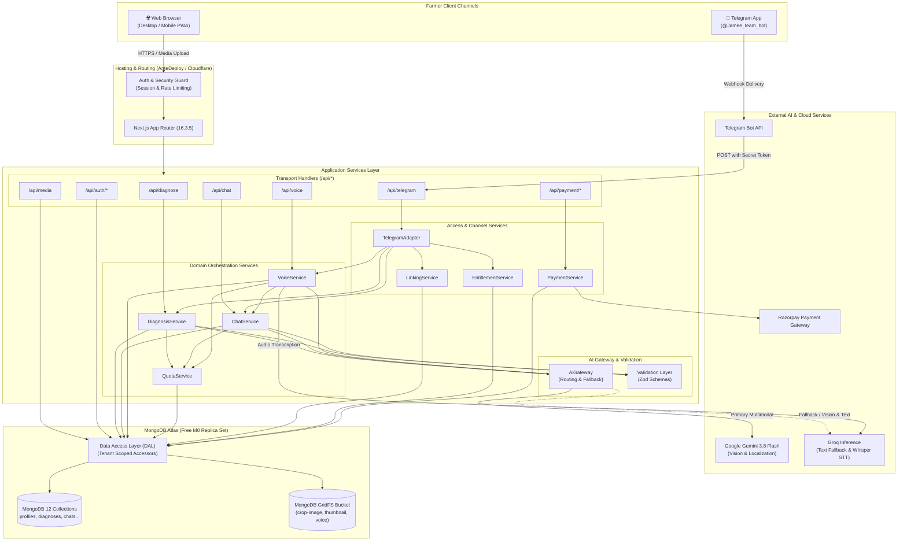
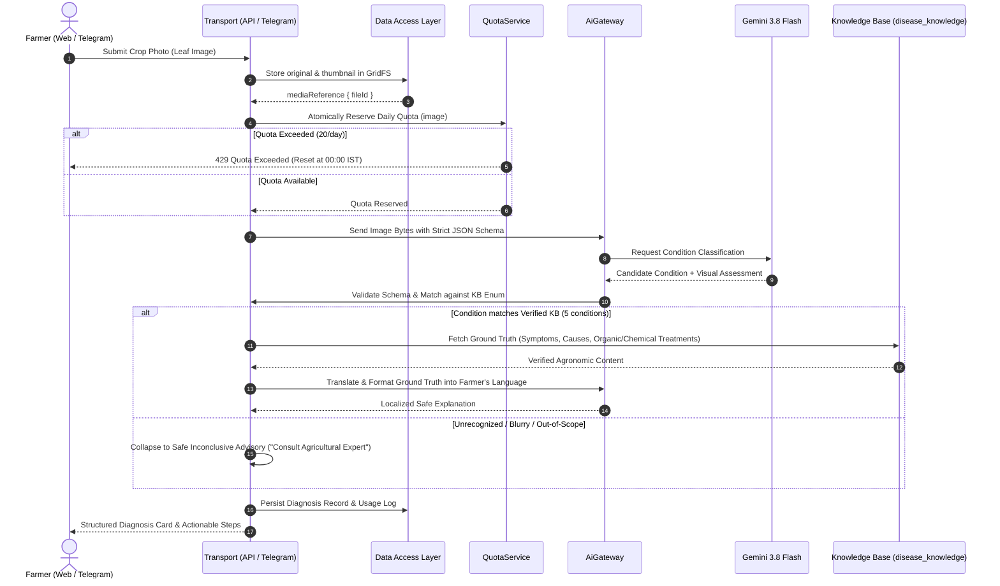
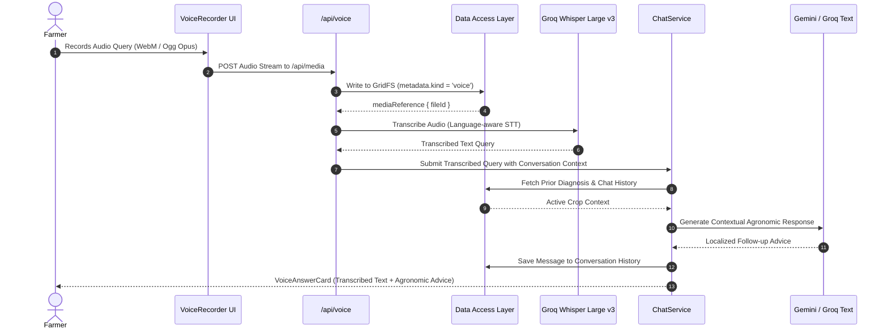
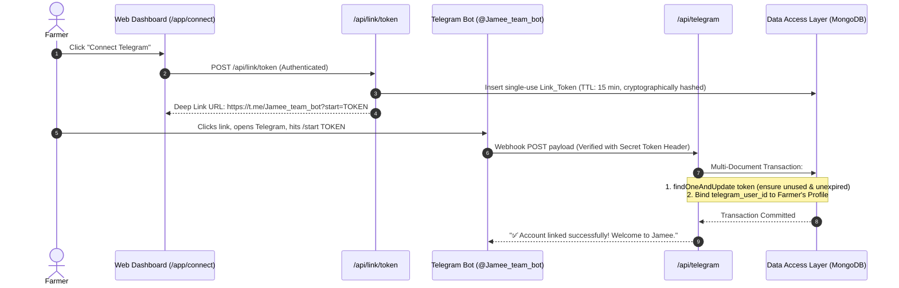
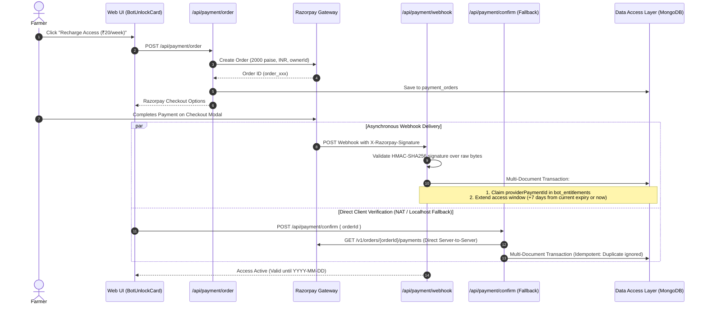
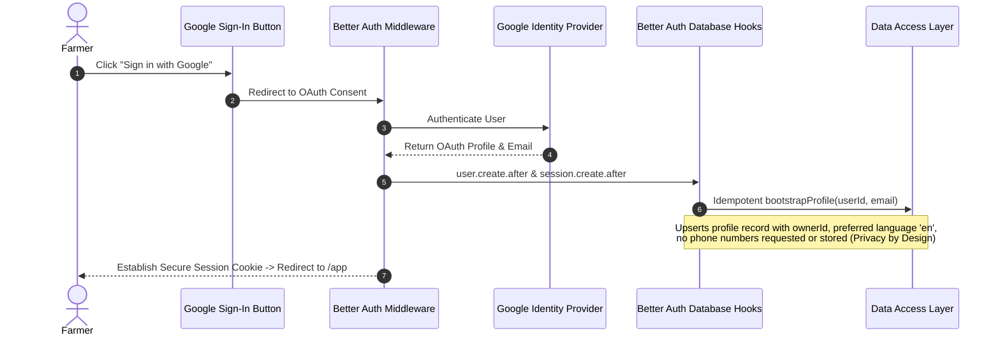

# 🌱 Jamee (जमी / ज़मी) — AI Crop-Care Assistant

> **Multimodal crop disease detection, voice consultation, and agricultural advice grounded in verified agronomy for smallholder tomato and potato farmers in English, Hindi, and Marathi.**

[](https://nextjs.org/)
[](https://www.typescriptlang.org/)
[](https://www.mongodb.com/atlas)
[](https://ai.google.dev/)
[](https://groq.com/)
[](https://jamee.antideploy.com)

---

## 📑 Table of Contents

1. [Project Overview](#-project-overview)
2. [High-Level System Architecture](#-high-level-system-architecture)
3. [End-to-End Workflow Diagrams](#-end-to-end-workflow-diagrams)
   - [1. Photo Diagnosis Workflow](#1-photo-diagnosis-workflow)
   - [2. Voice Consultation & Speech-to-Text Workflow](#2-voice-consultation--speech-to-text-workflow)
   - [3. Telegram Account Linking Workflow](#3-telegram-account-linking-workflow)
   - [4. Razorpay Recharge & Entitlement Workflow](#4-razorpay-recharge--entitlement-workflow)
   - [5. Authentication & Profile Bootstrap](#5-authentication--profile-bootstrap)
4. [Database & Storage Architecture](#-database--storage-architecture)
   - [Data Access Layer (DAL) & Tenant Isolation](#data-access-layer-dal--tenant-isolation)
   - [12 MongoDB Collections Reference](#12-mongodb-collections-reference)
   - [GridFS Single Bucket Media Architecture](#gridfs-single-bucket-media-architecture)
   - [Atomic Concurrency & Multi-Document Transactions](#atomic-concurrency--multi-document-transactions)
5. [Component & File System Hierarchy](#-component--file-system-hierarchy)
   - [Directory Tree Breakdown](#directory-tree-breakdown)
   - [Component Composition](#component-composition)
6. [Local Setup & Verification](#-local-setup--verification)
7. [Deployment](#-deployment)

---

## 🌟 Project Overview

**Jamee** enables farmers to take a picture of an affected crop leaf, speak a query in their local language, or chat via the web or Telegram. 

### Core Design Principles
* **Zero Agricultural Hallucinations**: Multimodal vision AI is constrained to classifying images into one of **five verified conditions** (`tomato_early_blight`, `tomato_late_blight`, `tomato_healthy`, `potato_early_blight`, `potato_late_blight`) or `unknown`. Every symptom, cause, treatment, and prevention recommendation is retrieved directly from a human-verified **Knowledge Base** (`disease_knowledge`).
* **Multimodal & Multilingual**: Supports natural photo capture, speech-to-text transcription (via Whisper on Groq), and conversational follow-ups in **English**, **Hindi (हिन्दी)**, and **Marathi (मराठी)**.
* **Dual-Channel Parity**: Features a unified Web App interface and a dedicated Telegram Bot (`@Jamee_team_bot`) running on shared backend domain services.
* **Zero Standing Infrastructure Cost**: Runs completely within cloud free-tier allocations (MongoDB Atlas M0 replica set, Google Gemini 3.8 Flash, Groq LPUs).

---

## 🏗 High-Level System Architecture



---

## 🔄 End-to-End Workflow Diagrams

### 1. Photo Diagnosis Workflow

When a farmer submits an image of a sick leaf, Jamee validates the image, reserves quota, classifies the condition, and returns verified agronomic treatments.



---

### 2. Voice Consultation & Speech-to-Text Workflow

Farmers can ask follow-up questions orally in their native language:



---

### 3. Telegram Account Linking Workflow

Binds a farmer's Telegram account to their Web profile without requiring phone numbers:



---

### 4. Razorpay Recharge & Entitlement Workflow

A nominal weekly recharge (₹20 test mode) unlocks Telegram bot access:



---

### 5. Authentication & Profile Bootstrap



---

## 🗄 Database & Storage Architecture

Jamee uses **MongoDB Atlas M0** (a 3-node replica set) providing document persistence, transaction support, and binary asset management.

### Data Access Layer (DAL) & Tenant Isolation

MongoDB does not provide database-level Row Level Security (RLS). Jamee enforces tenant isolation through a strict **Application-Enforced Data Access Layer**:

1. **Restricted Driver Access**: Only modules inside `src/lib/db/**` may import the `mongodb` driver. Enforced in CI via `scripts/check-data-access.ts`.
2. **Owner-Scoped Queries**: All DAL accessors require `authUserId` as a mandatory parameter and automatically inject `{ ownerId: authUserId }` into every query filter, insert, and update.
3. **No Unscoped Leaks**: There is no raw `collection.find()` exposed to external application services.

```
┌────────────────────────────────────────────────────────┐
│               Route Handlers & Domain Services          │
│               (src/app/api/**, src/services/**)        │
└───────────────────────────┬────────────────────────────┘
                            │ (Passes authenticated userId)
                            ▼
┌────────────────────────────────────────────────────────┐
│               Data Access Layer (DAL)                  │
│               (src/lib/db/**)                          │
│  - Automatically injects { ownerId: userId }           │
│  - Enforces JSON Schema validation                     │
│  - Manages atomic transactions                         │
└───────────────────────────┬────────────────────────────┘
                            │ (Native MongoDB Driver)
                            ▼
┌────────────────────────────────────────────────────────┐
│               MongoDB Atlas M0 Database                │
│  - 12 Indexed Collections                              │
│  - Single GridFS Media Bucket (media.files / chunks)   │
└────────────────────────────────────────────────────────┘
```

---

### 12 MongoDB Collections Reference

| Collection | Key Fields | Indexes & Constraints | Purpose |
|---|---|---|---|
| `profiles` | `_id`, `email`, `preferredLanguage`, `telegram_user_id`, `createdAt` | `unique(telegram_user_id)` (sparse) | Farmer profile, language preference, and Telegram binding. |
| `diagnoses` | `_id`, `ownerId`, `conversationId`, `crop`, `diseaseKey`, `confidence`, `urgency`, `explanation`, `channel` | `index(ownerId, createdAt)` | Full diagnosis results with localized explanations. |
| `conversations` | `_id`, `ownerId`, `diagnosisId`, `title`, `updatedAt` | `index(ownerId, updatedAt)` | Follow-up conversation threads anchored to a diagnosis. |
| `messages` | `_id`, `ownerId`, `conversationId`, `sender`, `text`, `mediaRef` | `index(conversationId, createdAt)` | Individual chat messages between farmer and assistant. |
| `disease_knowledge` | `_id`, `crop`, `diseaseKey`, `condition`, `symptoms`, `causes`, `treatments`, `source` | `unique(diseaseKey)` | 5 human-verified conditions. Single source of agronomic truth. |
| `counters` | `ownerId`, `operation`, `windowKind`, `windowKey`, `used` | `unique(ownerId, op, kind, key)` | Atomic daily quota tracking (20 image / 50 chat / 20 voice). |
| `telegram_inbound` | `_id` (`update_id`), `senderId`, `receivedAt`, `processedAt` | Primary Key `_id` | Deduplication and idempotency for Telegram updates. |
| `link_tokens` | `_id`, `ownerId`, `tokenHash`, `expiresAt`, `consumedAt` | `unique(tokenHash)`, TTL index | Expiring single-use tokens for Telegram deep-linking. |
| `payment_orders` | `_id`, `ownerId`, `providerOrderId`, `amountPaise`, `status` | `unique(providerOrderId)` | Order records for Razorpay weekly recharge. |
| `bot_entitlements` | `_id` (`ownerId`), `providerPaymentId`, `expiresAt`, `grantedAt` | `unique(providerPaymentId)` | Entitlement records granting bot access with expiration. |
| `webhook_throttle` | `_id`, `route`, `callerHash`, `windowKey`, `used` | `unique(route, hash, key)` | Rate limiter protecting webhooks from flood attacks. |
| `usage_logs` | `_id`, `ownerId`, `service`, `provider`, `model`, `tokens`, `durationMs` | `index(createdAt)` | Observability and audit logs for external AI calls. |

---

### GridFS Single Bucket Media Architecture

Rather than maintaining multiple external storage buckets, Jamee stores images and audio directly in MongoDB using a **single GridFS bucket (`media`)**:

* **Files Collection (`media.files`)**: Stores metadata including `metadata.kind` (`crop-image`, `thumbnail`, or `voice`), `metadata.ownerId`, and `metadata.sourceRef`.
* **Chunks Collection (`media.chunks`)**: Stores binary streams broken down into 255 KB chunks.
* **Compound Index**: `{ 'metadata.ownerId': 1, 'metadata.kind': 1 }` allows instantaneous farmer-scoped retrieval.
* **Owner-Controlled Streaming**: Files are streamed to the browser only via the authenticated `/api/media/[id]` endpoint after validating session ownership.

---

### Atomic Concurrency & Multi-Document Transactions

To prevent race conditions without table locks, Jamee maps critical operations to atomic MongoDB primitives:

1. **Daily Quotas**: Implemented via a single conditional atomic update:
   ```javascript
   db.counters.findOneAndUpdate(
     { ownerId, operation, windowKey, used: { $lt: limit } },
     { $inc: { used: 1 } },
     { upsert: true, returnDocument: 'after' }
   )
   ```
2. **Duplicate Webhook Delivery**: Telegram `update_id` is stored as the primary key `_id` in `telegram_inbound`. Duplicate deliveries trigger MongoDB error code `11000` (Duplicate Key), immediately returning HTTP 200 without duplicate processing.
3. **Multi-Document Transactions**:
   - **Account Linking**: Atomically marks the `link_tokens` row as consumed and sets `profiles.telegram_user_id`.
   - **Payment Confirmation**: Atomically records `bot_entitlements.providerPaymentId` and increments `expiresAt` by 7 days.

---

## 📁 Component & File System Hierarchy

### Directory Tree Breakdown

```
jamee/
├── .github/workflows/          # CI release gates (typecheck, lint, secret-scope, tests)
├── .kiro/specs/                # Requirements, design specifications, and task breakdown
├── docs/                       # Architectural decisions, API references, verification logs
├── scripts/                    # Database migrations and deployment verifications
│   ├── check-data-access.ts    # Enforces DAL boundary and driver isolation
│   ├── check-deployment.ts     # Post-deployment validation script
│   ├── check-secret-scope.ts   # Prevents client bundle secret leakage
│   ├── db-setup.ts             # Idempotent collection, index, and validator creator
│   └── telegram-set-webhook.ts # Sets live Telegram webhook URL with secret token
├── src/
│   ├── app/                    # Next.js App Router Pages and Endpoints
│   │   ├── api/                # Backend API Routes
│   │   │   ├── auth/[...all]/  # Better Auth Google OAuth catch-all
│   │   │   ├── chat/           # Conversational text query endpoint
│   │   │   ├── diagnose/       # Image disease diagnosis endpoint
│   │   │   ├── media/          # GridFS upload & streaming endpoint
│   │   │   ├── payment/        # Razorpay order, confirm & webhook routes
│   │   │   ├── telegram/       # Telegram bot incoming webhook
│   │   │   └── voice/          # Voice processing endpoint
│   │   ├── app/                # Unified Farmer Assistant Workspace
│   │   │   ├── chat/[id]/      # Detailed conversation view
│   │   │   ├── connect/        # Telegram link & recharge interface
│   │   │   ├── history/        # Diagnosis archive & history
│   │   │   └── profile/        # Farmer settings & language switcher
│   │   ├── layout.tsx          # App shell, fonts, and LanguageProvider
│   │   └── page.tsx            # Marketing and product landing page
│   ├── components/             # Reusable UI Components
│   │   ├── AppShell.tsx        # Responsive navigation shell with mobile tab bar
│   │   ├── ChatComposer.tsx    # Multimodal input bar with image/voice attachments
│   │   ├── DiagnosisResultCard # Condition breakdown, confidence meter, actionable advice
│   │   ├── ImageUploader.tsx   # Camera capture with client-side image compression
│   │   ├── LanguageSwitcher    # EN / HI / MR language selector
│   │   ├── TelegramLinkCard    # Deep link generation and QR trigger
│   │   ├── UnifiedAssistant    # Main conversational interface
│   │   └── VoiceRecorder.tsx   # Audio recording with live waveform feedback
│   ├── lib/                    # Shared Libraries & Infrastructure
│   │   ├── ai/                 # Gateway, fallback policies, and capabilities
│   │   ├── auth/               # Better Auth instance and profile bootstrap hooks
│   │   ├── config/             # Verified models, pricing constants, and rules
│   │   ├── db/                 # Data Access Layer, MongoClient, and collections
│   │   ├── media/              # GridFS bucket streaming and chunking utilities
│   │   ├── messages/           # Static agronomic copy (English, Hindi, Marathi)
│   │   ├── env.ts              # Zod-validated server-side environment secrets
│   │   └── schemas.ts          # Central Zod validation schemas
│   └── services/               # Core Domain Services
│       ├── chat.service.ts     # Conversation state and message routing
│       ├── diagnosis.service.ts# Multimodal image analysis and KB matching
│       ├── entitlement.service # Bot access and weekly validity checking
│       ├── linking.service.ts  # Token generation and Telegram account binding
│       ├── payment.service.ts  # Razorpay order generation and verification
│       ├── quota.service.ts    # Daily usage rate limits and atomic reservations
│       └── voice.service.ts    # Audio transcription and question delegation
└── tests/                      # Testing Suite (Unit, Property-Based, Integration)
    ├── integration/            # In-memory MongoDB integration tests
    ├── property/               # Fast-check property-based invariant tests
    └── unit/                   # Component and service unit tests
```

---

### Component Composition

```
                    ┌─────────────────────────┐
                    │       layout.tsx        │
                    │ (LanguageProvider & CSS)│
                    └────────────┬────────────┘
                                 │
                    ┌────────────▼────────────┐
                    │      AppShell.tsx       │
                    │ (Header, Nav & Footer)  │
                    └────────────┬────────────┘
                                 │
           ┌─────────────────────┼─────────────────────┐
           ▼                     ▼                     ▼
┌──────────────────┐  ┌──────────────────┐  ┌──────────────────┐
│  WorkspaceShell  │  │   HistoryList    │  │ TelegramLinkCard │
│ (Dashboard Hub)  │  │  (Past Records)  │  │ & BotUnlockCard  │
└──────────┬───────┘  └──────────────────┘  └──────────────────┘
           │
           ├────────────────────────┬────────────────────────┐
           ▼                        ▼                        ▼
┌──────────────────────┐ ┌──────────────────────┐ ┌──────────────────────┐
│  UnifiedAssistant    │ │   ImageUploader      │ │    VoiceRecorder     │
│ (Conversational UI)  │ │ (Client Compression) │ │  (Live Audio Stream) │
└──────────┬───────────┘ └──────────────────────┘ └──────────────────────┘
           │
           ├────────────────────────┐
           ▼                        ▼
┌──────────────────────┐ ┌──────────────────────┐
│     ChatThread       │ │ DiagnosisResultCard  │
│  (Message Stream)    │ │ (Verified Treatment) │
└──────────────────────┘ └──────────────────────┘
```

---

## 💻 Local Setup & Verification

### Prerequisites
* **Node.js**: v20.x or v22.x
* **MongoDB**: A free MongoDB Atlas M0 Cluster or local MongoDB instance
* **API Keys**: Google Gemini API key, Groq API key, Google OAuth Client ID/Secret

### 1. Clone & Install
```bash
git clone https://github.com/sarang-sketch/jamee.ai.git
cd jamee
npm install
```

### 2. Configure Environment Secrets
Create a `.env.local` file with the following keys:
```env
# Database
MONGODB_URI=mongodb+srv://<user>:<password>@cluster0.mongodb.net/jamee?appName=Cluster0

# Authentication (Better Auth & Google OAuth)
BETTER_AUTH_SECRET=your_32_byte_hex_secret
BETTER_AUTH_URL=http://localhost:3000
GOOGLE_CLIENT_ID=your_google_client_id.apps.googleusercontent.com
GOOGLE_CLIENT_SECRET=your_google_client_secret

# AI Providers
GEMINI_API_KEY=your_gemini_api_key
GROQ_API_KEY=your_groq_api_key

# Telegram Integration
TELEGRAM_BOT_TOKEN=your_telegram_bot_token
TELEGRAM_WEBHOOK_SECRET_TOKEN=your_telegram_webhook_secret
NEXT_PUBLIC_TELEGRAM_BOT_USERNAME=Jamee_team_bot

# Payment Integration (Razorpay Test Mode)
RAZORPAY_KEY_ID=rzp_test_your_key_id
RAZORPAY_KEY_SECRET=your_key_secret
NEXT_PUBLIC_RAZORPAY_KEY_ID=rzp_test_your_key_id
RAZORPAY_WEBHOOK_SECRET=your_webhook_secret

# Security & Cron
CRON_SECRET=your_cron_random_secret
```

### 3. Initialize Database Collections & Knowledge Base
Run the idempotent setup script to create all 12 collections, GridFS buckets, validation schemas, and seed the 5 verified disease entries:
```bash
npm run db:setup
```

### 4. Run CI Verification Gates
Ensure that all static checks, data access boundaries, and tests pass:
```bash
# Typecheck TypeScript
npm run typecheck

# Run ESLint
npm run lint

# Check Data Access Layer boundaries (prevents driver leak)
npm run check:data-access

# Run Unit, Property-Based, and Integration Tests
npm run test:unit
npm run test:property
npm run test:integration
```

### 5. Start Development Server
```bash
npm run dev
```
Open [http://localhost:3000](http://localhost:3000) in your browser.

---

## 🌐 Deployment

Jamee is configured for continuous zero-downtime deployment on **AnteDeploy**:

* **Live URL**: [https://jamee.antideploy.com](https://jamee.antideploy.com)
* **Production Status Check**:
  ```bash
  npm run check:deployment -- https://jamee.antideploy.com
  ```
* **Register Production Telegram Webhook**:
  ```bash
  npm run telegram:webhook -- https://jamee.antideploy.com
  ```

---

## 📄 License & Attribution

Academic project developed for smallholder crop disease diagnosis. 
* Ground truth agronomic recommendations sourced from verified public agricultural extension literature.
* Built with Next.js, Better Auth, MongoDB Atlas, Google Gemini, and Groq.
